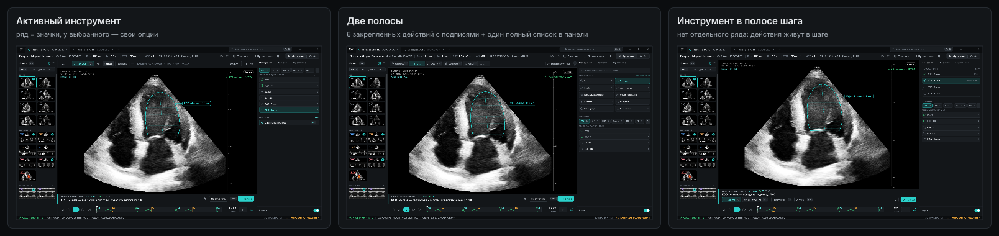
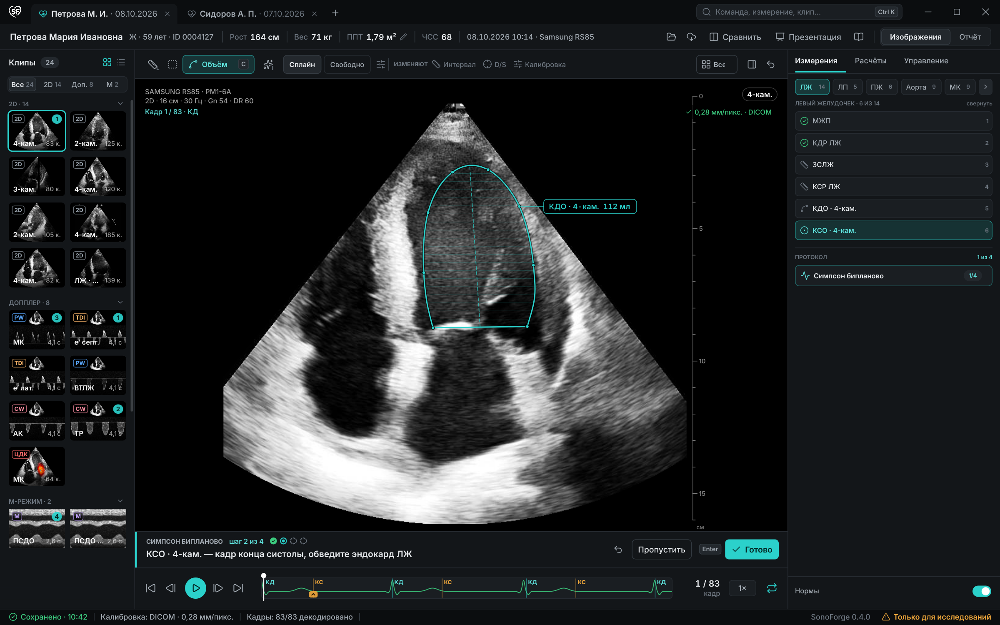
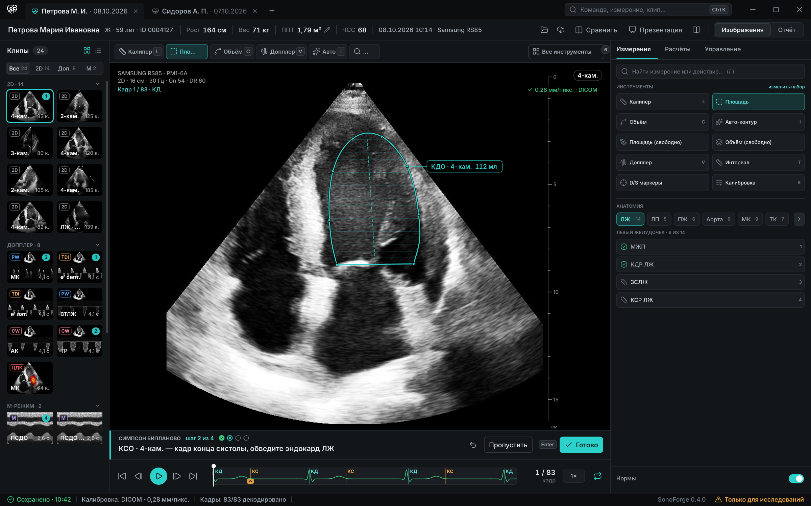
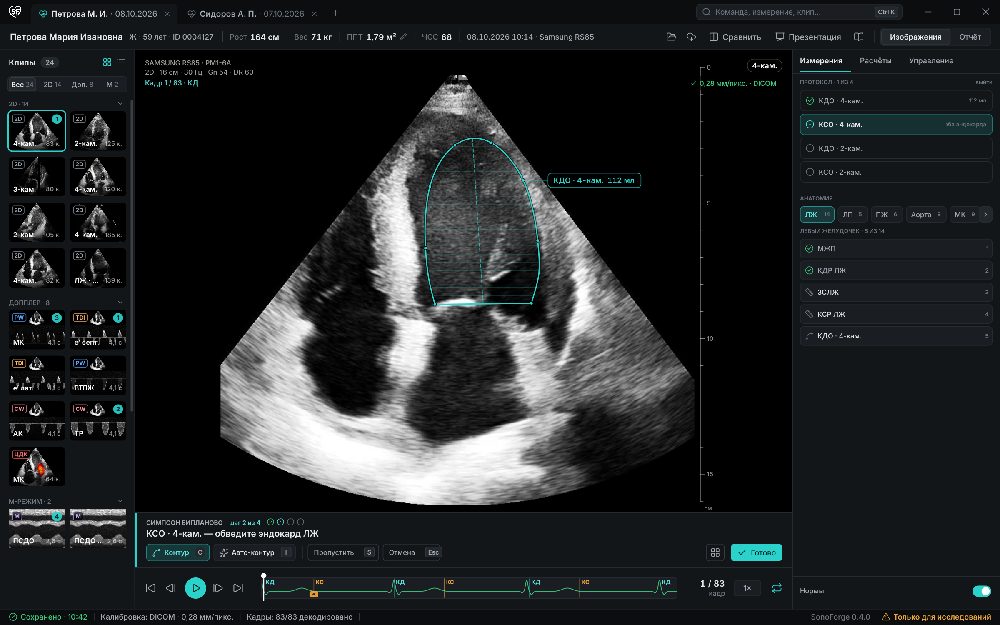

# Быстрый доступ к инструментам — раунд 2 (2026-10-30)

Первый раунд (`../quick-access-concepts/`) отвечал на вопрос «где живёт панель
инструментов». Проверка работающей сборки 0.3.3 (Linux, скриншоты сессии от
2026-10-30) показала, что проблема не в месте, а в модели панели:

- одни и те же одиннадцать действий живут и в ряду над снимком, и в правой
  панели — два разных места для одного действия;
- ряд тратит ширину на длинные подписи («Площадь (свободно)», «Объём
  (свободно)», «D/S маркеры»), не помещается в 930–1000 px и складывает остаток
  в безымянное «…» — в меню без подсказки, что там;
- у выбранного инструмента нет своего места: его параметры (сплайн / свободно,
  замкнуть контур, допуск) спрятаны в панели, а сам он отмечен только подписью;
- модификаторы («Интервал», «D/S маркеры», «Калибровка») выглядят точно как
  инструменты, хотя меняют поведение уже выбранного;
- анатомическая доска — единственный элемент, который объясняет, о чём панель, —
  уезжает под сгиб: в кадре её не видно, зато видно три ряда одних и тех же
  измерений.

Раунд 2 поэтому меняет **модель панели**, а не её место: те же окно, шапка,
клипы, снимок, полоса шага, кинополоса и статусбар, отличаются только ряд
инструментов и тело правой панели. Все три варианта убирают дублирование, дают
модификаторам отдельный вид и оставляют ровно один полный список инструментов.

## Вариант 11 — активный инструмент раскрывается в ряду

Ряд — только значки (32 px), поэтому весь набор виден без прокрутки и без «…»:
одиннадцать ячеек занимают ~380 px из 1250. У выбранного инструмента вместо
значка — **карточка**: значок, название и клавиша. Сразу за карточкой идут
параметры именно этого инструмента («Сплайн | Свободно», шестерёнка допуска) —
они перестают быть невидимыми и не требуют открывать панель. За вертикальной
линией — «ИЗМЕНЯЮТ»: «Интервал», «D/S», «Калибровка» набраны мелким текстом без
рамки, чтобы их нельзя было спутать с инструментами. Справа — «Все», отмена и
переключатель панели; «Все» — не «…», у него есть подпись и счётчик.

Панель освобождается от дублей: сверху анатомические чипы (одна строка,
горизонтальная прокрутка вместо скрытия), ниже — измерения выбранной области с
номерами избранного и текущим шагом протокола, внизу — карточка протокола и
«Нормы».

*Плюсы:* действие и его параметры в одном месте; ряд не растёт от локализации;
ничего не пропадает в «…».  *Минусы:* карточка сдвигает соседние значки при
смене инструмента (нужен переход ~120 мс), ряд остаётся вторым местом для
инструментов, пока в панели живут измерения.

## Вариант 12 — две полосы: закреплённые действия и один полный список

Ряд — шесть закреплённых действий **с подписями и клавишами** в одинаковых
ячейках: «Калипер L», «Площадь A», «Объём C», «Допплер V», «Авто ⇧A», «Лупа Z».
Ячейка шире значка, но не «по тексту», поэтому набор не переезжает при смене
языка, а всё, что не влезло, считается числом на кнопке «Все инструменты» (сейчас
6), а не режется. В панели — **единственный** полный список из десяти действий
(значок, название, клавиша, две колонки) и «изменить набор»; ниже анатомия и
измерения. Так «где все инструменты» имеет один ответ, а не два.

*Плюсы:* подписи всегда видны, включая раскладку RU/EN до 150 %; предсказуемая
ширина ячеек; полный список один.  *Минусы:* ряд остаётся выше (44 px) и
занимает место у снимка; шесть закреплённых — это выбор, который надо один раз
сделать (или он берётся из избранного).

## Вариант 13 — инструмент живёт в полосе шага

Отдельного ряда нет вообще. Полоса шага под снимком (88 px вместо 58) содержит
инструкцию шага и **только те действия, которые этот шаг принимает**: «Контур C»,
«Авто-контур ⇧A», затем «Пропустить S», «Отмена Esc» и основное «Готово». Снимок
получает высоту, которую раньше занимал ряд, а инструмент не может разойтись с
шагом: если шаг не рисует контур, кнопки контура в полосе нет. Полный список —
одна кнопка-сетка там же и в панели; панель становится навигатором: протокол →
анатомия → измерения.

*Плюсы:* меньше хрома, максимум снимка, действия подписаны и однозначны; нет
вопроса «какой инструмент сейчас активен».  *Минусы:* вне протокола нужен
постоянный «холодный» ряд (иначе инструменты доступны только через список);
привычка искать инструменты сверху ломается сильнее всего.

## Что выбрать

Ответы на претензии сессии 2026-10-30 по вариантам:

| Претензия | 11 | 12 | 13 |
|---|---|---|---|
| Кнопки не умещаются в ширину панели | ряд не сворачивается | ячейки фиксированной ширины, излишек — счётчиком | ряда нет |
| Дублирование ряда и панели | панель без инструментов | один полный список в панели | списка два, но один — по кнопке |
| Параметры инструмента не видны | в карточке активного | остаются в панели | не нужны: действия заданы шагом |
| Модификаторы неотличимы | отдельная группа «ИЗМЕНЯЮТ» | в общем списке, но вне закреплённых | нет модификаторов в полосе |
| Анатомия ниже сгиба | первая строка панели | третья строка панели | вторая строка навигатора |

Рекомендация: прототип варианта **11** (он сохраняет привычное место ряда и
сразу убирает «…» и невидимые параметры) с элементами **12** — фиксированные
ширины ячеек и счётчик вместо обрезки — и одним заимствованием из **13**:
инструменты текущего шага подсвечиваются в ряду, а не прячутся.  Вариант 13
стоит держать для режима «Фокус» и презентации, где важен каждый пиксель снимка.

Что уже сделано в сборке до реализации концепции: ряд сам выбирает состав по
числу скрытых кнопок — подписи остаются, пока стоят не меньше кнопок, чем
значки, иначе он переходит в значки с подписью у активного (§4.1), а «Ещё N»
появляется только там, где не влезают и значки. На 1366×768 (830 px) и в RU, и в
EN видны все одиннадцать инструментов; на 1920 px ряд ещё остаётся значковым,
подписи возвращаются, когда помещаются целиком (RU — от 1600 px, EN — от 1256 px).
Замеры и регрессии — `tests/unit/test_quick_access_followup.py`.

Проверять любую реализацию нужно на 1366×768 при 100 %, 125 % и 150 % и в RU/EN:
именно на 1366 px ряд из одиннадцати подписанных кнопок и складывался в «…».

## Технические заметки

- Макеты нарисованы `tools/design_mockups/quick_access_v2.py`, запуск —
  `quick_access_v2_run.py` (по одному QPainter-канвасу на процесс). Используются
  те же примитивы и обезличенные кадры `tests/fixtures/for_pero`, что и в раунде 1.
- Клавиши в макетах — только те, что реально зарегистрированы в приложении;
  ярлыки не выдуманы, полный список — в `docs/HELP_RU.md`.
- Макеты — визуальные концепции, а не изменения работающих виджетов: доменные
  значения, протоколы и поведение съёмки они не трогают.
