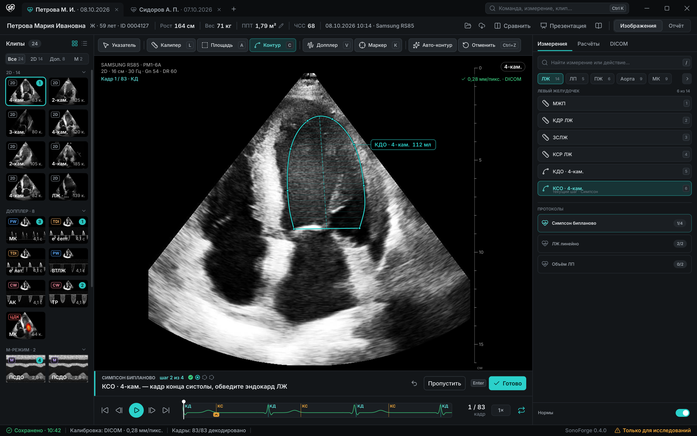
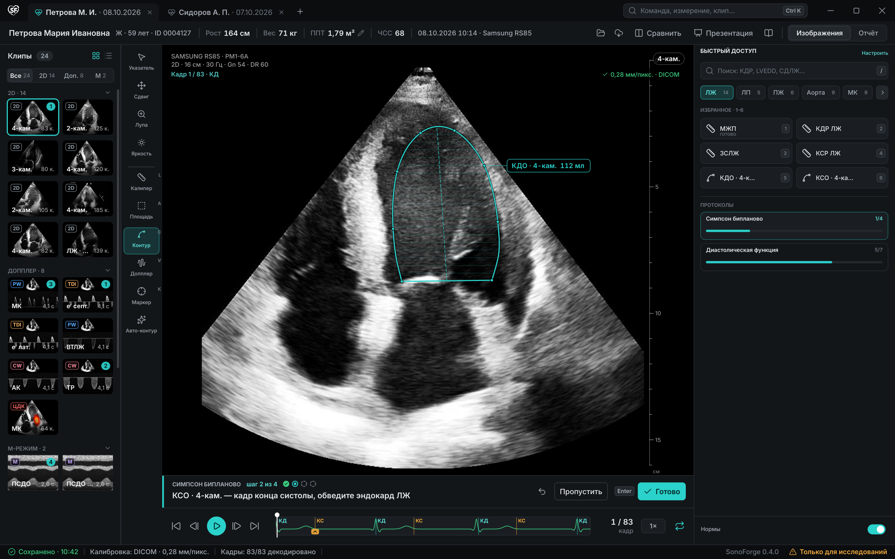
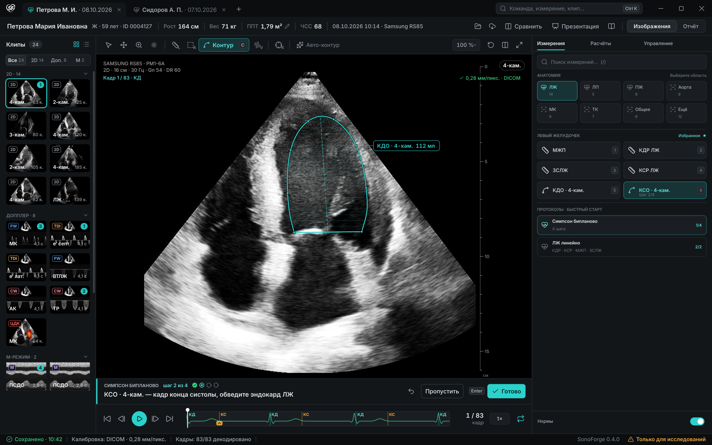

# Быстрый доступ к инструментам — концепты

Макеты показывают варианты упрощения панели измерений для главного окна Windows. Это визуальные концепции, а не готовые изменения работающих виджетов. В них намеренно убраны выпадающие списки анатомических разделов вроде «General / Left Ventricle / Aorta»: группы и частые действия показаны непосредственно на экране.

## Вариант 1 — подписанная полоса над снимком

Основные действия находятся в одном ряду над областью изображения: пиктограмма, название и, где есть, клавиша вызова. Справа — поиск, постоянно видимые анатомические фильтры, измерения выбранной области и карточки протоколов. Это самый близкий к текущей компоновке переход и не требует отдельной боковой рейки.

## Вариант 2 — закреплённая рейка и избранное

Небольшая постоянная рейка слева от снимка содержит основные действия с видимыми подписями. Правая панель отдана поиску, анатомическим чипам, избранным измерениям с клавишами 1–6 и ходу протоколов. Расположение экономит вертикальное пространство; важно проверить, что узкая рейка остаётся читаемой при масштабе Windows 125–150%.

## Вариант 3 — видимая сетка анатомии

Анатомические области — постоянная сетка крупных кнопок; после выбора «ЛЖ» сразу видны его частые измерения. Избранное и быстрый запуск протоколов расположены ниже. Здесь нет скрываемых секций и вложенного выбора: пользователь видит структуру и прогресс на одной панели.

## Общие графические решения

- Важные инструменты всегда видимы, имеют подписи и вызываются одним нажатием; клавиатурные сокращения остаются дополнением, а не единственным способом найти действие.
- Поиск остаётся доступен во всех вариантах и понимает русские названия, английские аббревиатуры и синонимы.
- Анатомические группы оформлены как кнопки-фильтры/плитки с количеством измерений, а не как выпадающий список или скрытая группа; в узкой панели ряд чипов прокручивается по горизонтали, что обозначено отдельной стрелкой.
- Контекстное выделение использует цветовой акцент, но не сообщает клиническую норму или диагноз. Статус шага и прогресс протокола подписаны текстом и числом.
- Плитки имеют предсказуемые размеры и увеличенные области нажатия; цвет — не единственный признак активного состояния.

### Первое направление для прототипа

Для дальнейшего интерактивного прототипа стоит начать с варианта 1: он сохраняет большую область снимка и даёт быстрый доступ к основным действиям. Из варианта 3 целесообразно перенести постоянно видимые анатомические плитки; избранное и числовые клавиши варианта 2 — оставить как настраиваемую ускоренную полосу. Перед реализацией нужно проверить плотность панели на 1366×768, Windows 10/11 при масштабе 100%, 125% и 150%, а также RU/EN.

Макеты нарисованы `tools/design_mockups/quick_access.py` (запуск — через `quick_access_run.py`, по одному QPainter-рендеру в процессе) на обезличенных тестовых кадрах и синтетических данных. Они не являются клиническим интерфейсом, не меняют доменные значения или рабочее поведение приложения.
