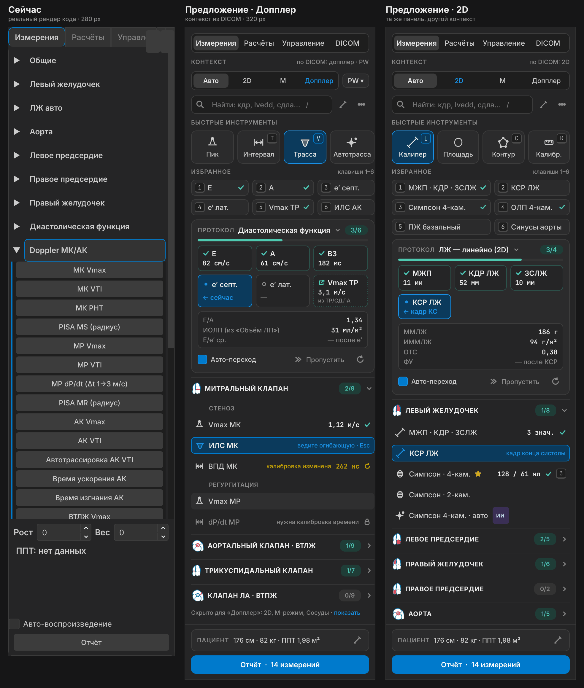
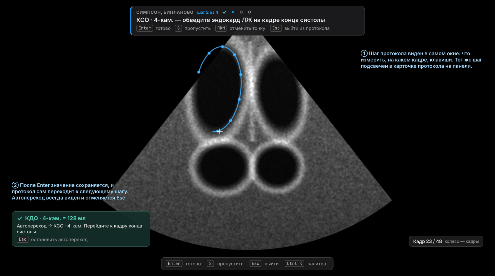
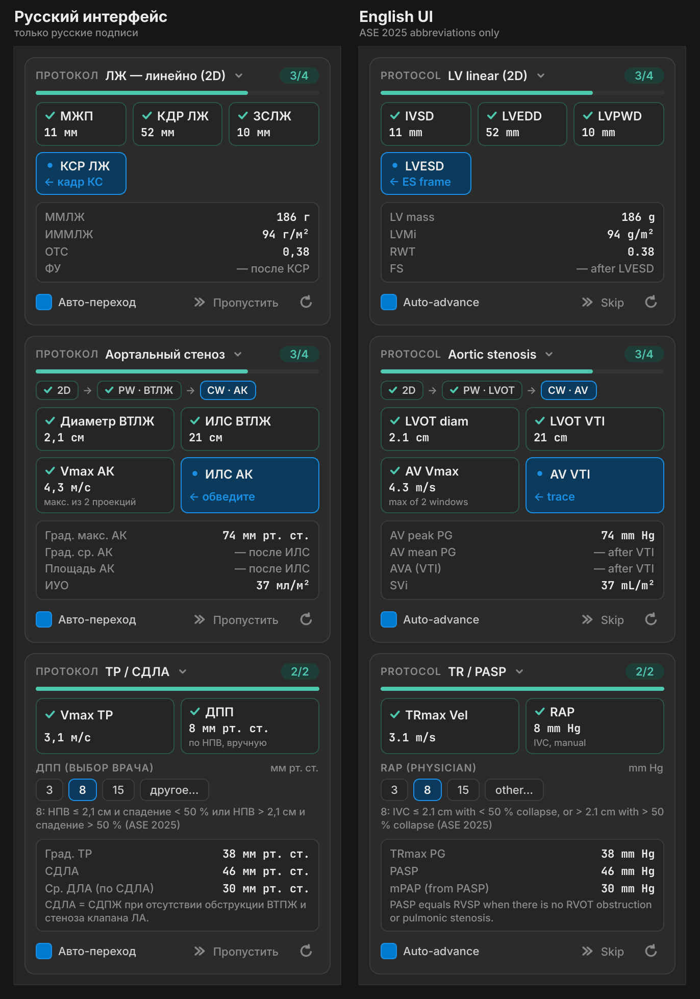
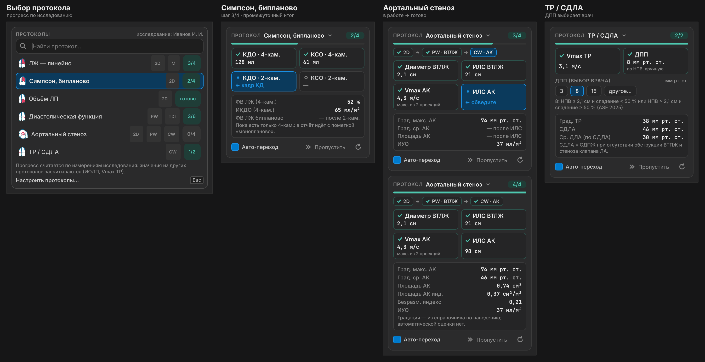
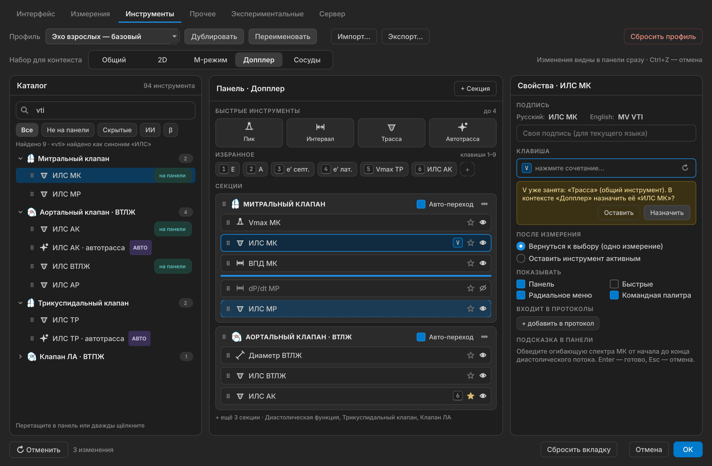
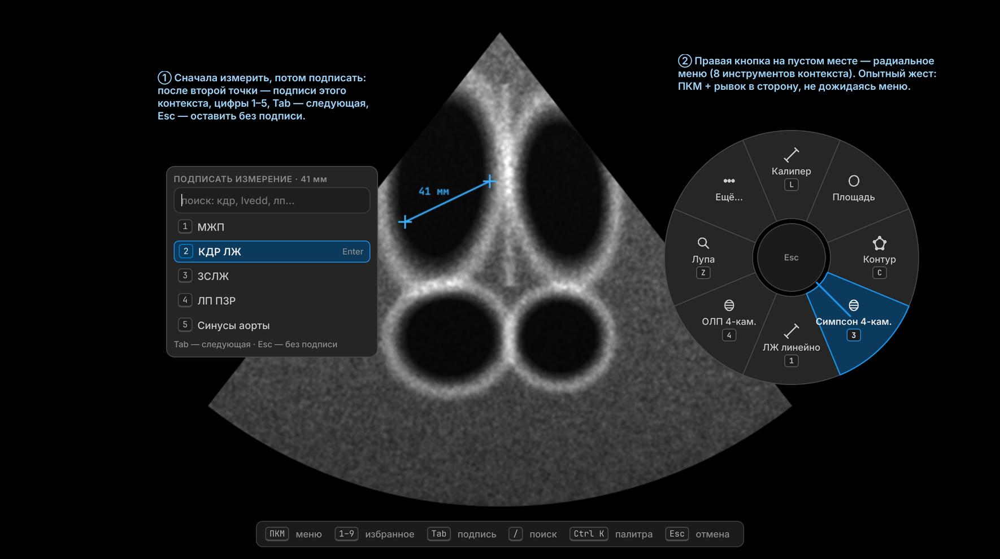
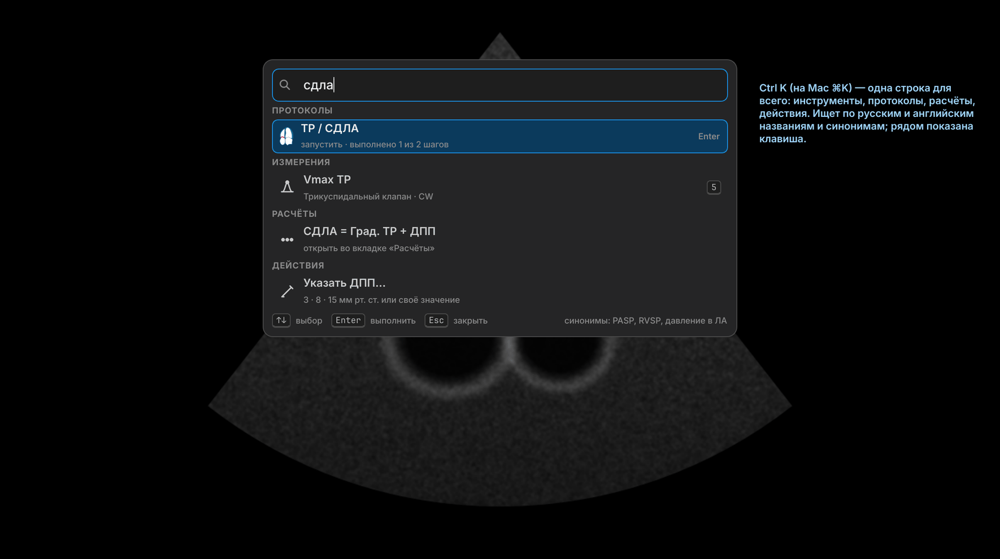

# Панель измерений 2.0 и протоколы — спецификация и план (TP)

**Дата:** 2026-10-15

**Статус:** Draft. Концепция одобрена пользователем целиком (обсуждение 2026-10-15, ход 2). Детали ниже — на согласование. Код этим документом не меняется.

**Тип:** UX-спецификация + доменные контракты (каталог, протоколы, раскладка v3) + поэтапный план PR и приёмки + макеты.

**Проверенная база:** `main` на `4dd3e52` (ветка `arena/ea808c3a-sonoforge`). После неё в `main` влиты #194–#196 (QH-1b.2 freshness, QH-4a). Файлы панели, меню, вьюера и клавиш они не меняют; оценщики актуальности учтены в §8.5.

> **Актуализация 2026-10-25 (S1-05):** старые `tool_panel_settings.py`, `measurement_tools_panel.py`, `measurement_panel.py` и `measurement_worksheet.py` удалены. Текущий редактор настроек — `presentation/tool_settings_2.py`; активные измерения и отчёт — `presentation/measures_menu.py`, `presentation/tool_panel.py`, `presentation/report_dialog.py`. Решения и проверка импортов: `docs/reviews/2026-10-25-s1-05-dead-code-inventory-ru.md`.

**Связанные документы:** [QH: качество и безопасность](2026-10-13-quality-safety-hardening-spec-plan-ru.md) (инварианты S-01…S-12, QH-1b provenance, QH-3 `ViewerWidget`), [UI/data/Doppler roadmap](2026-10-02-ui-data-doppler-roadmap-ru.md) (D-16 PGmax, D-17 единицы), [правки перед релизом](2026-10-09-pre-release-ui-fixes-spec-ru.md) (Ф3, Ф6: секции и раскладка v2), [Multiview](2026-10-01-multiview-two-clips-spec-ru.md) (инструменты в панелях), [переработка интерфейса](2026-10-16-ui-redesign-spec-plan-ru.md) (компоновки, полоса шага под снимком, токены оформления).

**Макеты:** [`docs/images/tool-panel/`](../../images/tool-panel/). Это настоящие виджеты Qt с QSS в палитре `vscode_dark`, отрисованные вне приложения. Значения на макетах условные.

> Документ описывает интерфейс и проверяемые контракты. Это не клиническая валидация. Протоколы не ставят диагноз и не присваивают степень тяжести: врач читает значения и градации справочника.

---

## 0. Коротко

1. **Панель становится контекстной.** Режим берётся из DICOM (2D / М / допплер PW·CW·TDI). Видны только инструменты этого режима. Сверху поиск (`/`), 4 быстрых инструмента, до 9 избранных на клавишах 1–9, карточка протокола. Ниже анатомические секции с прогрессом.
2. **Протоколы вместо мигания.** Шесть первых протоколов: ЛЖ линейно, Симпсон Биплан, Объём ЛП, Диастолическая функция, Аортальный стеноз, ТР / Сист. ДЛА. После Enter протокол сам переходит к следующему шагу. Автопереход виден и отменяется Esc. Производные (ОТС, ФВ, иОЛП, E/e′, площадь АК, Сист. ДЛА…) считает существующий домен.
3. **Подписи только на одном языке.** EN — сокращения ASE 2025 (Table 6 «Measurement dictionary»), RU — утверждаемый русский глоссарий (§5). Ни одной подписи вида «КДР (LVIDd)». Поиск понимает оба языка в любом интерфейсе.
4. **Во вьюере:** выбор подписи после свободного измерения, радиальное меню по ПКМ на пустом месте, палитра Ctrl+K (⌘K). Шаг протокола показан полосой под снимком, изображение ничем не перекрыто ([UI-спека](2026-10-16-ui-redesign-spec-plan-ru.md), UD-04).
5. **Настройки «Инструменты» 2.0:** профили × контексты, три панели (каталог · живой предпросмотр · свойства), запись клавиш с проверкой конфликтов, импорт/экспорт, сброс.
6. **Под капотом:** единый каталог со стабильными id, раскладка v3 в **новом** ключе настроек (v2 не трогается, откат безопасен), прогресс протоколов вычисляется из снимка исследования. Новых хранилищ клинических данных нет.
7. **Первый шаг — TP-0:** каталог, правила подписей и миграция, без видимых изменений. Затем номенклатура (TP-1) и каркас панели (TP-2) параллельно.



*Макет 1. Слева — настоящий рендер текущей панели (280 px). В центре и справа — та же панель 2.0 в контекстах «Допплер» и «2D» (320 px). Подписи только русские; E и A в см/с по D-17.*

---

## 1. Решения и открытые вопросы

### 1.1. Решения

| ID | Решение | Источник | Статус |
|---|---|---|---|
| **D-01** | Концепция «Панель измерений 2.0» принимается целиком: контекст, поиск, быстрые инструменты, избранное, протоколы, секции, футер; выбор подписи после измерения, радиальное меню, Ctrl+K; настройки 2.0; каталог и раскладка v3 | Пользователь, 2026-10-15 | ПРИНЯТО |
| **D-02** | Подпись измерения — только на языке интерфейса. Смешанные подписи запрещены. EN = сокращения ASE 2025 (Taub et al., JASE 2025, Table 6). RU = глоссарий §5.2 (по D-11) | Пользователь, 2026-10-15 | ПРИНЯТО |
| **D-03** | Первые протоколы: ЛЖ линейно, Симпсон Биплан, Объём ЛП, Диастолическая функция, Аортальный стеноз, ТР / Сист. ДЛА | Пользователь, 2026-10-15 | ПРИНЯТО |
| **D-04** | Результат этапа — спека-план с макетами в репозитории | Пользователь, 2026-10-15 | ПРИНЯТО |
| **D-05** | Единицы скоростей — по D-17: CW — м/с; PW и TDI — см/с (ответ на Q-02) | Пользователь, 2026-10-16 | ПРИНЯТО |
| **D-06** | Хранимые метки измерений (`caliper_label`, `doppler_peak` …) не меняются. Подпись на экране и в отчёте берётся из каталога по стабильному id; старые метки — алиасы. Миграции клинических данных нет | Предложение | ПРЕДЛОЖЕНО |
| **D-07** | Цветом «норма/патология» не размечаем. Панель показывает значение и состояние (готово / устарело / предупреждение QC / заблокировано). Градации справочника — по наведению, как в карточках калькуляторов (`reference_hints.py`: «No automatic grade is assigned») | Принцип кода | ПРЕДЛОЖЕНО |
| **D-08** | Прогресс протокола вычисляется из снимка исследования. Отдельного хранилища протоколов нет; отметка «пропущено» живёт в памяти вкладки | Предложение | ПРЕДЛОЖЕНО |
| **D-09** | Все входы в инструмент (строка панели, клавиша, избранное, радиальное меню, палитра, шаг протокола) идут через один контракт `action_requested(action, view, phase, extra)` | Предложение | ПРЕДЛОЖЕНО |
| **D-10** | Пользовательские клавиши — слой поверх канонического реестра `keyboard_shortcuts.py` (#150) с проверкой `shortcut_conflicts()`. Конфликт молча не сохраняется | Предложение | ПРЕДЛОЖЕНО |
| **D-11** | Русский глоссарий (ответ на Q-03). DT, IVRT, VTI, DVI не переводятся: «DT», «IVRT», «VTI АК», «DVI». Биплан — «Биплан» («КДО ЛЖ Биплан», не «бипланово»). Индексированные величины — строчная «и» перед названием: иКДО, иКСО, иОЛП, иУО, иММЛЖ. PASP — «Сист. ДЛА». Остальное — по §5.2 | Пользователь, 2026-10-16 | ПРИНЯТО |
| **D-12** | Линейные размеры по умолчанию — мм (ответ на Q-01). В TP-1 добавляется переключатель «Линейные размеры: мм / см (ASE)»: мм — 0 знаков, см — 1 знак; действует сразу на панель, оверлей, текст отчёта и PDF (S-11). Диаметры для формул площади (ВТЛЖ, ВТПЖ, кольцо МК), радиус PISA и VTI всегда в см — как во входах калькуляторов | Пользователь, 2026-10-16 | ПРИНЯТО |

### 1.2. Открытые вопросы

Для каждого вопроса указан вариант по умолчанию. План пользуется им, если ответа не будет. Q-01…Q-03 закрыты 2026-10-16 (D-12, D-05, D-11).

| # | Вопрос | Вариант по умолчанию |
|---|---|---|
| **Q-01** | ~~Линейные размеры: мм или см с 1 знаком (ASE 2025, Table 6)?~~ | **Закрыт 2026-10-16:** основная единица — мм; в TP-1 переключатель «Линейные размеры: мм / см (ASE)» → D-12 |
| **Q-02** | ~~Скорости E и A: см/с (D-17) или м/с (ASE 2025)?~~ | **Закрыт 2026-10-16:** CW — м/с; PW и TDI — см/с → D-05 |
| **Q-03** | ~~Утвердить русский глоссарий §5.2~~ | **Закрыт 2026-10-16:** DT, IVRT, VTI, DVI не переводятся; «Биплан»; индексы с префиксом «и»; PASP — «Сист. ДЛА» → D-11. Не подтверждены и стоят по умолчанию до ответа: TAPSE, PISA, GLS латиницей как имена собственные; FAC — «ФИП ПЖ»; RVSP — «Сист. ДПЖ» (по аналогии с «Сист. ДЛА»); AVAi — «иПлощадь АК»; однопроекционный Симпсон — «Моноплан»; сосудистые Vps / Ved |
| **Q-04** | ДПП для Сист. ДЛА: чипы 3 / 8 / 15 мм рт. ст. + своё значение (врач выбирает по НПВ). Делать ли позже инструмент «НПВ: диаметр + спадение» с подсказкой категории? | Чипы сразу (TP-3). Инструмент НПВ — кандидат в следующую волну |
| **Q-05** | Vmax АК (и Vmax ТР) из нескольких окон: брать наибольшее автоматически и показывать «макс. из N»? | Да. Все измерения остаются в данных; в карточку и отчёт идёт максимум с пометкой числа проекций |
| **Q-06** | Строка «Оценка» в протоколе диастолической функции. Сейчас `diastology_grade.py` — упрощённый ASE 2016 (большинство критериев), а не алгоритм ASE 2025 | Пока показывать входы и отношения. Строка оценки — только с явной подписью «ASE 2016, упрощённо». Переход на ASE 2025 — отдельный доменный PR с формульными тестами по манифесту QH-1e |
| **Q-07** | Автопереход по умолчанию включён? | Включён: уведомление ≥ 2 с, Esc останавливает, выключается для каждого протокола |
| **Q-08** | Повторное измерение уже выполненного шага: заменить или добавить к среднему? | Заменить (старое удаляется обычным путём, S-05). Усреднение по циклам (ФП) — позже |
| **Q-09** | Радиальное меню по ПКМ на пустом месте вместо нынешнего контекстного меню. «Сохранить как», калибровки, «Свойства», «Сброс» переезжают в сектор «Ещё…» | Да, с настройкой «Классическое контекстное меню» |
| **Q-10** | Какие протоколы делать следом? | ПЖ (TAPSE, s′, ФИП, базальный размер) → Аорта → МР → МС → АР |

---

## 2. Исходное состояние (код на `4dd3e52`)

### 2.1. Что есть и что из этого следует

| Область | Факт в коде | Следствие для TP |
|---|---|---|
| Каталог кнопок | `presentation/measures_menu.py`, `_MENU`: 13 секций, 94 кнопки. `_MenuButton.tool_id` — строка payload через `\|` (action, view, phase, caliper_label, doppler_peak, doppler_interval, doppler_trace …). Подписи — ключи `menu.*` в `infrastructure/locales/{ru,en}.json` | Нужны стабильные id. Старые `tool_id` становятся алиасами (TP-0) |
| Раскладка | JSON v2 `{"version": 2, "sections": [{key, title, items: [{id, enabled}]}]}` в `tool_panel_layout_json`; v1 без порядка; `MAX_CUSTOM_SECTIONS = 12` | Миграция v1/v2 → v3 без потерь, v3 — в новом ключе |
| Панель | `presentation/tool_panel.py`: `QTabWidget` (Измерения / Расчёты / Управление / DICOM Теги), ширина 280 px. Аккордеон пускает одну открытую секцию. Подсказка шага — мигание `#fff59d` раз в 500 мс | Каркас заменяется (TP-2). Мигание заменяет карточка протокола |
| Настройки | На проверенной базе — старый `presentation/tool_panel_settings.py`; теперь удалён в S1-05, текущий редактор — `presentation/tool_settings_2.py` (TP-5, раскладка v3) | Реализация 2.0 активна |
| Клавиши | Реестр `keyboard_shortcuts.py` (#150). Заняты: L C M I K Shift+K Tab T V R G Shift+G [ ] Z P Space Enter Esc Delete/Backspace F10 F11 Ctrl+O/P/T/W/Tab. **Свободны** в главном окне и вьюере: 1–9, `/`, Ctrl+K, S, удержание Alt. Ctrl+F занят только в диалогах. `_DISPLAY_KEYS` не показывает ⌘/⌥ | Новые привязки — §4.5. На macOS — отображение ⌘ (TP-6) |
| Расчёты | `domain/calculators/registry.py`: 32 входа, 29 выходов — LVOT area, SV/SVi, AVA (VTI/Vmax), AVAi, DVI (VTI/Vmax), TR PGmax, PASP = TR PG + RAP, mPAP, PVR, Teichholz, FS… RAP — ручной вход. `doppler_metrics.py`: PGmean по трассе (формула ASE/EACVI), PGmax по Vmax, E/e′ ср./септ./лат. Индексы: Simpson EDVi/ESVi (би/моно), LAVi (4C/би/площадь-длина), LVMI. `diastology_grade.py` — ASE 2016 упрощённо | Новых формул для шести протоколов не нужно (кроме Q-06). Протоколы читают готовые результаты |
| Справочник | `domain/calculators/reference_hints.py`: градации из редактируемого справочника, без автоматической оценки | Основа подсказок по наведению (D-07) |
| Сигналы | `ViewerWidget`: `linear_measurements_changed`, `contours_changed`, `doppler_markers_changed`, `contour_completed`, `linear_caliper_sequence_completed`, `calibration_completed`… `AppController.compute_study_snapshot()` и `compute_overlay_snapshot()`. Общего сигнала «снимок обновлён» нет | Добавить один сигнал проекции (§8.6). Внутренности вьюера протоколу не нужны |
| ПКМ во вьюере | При рисовании контура — отмена точки или откат freehand. Иначе `_show_save_context_menu` (Сохранить как, Калибровка B/Doppler, Свойства, Сброс) | Радиальное меню — только в режиме покоя (Q-09) |
| Мёртвый код | На проверенной базе `measurement_tools_panel.py`, `measurement_panel.py`, `measurement_worksheet.py` были подключены только тестами; удалены в S1-05 | Готово; активные пути перечислены в заметке S1-05 выше |

### 2.2. Проблемы номенклатуры (найдены в коде)

- **Смешанные подписи в RU-интерфейсе:** «Simpson 4C КДО», «АК Vmax», «ВТЛЖ VTI», «LVOTd» (одинаково в RU и EN), «e'Sept», «Auto-Trace Вниз», «Trace AV», «Doppler ТК/ЛК», «Speckle Tracking».
- **Одно и то же под разными именами:** калькуляторы — LVEDD/LVESD в см; меню и оверлей — IVSd/LVIDd/LVPWd/LVIDs в мм; RU — «МЖП-КДР-ЗСЛЖ».
- **EN не по ASE 2025:** IVSd/LVIDd/LVPWd/LVIDs вместо IVSD/LVEDD/LVPWD/LVESD; «TR Vmax» вместо «TRmax Vel»; «AV Mean Gr».
- **Макеты хода 2** содержали «КДР (LVIDd)», «Simpson 4C», «e′ sept» и E в м/с. В этом документе макеты перерисованы.

---

## 3. Цели, метрики, границы

| ID | Цель | Как проверяем |
|---|---|---|
| G-1 | Любой инструмент находится за ≤ 2 с без прокрутки | Сценарии A-01, A-02 (поиск, палитра) |
| G-2 | Между шагами протокола — 0 кликов по панели | A-04…A-07 |
| G-3 | Полный доступ с клавиатуры: каждый инструмент и протокол вызывается без мыши | A-13 |
| G-4 | Миграция раскладки без потерь; откат на старую версию не ломает настройки | A-11 |
| G-5 | 0 смешанных подписей в RU и EN | Автотест каталога A-12 |
| G-6 | UI, текст отчёта и PDF: одинаковые имена, единицы и округление (S-11) | Golden-тесты отчёта RU/EN |
| G-7 | Ширина 280–420 px, масштаб 100–200 %, RU/EN — без обрезки ключевых подписей | Скриншот-тесты A-16 |
| G-8 | Обновление панели после измерения ≤ 50 мс (p95); фильтр палитры ≤ 16 мс на символ | A-17 |

**Не входит:** новые клинические формулы (кроме Q-06 отдельным PR), конструктор пользовательских протоколов, DICOM SR, инструменты в нескольких панелях Multiview (сохраняются текущие tool gates), авто-измерения ИИ, изменение формата хранения измерений.

---

## 4. Информационная архитектура и поведение

### 4.1. Общая схема

```text
 Вход: строка панели · клавиша · избранное 1–9 · радиальное меню · Ctrl+K · шаг протокола
                                   │  (все → один контракт, D-09)
                                   ▼
                     ToolCatalog (domain, без Qt) ── id, подписи RU/EN, синонимы,
                                   │                  контексты, payload, ед./знаки
                                   ▼
                  action_requested(action, view, phase, extra) ──► ViewerWidget / контроллеры QH-3
                                                                        │ сигналы измерений
                                                                        ▼
                                AppController → проекция исследования (та же, что для отчёта)
                                                                        │ study_projection_changed
                       ┌────────────────────┬───────────────────────────┼──────────────────────┐
                       ▼                    ▼                           ▼                      ▼
              ToolStatusProvider     ProtocolRunner               Панель 2.0           Палитра / подписи
            (значение, состояние)  (шаг, автопереход)       (строки, карточки)
```

### 4.2. Панель (макет 1)

| Блок | Содержимое | Поведение |
|---|---|---|
| Контекст | Сегменты «Авто / 2D / М / Допплер» + чип режима PW/CW/TDI; справа «по DICOM: …» | «Авто» берёт режим из DICOM-регионов (`is_doppler_context()`, ultrasound regions). Ручной выбор держится до смены клипа. В Multiview — контекст активной панели |
| Поиск | Поле с подсказкой «Найти: кдр, lvedd, сдла…», клавиша `/` | Ищет по RU, EN, синонимам и старым подписям, терпит неправильную раскладку («rlh» → «кдр»). Enter запускает первый результат, ↓ переводит фокус в список, Esc очищает |
| Быстрые | 4 плитки на контекст с бейджами клавиш (2D: Калипер L, Площадь, Контур C, Калибровка K; Допплер: Пик, Интервал T, Трасса V, Автотрасса) | Состав настраивается для каждого контекста (TP-5) |
| Избранное | До 9 чипов, клавиши 1–9, ✓ если значение есть | Свои для каждого контекста: в «Допплере» 1 = E, в «2D» 1 = МЖП·КДР·ЗСЛЖ |
| Протокол | Карточка активного протокола (§6), заголовок с выбором протокола | Заменяет мигание. Свёрнута, если протокол не запущен |
| Секции | Анатомия: пиктограмма + название + прогресс «2/9»; у клапанов подгруппы «Стеноз / Регургитация» | Открыто может быть несколько секций сразу. Скрытые для контекста перечислены строкой «Скрыто для «Допплер»: … · показать» |
| Строка | Глиф типа + подпись + значение + состояние + клавиша | Клик запускает; повторный клик по активной — отмена; ПКМ — меню строки (★, клавиша, скрыть, «Настроить…»); наведение — полное название, градации справочника, происхождение значения |
| Футер | «Пациент: рост · вес · ППТ» (правка на месте) + «Отчёт · N измерений» | Без ППТ индексы заблокированы с причиной «нужна ППТ» |

Ширина по умолчанию 320 px, сплиттер 280–420 px, ширина сохраняется. Вкладки «Расчёты», «Управление», «DICOM» остаются; «Отчёт» переезжает в футер.

### 4.3. Состояния строк и шагов

| Состояние | Признак (цвет никогда не единственный) | Когда |
|---|---|---|
| Готово | ✓ + значение | Результат есть и актуален |
| Текущий шаг / активный инструмент | Синяя рамка + текст подсказки («ведите огибающую · Esc», «← кадр КС») | Инструмент взведён во вьюере |
| Не начато | ○ + «—» | Нет результата |
| Из другого протокола | ↗ + пунктирная рамка + «из ТР / Сист. ДЛА» | Результат уже получен другим протоколом или вне протокола |
| Устарело | ⟳ + жёлтое значение + причина («калибровка изменена», «ППТ изменена») | S-03: изменился значимый вход (по оценщикам QH-1b.2, §8.5). Если пересчёт синхронный, состояние видно только в момент смены; если асинхронный — до пересчёта |
| Предупреждение QC | ⚠ + подсказка | `CalcWarning` калькулятора (`ava_methods_diverge`, `dvi_above_one` и т. п.) |
| Пропущено | — + «пропущено» | S в протоколе. Только в памяти вкладки |
| Заблокировано | 🔒 + причина | Нет калибровки, нет ППТ, не тот режим клипа, нужен другой кадр |
| ИИ / β | Бейдж | Экспериментальные и ИИ-инструменты (видны по флагам `show_la_auto`, `show_strain`, «Экспериментальные») |

Анимации подчиняются существующей настройке `reduce_motion`.

### 4.4. Во вьюере

**Сначала измерить, потом подписать (макет 5).** После свободного калипера или трассы появляется окошко «Подписать измерение · 41 мм»: топ-5 подписей контекста (цифры 1–5), поиск, Tab — следующая (существующий `cycle_caliper_label`), Enter — принять, Esc — оставить без подписи. В протоколе окошко не показывается: подпись известна из шага.

**Радиальное меню (макет 5, Q-09).**
- Открывается по ПКМ на пустом месте, когда ничего не рисуется. 8 секторов на контекст, состав настраивается. В центре — Esc. Сектор «Ещё…» содержит прежнее контекстное меню.
- Жест опытного пользователя: ПКМ + рывок ≥ 24 px в сторону сектора выбирает инструмент без показа меню. Само меню появляется через 250 мс удержания.
- ПКМ во время рисования контура работает как сейчас: отменяет точку или откатывает freehand.
- macOS: Ctrl+клик и клик двумя пальцами.

**Палитра Ctrl+K / ⌘K (макет 6).** Одна строка для всего. Группы: «Протоколы», «Измерения», «Расчёты», «Действия». Поиск по RU, EN и синонимам; рядом с результатом — клавиша. При пустом запросе — пять последних команд.

**Подсказки клавиш.** Пока удерживается Alt (Option), на строках и плитках панели видны бейджи клавиш.

**Шаг протокола.** Полоса под снимком, между изображением и кинопетлёй ([UI-спека](2026-10-16-ui-redesign-spec-plan-ru.md) §4.4, UD-04; [макет](../../images/ui-redesign/01-main-classic.png)): «СИМПСОН БИПЛАНОВО · шаг 2 из 4», что измерить и на каком кадре, кнопки «Отменить точку», «Пропустить» (S), «Готово» (Enter). После Enter в той же полосе — уведомление «✓ КДО · 4-кам. = 128 мл → далее: КСО · 4-кам.» с подсказкой «Esc — остановить автопереход». На изображении остаются только контур, точки, подпись значения и номер кадра.



*Макет 3 — ранний вариант: баннер шага и уведомление автоперехода на снимке. Утверждён другой вид — полоса под снимком (UD-04 UI-спеки), уведомление в ней же. Контур и номер кадра — без изменений.*

### 4.5. Клавиатура

| Клавиша | Действие | Контекст реестра | Статус |
|---|---|---|---|
| `/` | Фокус поиска панели | `main-window` | Свободно |
| Ctrl+K (⌘K) | Палитра | `main-window` | Свободно; Qt переводит Ctrl в ⌘ на macOS |
| 1–9 | Избранное текущего контекста | `main-viewer` | Свободно (0 = `zoom_fit`) |
| S | Пропустить шаг | `main-viewer`, только при активном протоколе | Свободно |
| Удержание Alt / Option | Подсказки клавиш | `main-window` | Свободно |
| Enter / Esc | Готово / отмена (как сейчас) | `main-window` | Существующие `finish_tool` / `cancel_tool` |
| Esc, второй раз | Остановить автопереход, затем выйти из протокола | Протокол | Двухступенчатый Esc: первое нажатие отменяет рисование |
| Tab | Следующая подпись (как сейчас) | `main-viewer` | Существующий `cycle_caliper_label` |
| ПКМ при рисовании | Отменить точку (как сейчас) | Жест | Без изменений |

Backspace и Delete не используются для отмены точки: они заняты `delete_selection`. Пользовательские привязки задаются в настройках (TP-5), конфликты проверяет `shortcut_conflicts()` (D-10).

---

## 5. Номенклатура ASE 2025 и единицы

### 5.1. Правила подписей

1. Одна подпись — один язык, язык интерфейса. Никаких скобок с переводом.
2. **EN** — сокращение из Table 6 «Measurement dictionary» ASE 2025. Если строки нет — сокращение из профильных документов ASE (2025 диастолическая функция, 2025 правые отделы, 2017 стеноз АК). Такие строки помечены источником в колонке «Сверка».
3. **RU** — русское клиническое сокращение из глоссария §5.2. Символы величин и волн (E, A, e′, a′, s′, Vmax, Vps, Ved, dP/dt, Qp:Qs, RR) допустимы в обоих языках: это обозначения, а не слова. Термины DT, IVRT, VTI, DVI не переводятся (D-11) и пишутся латиницей и в русском интерфейсе. Прочие английские аббревиатуры слов (PHT, PG, LVOT, AVA…) в русских подписях не используются: ВПД, Град., ВТЛЖ, Площадь АК.
   - Биплан — «Биплан»: «КДО ЛЖ Биплан», «ОЛП Биплан».
   - Индексированная величина — строчная «и» перед названием: иКДО, иКСО, иОЛП, иУО, иММЛЖ.
   - Порядок «символ → место»: «Vmax АК», «VTI ВТЛЖ», «e′ септ.».
4. Полное название — во всплывающей подсказке и в отчёте, на том же языке.
5. Поиск понимает оба языка и синонимы в любом интерфейсе: в русском интерфейсе запрос «lvedd» находит «КДР ЛЖ».
6. Хранимая метка ≠ подпись на экране (D-06).
7. Автотест: в русской подписи нет латиницы вне белого списка (`RU_LATIN_ALLOWLIST` в `domain/measurement_catalog.py`), в английской нет кириллицы.



*Макет 4. Одни и те же карточки: слева русский интерфейс, справа английский с сокращениями ASE 2025. Единицы по D-12/D-05 (мм, см/с) не меняются. Подписи на макете — до D-11 (ИЛС, ВЗ, «бипланово»); действует текст §5.2.*

### 5.2. Глоссарий шести протоколов

«✓» — строка сверена с Table 6 ASE 2025 (TP-0 PR-3) либо с профильным документом ASE, который назван в скобках. Знаки после запятой — для показанной единицы. Линейные размеры (D-12): мм — 0 знаков, см — 1. Источник истины — `domain/measurement_catalog.py` (TP-0 PR-1); таблица ASE 2025 лежит в `domain/ase_table6.py` (TP-0 PR-3); таблицы ниже — выдержка из каталога.

**ЛЖ линейно**

| id | EN (ASE 2025) | RU | Ед. | Знаков | Сверка | Сейчас в коде |
|---|---|---|---|---|---|---|
| `lv.ivsd` | IVSD | МЖП | мм (D-12; см — 1) | 0 | ✓ | RU «МЖП», EN «IVSd» |
| `lv.lvedd` | LVEDD | КДР ЛЖ | мм | 0 | ✓ | «КДР» / «LVIDd»; калькулятор — LVEDD, см |
| `lv.lvpwd` | LVPWD | ЗСЛЖ | мм | 0 | ✓ | «ЗСЛЖ» / «LVPWd» |
| `lv.lvesd` | LVESD | КСР ЛЖ | мм | 0 | ✓ | «КСР» / «LVIDs»; калькулятор — LVESD |
| `lv.rwt` | RWT | ОТС | — | 2 | ✓ | `snapshot.rwt` |
| `lv.mass` | LV mass | ММЛЖ | г | 0 | ✓ (ASE 2015 Chambers) | `snapshot.lvm_g` |
| `lv.mass_i` | LVMi | иММЛЖ | г/м² | 0 | ✓ (ASE 2015 Chambers) | `IndexedMeasurements.lvmi_g_m2` |
| `lv.fs` | LV FS | ФУ | % | 0 | ✓ (Table 6) | калькулятор `fs` |

**Симпсон Биплан**

| id | EN | RU | Ед. | Знаков | Сверка | Сейчас |
|---|---|---|---|---|---|---|
| `lv.edv_a4c` / `lv.esv_a4c` | LVEDV A4C / LVESV A4C | КДО · 4-кам. / КСО · 4-кам. | мл | 0 | ✓ (LVEDV; LVESVi в Table 2) | «Simpson 4C КДО/КСО» |
| `lv.edv_a2c` / `lv.esv_a2c` | LVEDV A2C / LVESV A2C | КДО · 2-кам. / КСО · 2-кам. | мл | 0 | ✓ | «Simpson 2C КДО/КСО» |
| `lv.edv_bp` / `lv.esv_bp` | LVEDV / LVESV (biplane) | КДО / КСО ЛЖ Биплан | мл | 0 | ✓ | `lvef`, `simpson_*` |
| `lv.ef_bp` | LV EF (biplane) | ФВ ЛЖ Биплан | % | 0 | ✓ (Table 6) | `lvef` |
| `lv.edvi` / `lv.esvi` | LVEDVi / LVESVi | иКДО / иКСО | мл/м² | 0 | ✓ | `simpson_edvi_ml_m2` … |
| `lv.sv` | LV SV | УО | мл | 0 | ✓ (Table 6) | — |

**Объём ЛП**

| id | EN | RU | Ед. | Знаков | Сверка | Сейчас |
|---|---|---|---|---|---|---|
| `la.lav_a4c` / `la.lav_a2c` | LAV A4C / LAV A2C | ОЛП · 4-кам. / ОЛП · 2-кам. | мл | 0 | ✓ (LAV) | «ОЛП 4C» / «ОЛП 2C» (ключ `lav_bi`) |
| `la.lav_bp` | LAV (biplane) | ОЛП Биплан | мл | 0 | ✓ | `la_volume` |
| `la.lavi` | LAVi | иОЛП | мл/м² | 0 | ✓ | `lav_bi_index_ml_m2` |
| `la.ap` | LA AP | ЛП ПЗР | мм (D-12; см — 1) | 0 | ✓ | «ЛП ПЗР» |

**Диастолическая функция**

| id | EN | RU | Ед. | Знаков | Сверка | Сейчас |
|---|---|---|---|---|---|---|
| `mv.e` / `mv.a` | MV E / MV A | E / A | см/с (PW, D-05) | 0 | ✓ (Table 6; ASE — м/с) | метки `E`, `A`; RU «Пик E» |
| `mv.ea` | MV E/A | E/A | — | 1 | ✓ (Table 6) | `MV E/A` |
| `mv.dt` | DT | DT | мс | 0 | ✓ (ASE 2025 Diastolic) | «DT» |
| `tdi.e_sept` / `tdi.e_lat` | e′ septal / e′ lateral | e′ септ. / e′ лат. | см/с | 1 | ✓ (ASE 2025 Diastolic) | «e'Sept» / «e'Lat» |
| `tdi.e_avg` | e′ average | e′ ср. | см/с | 1 | ✓ (ASE 2025 Diastolic) | `e_prime_avg_cm_s` |
| `mv.e_e_avg` | MV average E/e′ | E/e′ ср. | — | 0 | ✓ (Table 6) | `e_over_e_prime` |
| `lv.ivrt` | IVRT | IVRT | мс | 0 | ✓ (ASE 2025 Diastolic) | «IVRT» |

**Аортальный стеноз**

| id | EN | RU | Ед. | Знаков | Сверка | Сейчас |
|---|---|---|---|---|---|---|
| `lvot.d` | LVOTd | Диаметр ВТЛЖ | см | 1 | ✓ (Table 6) | «LVOTd» в обоих языках |
| `lvot.vti` | LVOT VTI | VTI ВТЛЖ | см | 0 | ✓ (Table 6) | «ВТЛЖ VTI» |
| `lvot.vmax` | LVOT Vmax | Vmax ВТЛЖ | см/с (PW, D-17) | 0 | ✓ (ASE 2017 AS; ASE — м/с) | «ВТЛЖ Vmax» |
| `av.vmax` | AoV peak vel | Vmax АК | м/с | 1 | ✓ (Table 6) | «АК Vmax» |
| `av.vti` | AoV VTI | VTI АК | см | 0 | ✓ (Table 6) | «АК VTI» |
| `av.pg_peak` | AoV peak PG | Град. макс. АК | мм рт. ст. | 0 | ✓ (Table 6) | PGmax (D-16) |
| `av.pg_mean` | AoV mean PG | Град. ср. АК | мм рт. ст. | 0 | ✓ (Table 6) | «АК сред. градиент» / «AV Mean Gr» |
| `av.ava_vti` | AVA (continuity) | Площадь АК | см² | 1 | ✓ (Table 6) | калькулятор `ava_vti` |
| `av.avai` | AVAi | иПлощадь АК | см²/м² | 2 | — (в Table 6 нет; ASE 2017 AS) | `avai` |
| `av.dvi` | AoV DI | DVI | — | 2 | ✓ (Table 6) | `dvi_vti` |
| `lv.svi` | LV SVi | иУО | мл/м² | 0 | ✓ (Table 6) | `svi` |

**ТР / Сист. ДЛА**

| id | EN | RU | Ед. | Знаков | Сверка | Сейчас |
|---|---|---|---|---|---|---|
| `tr.vmax` | TRmax Vel | Vmax ТР | м/с | 1 | ✓ | «ТР Vmax» / «TR Vmax» |
| `tr.pg` | TRmax PG | Град. ТР | мм рт. ст. | 0 | ✓ | `tr_pg` «TR PGmax» |
| `ra.rap` | RAP | ДПП | мм рт. ст. | 0 | ✓ (Table 2) | вход `rap` |
| `pa.pasp` | PASP | Сист. ДЛА | мм рт. ст. | 0 | ✓ | `pasp` |
| `rv.rvsp` | RVSP | Сист. ДПЖ | мм рт. ст. | 0 | ✓ | синоним в поиске; в подсказке «= Сист. ДПЖ» |
| `pa.mpap` | mPAP | Ср. ДЛА | мм рт. ст. | 0 | ✓ (ASE 2025 Right Heart; в Table 6 нет) | `mpap_pasp` |
| `hr` | HR | ЧСС | уд/мин | 0 | ✓ | — |

Остальные инструменты (всего 94 кнопки) размечены в каталоге TP-0 PR-1 по тем же правилам; TP-1 выводит их в UI. PISA, TAPSE, GLS пока пишутся латиницей как имена собственные (как «метод Симпсона») — по умолчанию, ждёт подтверждения (Q-03, хвост).

### 5.3. Источники номенклатуры

- ASE 2025, стандартизация отчёта: Taub CC, Stainback RF et al. *Guidelines for the Standardization of Adult Echocardiography Reporting.* J Am Soc Echocardiogr 2025;38(9):735–774, doi:10.1016/j.echo.2025.06.001 — [страница ASE](https://www.asecho.org/guideline/guidelines-for-the-standardization-of-adult-echocardiography-reporting/), [PDF](https://www.asecho.org/wp-content/uploads/2025/09/PIIS0894731725002925.pdf). Table 6 «Measurement dictionary»: название, сокращение, единица, рекомендуемое число знаков. Table 2: список сокращений. Для ДПП достаточно указать значение ДПП.
- ASE 2025, диастолическая функция: [PDF](https://www.asecho.org/wp-content/uploads/2025/07/Left-Ventricular-Diastolic-Function.pdf) — E и A в м/с, e′ в см/с; обязательные в отчёте: скорости митрального притока, e′, Vmax ТР, E/A, E/e′ ср.
- ASE 2025, правые отделы и ЛГ: [JASE](https://onlinejase.com/article/S0894-7317(25)00037-9/fulltext) — ДПП по НПВ (3 / 8 / 15 мм рт. ст.), Сист. ДПЖ = 4·V²ТР + ДПП, Сист. ДПЖ ≈ Сист. ДЛА при отсутствии обструкции ВТПЖ и стеноза ЛА.
- EACVI/ASE 2017, стеноз АК: [PDF](https://www.asecho.org/wp-content/uploads/2017/04/2017ValveStenosisGuideline.pdf) — уравнение непрерывности, отношение скоростей и VTI (безразмерный индекс), Vmax из нескольких окон.

---

## 6. Протоколы

### 6.1. Модель

Протокол — упорядоченный список шагов. Каждый шаг ссылается на инструмент каталога и требуемый контекст (режим, проекция, фаза). Шаг может быть необязательным или многократным («максимум из N»). У протокола есть список производных результатов.

**Прогресс = функция от проекции исследования** (D-08): шаг выполнен, если нужный результат есть в той же проекции, по которой строится отчёт. Поэтому:
- значения, полученные другим протоколом или без протокола, засчитываются автоматически (↗);
- переключение протоколов не теряет прогресс;
- нового персистентного состояния нет (S-04/S-05 не затрагиваются); «пропущено» — в памяти вкладки.

Состояния шага: `todo → current → done`; из `done` в `stale` (S-03); `skipped`; `shared`; `locked(reason)`.



*Макет 2. Выбор протокола с прогрессом по исследованию; Симпсон на шаге 3 из 4 с промежуточным итогом «Моноплан»; аортальный стеноз в работе и завершённый; ТР / Сист. ДЛА с выбором ДПП.*

### 6.2. События

| Событие | Поведение |
|---|---|
| Запуск | Карточка, выбор протокола, палитра или своя клавиша. Первым становится первый невыполненный шаг; выполненные отмечены сразу |
| Взвод шага | `ProtocolRunner` отправляет `action_requested` с payload шага (D-09). Под снимком появляется полоса шага (UI-спека §4.4); строка в секции подсвечена |
| Фиксация | Проекция обновилась → шаг `done` → автопереход к следующему невыполненному с уведомлением ≥ 2 с (Q-07). Esc в это время останавливает автопереход |
| Пропуск | S или «Пропустить». Шаг `skipped`, в отчёте значения нет, как и сейчас |
| Повтор | Клик по выполненному шагу взводит его снова; новое значение заменяет старое (Q-08) |
| Не тот контекст | Шаг требует CW, а клип 2D → шаг `locked` с причиной «нужен CW-клип». Подсказка «Найти клип» — если в исследовании есть клип с нужным режимом (по метаданным миниатюр; необязательно для первой версии) |
| Смена вкладки или исследования | Состояние протокола принадлежит вкладке (S-02). Смена исследования останавливает протокол |
| Завершение | Карточка показывает итог; «В отчёт» открывает соответствующий раздел. Ничего дополнительно не сохраняется |

### 6.3. Шесть протоколов

**П1. ЛЖ линейно** — контекст 2D (ПЛАКС) или М-режим.

| № | Шаг (RU / EN) | Инструмент сейчас | Кадр | Обяз. |
|---|---|---|---|---|
| 1 | МЖП · КДР ЛЖ · ЗСЛЖ / IVSD · LVEDD · LVPWD | `LV2D_ALL_DIASTOLE` (серия из трёх калиперов); М-режим — `TEICHHOLZ_ED` | Конец диастолы | да |
| 2 | КСР ЛЖ / LVESD | `LV2D_ES`; М-режим — `TEICHHOLZ_ES` | Конец систолы | да |

Производные: ОТС = 2·ЗСЛЖ/КДР, ММЛЖ (кубическая формула ASE), иММЛЖ (нужна ППТ), ФУ. ФВ по Тейхольцу в протоколе не показывается (ASE 2015 не рекомендует её для ФВ), она остаётся во вкладке «Расчёты».

**П2. Симпсон Биплан** — 2D, А4К и А2К.

| № | Шаг | Инструмент сейчас | Кадр | Обяз. |
|---|---|---|---|---|
| 1 | КДО · 4-кам. / LVEDV A4C | `MANUAL_SIMPSON` A4C ED (вариант ИИ: `MBS_SIMPSON`, β) | КД | да |
| 2 | КСО · 4-кам. / LVESV A4C | `MANUAL_SIMPSON` A4C ES | КС | да |
| 3 | КДО · 2-кам. / LVEDV A2C | `MANUAL_SIMPSON` A2C ED | КД | да |
| 4 | КСО · 2-кам. / LVESV A2C | `MANUAL_SIMPSON` A2C ES | КС | да |

Производные: КДО и КСО Биплан, ФВ ЛЖ, УО, иКДО, иКСО. Пока есть только 4-кам., значения показываются и уходят в отчёт с пометкой «Моноплан».

**П3. Объём ЛП** — 2D, конец систолы ЛЖ (кадр перед открытием МК).

| № | Шаг | Инструмент сейчас | Обяз. |
|---|---|---|---|
| 1 | ОЛП · 4-кам. / LAV A4C | `LAV_4C` (варианты ИИ: `LAV_4C_AUTO`, `LAV_4C_AI_PLUS`, β) | да |
| 2 | ОЛП · 2-кам. / LAV A2C | `LAV_BI` | да |
| 3 | ЛП ПЗР / LA AP | `LA_DIAMETER` | нет |

Производные: ОЛП Биплан, иОЛП. Порог иОЛП > 34 мл/м² виден в справочной подсказке и не размечается цветом.

**П4. Диастолическая функция** — PW (митральный приток), TDI (кольцо), CW (ТР).

| № | Шаг | Инструмент сейчас | Обяз. |
|---|---|---|---|
| 1–3 | E, A, DT | `DOPPLER_MITRAL_INFLOW` или по отдельности: пики `E`, `A`, интервал `DT` | да |
| 4 | e′ септ. / e′ septal | пик `e_sept` (TDI) | да |
| 5 | e′ лат. / e′ lateral | пик `e_lat` (TDI) | да |
| 6 | Vmax ТР / TRmax Vel | пик `TR Vmax` (CW) — общий с П6 | да |
| 7 | иОЛП / LAVi | из П3, ссылка «Открыть «Объём ЛП»» | да |
| 8 | IVRT | интервал `IVRT` | нет |

Производные: E/A, e′ ср., E/e′ ср. (а также септ./лат.). Строка «Оценка» — по Q-06. Пороги ASE 2025 (e′ септ. ≤ 6, e′ лат. ≤ 7 см/с, E/e′ ср. ≥ 14, Vmax ТР ≥ 2,8 м/с, иОЛП > 34 мл/м²) показываются как справочные. Скорости сравниваются по модулю: хранится знак (Э2), как уже сделано в `diastology_grade.py`.

**П5. Аортальный стеноз** — цепочка контекстов 2D → PW (ВТЛЖ) → CW (АК).

| № | Шаг | Инструмент сейчас | Обяз. |
|---|---|---|---|
| 1 | Диаметр ВТЛЖ / LVOT diam | калипер `LVOTd` (ПЛАКС, середина систолы) | да |
| 2 | VTI ВТЛЖ / LVOT VTI | трасса `LVOT VTI` (PW); Vmax ВТЛЖ — из трассы | да |
| 3 | Vmax АК / AV Vmax | пик `AV Vmax` (CW); несколько окон → максимум (Q-05) | да |
| 4 | VTI АК / AV VTI | трасса `AV VTI` (вариант: автотрасса, β) | да |

Производные: Град. макс. (4·V², D-16), Град. ср. (по трассе), Площадь АК (VTI) и при желании (Vmax), иПлощадь АК, DVI, УО, иУО. Предупреждения QC калькулятора показываются значком ⚠. Градации EACVI/ASE 2017 (Vmax ≥ 4 м/с, Град. ср. ≥ 40, площадь < 1,0 см², индекс < 0,6, безразм. индекс < 0,25) — справочно по наведению.

**П6. ТР / Сист. ДЛА** — CW.

| № | Шаг | Инструмент сейчас | Обяз. |
|---|---|---|---|
| 1 | Vmax ТР / TRmax Vel | пик `TR Vmax` (несколько окон → максимум) | да |
| 2 | ДПП / RAP | чипы 3 / 8 / 15 / «другое…» → вход калькулятора `rap`, происхождение «вручную» (Q-04) | да |

Производные: Град. ТР, Сист. ДЛА = Град. ТР + ДПП (подсказка «= Сист. ДПЖ при отсутствии обструкции ВТПЖ и стеноза клапана ЛА»), Ср. ДЛА по Сист. ДЛА, ЛСС при наличии VTI ВТПЖ. Подсказка к чипам — категории НПВ по ASE 2025. Это выбор врача, а не автоматическая оценка.

### 6.4. Общие значения

Один результат может участвовать в нескольких протоколах (Vmax ТР — П4 и П6; иОЛП — П3 и П4; ППТ — всюду). Протокол показывает то значение, которое использует отчёт, из той же проекции (S-11). Собственного выбора «какое из измерений взять» у протокола нет. Исключение — явное правило «максимум из N» (Q-05), реализованное в домене и одинаковое для панели и отчёта.

---

## 7. Настройки «Инструменты» 2.0



*Макет 7. Каталог (поиск понимает «vti» и «кдр» в любом языке интерфейса), живой предпросмотр панели контекста «Допплер», свойства инструмента с подписями RU и EN, записью клавиши и разбором конфликта.*

- **Профили.** Встроенный «Эхо взрослых — базовый» (только чтение) и пользовательские копии: «Дублировать», «Переименовать», «Сбросить профиль».
- **Контексты.** Общий / 2D / М-режим / Допплер / Сосуды. Контекст наследует «Общий», пока его не изменили.
- **Каталог.** Поиск RU/EN/синонимы; фильтры «Все / Не на панели / Скрытые / ИИ / β»; перетаскивание в панель или двойной щелчок.
- **Предпросмотр.** Та же панель, что в главном окне: быстрые (до 4), избранное (до 9), секции. Перетаскивание, ★, видимость 👁, клавиша, автопереход для секции. Изменения видны в панели сразу.
- **Свойства.**
  - Подписи RU и EN из каталога; своя подпись — отдельно для каждого языка, необязательно.
  - Запись клавиши: конфликт показывается с выбором «Оставить / Назначить».
  - Поведение после измерения: вернуться к выбору или оставить инструмент активным.
  - Где показывать: панель, быстрые, радиальное меню, палитра.
  - Протоколы, в которые входит инструмент; подсказка.
- **Отмена и возврат** внутри диалога (Ctrl+Z / Ctrl+Shift+Z в контексте диалога). Импорт и экспорт JSON (v3), «Сбросить вкладку».
- **Правка на месте:** карандаш на панели переводит её в режим правки той же модели — ручки перетаскивания, ★, 👁.
- **Радиальное меню:** 8 секторов для каждого контекста.

---

## 8. Данные и контракты

### 8.1. Запись каталога

```python
@dataclass(frozen=True)
class ToolSpec:
    id: str                         # стабильный: "lv.lvedd", "av.vti", "tr.vmax"
    kind: ToolKind                  # distance | area | volume | peak | interval | trace | auto | input | action
    labels: Mapping[str, Label]     # {"ru": Label(short="КДР ЛЖ", full="Конечно-диастолический размер ЛЖ"),
                                    #  "en": Label(short="LVEDD", full="LV end-diastolic dimension")}
    synonyms: tuple[str, ...]       # оба языка + старые подписи: "lvidd", "кдр", "edd", "LVIDd"
    contexts: frozenset[str]        # {"2d"}, {"m"}, {"pw"}, {"cw"}, {"tdi"}, {"vessel"}
    payload: ActionPayload          # MeasurementAction + view/phase/caliper_label/doppler_*
    legacy_ids: tuple[str, ...]     # tool_id из раскладки v2 ("<action>|<view>|<phase>|…")
    result_keys: tuple[str, ...]    # ключи проекции, которые даёт инструмент
    # Единица и знаки — у измерения (MeasurementSpec.quantity → display_unit(), D-05/D-12)
    requires: frozenset[str]        # spatial_calibration, doppler_calibration, bsa, mode:cw …
    flags: frozenset[str]           # experimental, ai, pref:show_la_auto, profile:full …
    default_key: str | None
    reference_id: str | None        # id параметра справочника для подсказки градаций
```

Каталог — чистый domain-модуль без Qt: `domain/measurement_catalog.py` (TP-0 PR-1). Рядом лежат `MeasurementSpec` (id результата, подписи, `quantity`, знаки, `doppler_mode`, `ase_ref`, `verified`, синонимы) и `SectionSpec`. Пространство id общее: инструмент с одним результатом носит id этого результата (`av.vti`); варианты — суффиксы `.auto`, `.ai_plus`, `.m` (М-режим). Команды без собственного измерения (позиции стрейна, «Очистить», анатомический М-режим) — `kind=action`. Единица показа выводится из `quantity`: `display_unit(quantity, linear_unit="mm"|"cm", doppler_mode=…)` — длина по D-12, скорость по D-05, VTI и диаметры для формул площади — см. Фильтрация по профилю сборки (`_filter_profile`) и пользовательским флагам сохраняется.

### 8.2. Раскладка v3

```json
{
  "version": 3,
  "active_profile": "user-1",
  "profiles": [
    {
      "id": "user-1",
      "name": "Мой профиль",
      "base": "builtin.adult_echo",
      "contexts": {
        "common":  { "quick": ["tool.caliper", "tool.area", "tool.contour", "tool.calibration"],
                     "favorites": ["lv.linear_ed", "lv.lvesd", "lv.edv_a4c"],
                     "sections": [ { "key": "lv", "visible": true,
                                     "items": [ { "id": "lv.linear_ed", "visible": true } ] },
                                   { "key": "custom.1", "title": "Мои", "items": [] } ] },
        "doppler": { "inherit": false, "quick": ["tool.peak", "tool.interval", "tool.trace", "tool.autotrace"],
                     "favorites": ["mv.e", "mv.a", "tdi.e_sept", "tdi.e_lat", "tr.vmax", "av.vti"] }
      },
      "tool_props": { "mv.vti": { "key": "V", "after": "return" } },
      "radial": { "2d": ["tool.caliper", "tool.area", "tool.contour", "lv.edv_a4c",
                         "lv.linear_ed", "la.lav_a4c", "tool.magnifier", "more"] },
      "protocols": { "order": ["lv_linear", "simpson_bp", "la_volume", "diastolic", "as", "tr_pasp"],
                     "auto_advance": { "default": true, "simpson_bp": true } }
    }
  ],
  "unknown_items": []
}
```

### 8.3. Миграция v1/v2 → v3

1. v2 читается существующим `decode_tool_layout` (v1 тоже: порядок по каталогу).
2. Каждый `items[].id` через карту алиасов `legacy_id → catalog id` превращается в стабильный id.
3. Неизвестные id не выбрасываются: они попадают в `unknown_items`, сохраняются и экспортируются обратно.
4. Пользовательские секции сохраняются с названиями и порядком (≤ 12).
5. Итог — профиль «Мой профиль (перенесён)», контекст «Общий». Остальные контексты наследуют его.
6. **v3 пишется в новый ключ** (`tool_layout_v3_json`). Старый `tool_panel_layout_json` не изменяется: старая версия приложения после отката читает свои настройки.
7. Миграция идемпотентна. Property-тест: множество видимых инструментов и их порядок до и после совпадают.

### 8.4. Описание протокола

```python
@dataclass(frozen=True)
class StepSpec:
    tool_id: str                    # из каталога
    contexts: frozenset[str]        # требуемый режим клипа
    frame_hint: str | None          # "ed" | "es" | None — подсказка, не автоматика
    optional: bool = False
    aggregate: str | None = None    # "max" — максимум из N (Q-05)
    satisfied_by: tuple[str, ...] = ()   # ключи проекции; по умолчанию — result_keys инструмента

@dataclass(frozen=True)
class ProtocolSpec:
    id: str                         # "as"
    labels: Mapping[str, str]       # {"ru": "Аортальный стеноз", "en": "Aortic stenosis"}
    steps: tuple[StepSpec, ...]
    derived: tuple[str, ...]        # tool/result ids производных для карточки
    notes: Mapping[str, str]        # подсказки RU/EN

def progress(spec: ProtocolSpec, projection: StudyProjection, skipped: frozenset[int]) -> ProtocolProgress: ...
```

`progress()` — чистая функция. Тесты строятся на синтетических проекциях без Qt.

### 8.5. ToolStatusProvider

На входе — проекция исследования, та же, что строит отчёт (S-11). На выходе для каждого id: форматированное значение (единица, знаки, локаль из каталога), состояние (`done / stale / qc / locked + reason`), происхождение (вручную / авто / ИИ / из протокола), число измерений.

Актуальность (S-03) берётся из оценщиков QH-1b.2. Они влиты в `main` уже после базы этого документа (#195):
- `domain/services/simpson_freshness.py` — `evaluate_simpson_freshness`;
- `domain/services/doppler_freshness.py` — `evaluate_doppler_freshness`;
- `domain/services/derived_freshness.py` — `evaluate_derived_freshness`.

Панель сама актуальность не вычисляет, она только показывает результат этих оценщиков. Остальные случаи (смена ППТ → индексы, смена калибровки → линейные размеры) подключаются по мере расширения того же контракта.

### 8.6. Сигнал проекции

`AppController.study_projection_changed` с дребезгом 50–100 мс. Испускается после изменения измерений, калибровки, роста/веса и ручных входов калькулятора. Слушатели: панель, палитра, `ProtocolRunner`; оверлей по желанию. Других точек входа во внутренности `ViewerWidget` протоколам не нужно.

---

## 9. Модули

| Модуль | Слой | Ответственность |
|---|---|---|
| `domain/measurement_catalog.py` | domain, без Qt | `ToolSpec`, `CATALOG`, алиасы v2, правила подписей |
| `domain/protocols.py`, `domain/protocol_definitions.py` | domain | Модель протокола, `progress()`, шесть протоколов |
| `application/tool_status.py` | application | `ToolStatusProvider` |
| `application/protocol_runner.py` | application (QObject) | Активный протокол, шаг, автопереход, Esc, связь с вкладкой |
| `presentation/tool_panel_v2/` | presentation | Каркас панели, строки, карточка протокола, поиск, избранное, контекст |
| `presentation/label_picker.py`, `radial_menu.py`, `command_palette.py`, `keytips.py` | presentation | Взаимодействия во вьюере |
| `presentation/tool_settings_v2/` | presentation | Настройки 2.0 |
| `infrastructure/user_preferences.py` | infrastructure | Новые ключи: `tool_layout_v3_json`, `panel_width`, `protocol_auto_advance`, `radial_menu_enabled`, `label_picker_enabled` |
| `keyboard_shortcuts.py` | — | Слой пользовательских привязок; отображение ⌘/⌥ |

**Согласование с QH-3.** Хуки во вьюере (радиальное меню в покое, окошко подписи после фиксации, полоса шага) подключаются через `ToolInteractionController`, когда его срез QH-3 будет в `main`. До этого — тонкий адаптер с тремя точками входа без нового состояния в `ViewerWidget`. PR TP никогда не смешивается с рефакторингом QH-3 (правило QH: не менять видимый UX в PR переноса).

---

## 10. План работ

| Пакет | Содержание | PR | Зависит от | Размер |
|---|---|---|---|---|
| **TP-0** | Каталог, правила подписей, раскладка v3 и миграция. Видимых изменений нет | PR-1: каталог + карта алиасов из `_MENU` + тесты; PR-2: v3 + миграция + новый ключ + тесты; PR-3: сверка строк с Table 6 и обновление каталога (сделано) | — | M |
| **TP-1** | Номенклатура в UI и отчёте: подписи панели, оверлея, текста отчёта и PDF — из каталога, только RU или только EN (D-11). Переключатель «Линейные размеры: мм / см (ASE)» (D-12) | PR-1: подписи из каталога; PR-2: переключатель мм/см — настройка, форматтер, панель, оверлей, отчёт, PDF | TP-0 | M |
| **TP-2** | Каркас панели 2.0: контекст, поиск, быстрые, избранное, секции с прогрессом, состояния, футер, 320 px + сплиттер; мигание удаляется. Флаг в «Экспериментальных» на один релиз | 2–3 PR | TP-0 | L |
| **TP-3** | Протоколы: домен, шесть описаний, `ProtocolRunner`, карточка, полоса шага под снимком (UI-3), уведомление, чипы ДПП; сигнал проекции | 3 PR | TP-0, TP-2 | L |
| **TP-4** | Окошко подписи после свободного измерения | 1 PR | TP-0 | S |
| **TP-5** | Настройки 2.0: профили × контексты, три панели, клавиши с конфликтами, импорт/экспорт, отмена/возврат, сброс, правка на месте | 2 PR | TP-0, TP-2 | L |
| **TP-6** | Радиальное меню, палитра, подсказки Alt, отображение ⌘/⌥ на macOS | 2 PR | TP-0, TP-2 | M |
| **TP-7** | Удаление мёртвых модулей, HELP RU/EN (инструменты, протоколы, клавиши), CHANGELOG, новые скриншоты в `docs/screenshots` | 1 PR | все | S |

Порядок: TP-0 → (TP-1 ∥ TP-2) → TP-3 → (TP-4 ∥ TP-5 ∥ TP-6) → TP-7. Доменный PR по Q-06 (градация ASE 2025) идёт отдельно и в любой момент.

**Проверки каждого пакета (PR gate):**
- **TP-0** — 100 % кнопок `_MENU` сопоставлены id; автотест подписей (G-5); property-тест миграции; UI не меняется.
- **TP-1** — golden-тесты текста отчёта и PDF на RU и EN; ни одной смешанной подписи в локалях; при «см» одно и то же значение (52 мм = 5,2 см) одинаково в панели, оверлее, тексте отчёта и PDF; при «мм» вывод не меняется относительно текущего.
- **TP-2** — сценарии A-01…A-03, A-13, A-16; работа только с клавиатуры; скриншоты 280/320/420 px × 100/150/200 % × RU/EN.
- **TP-3** — синтетические проекции для каждого протокола (прогресс, производные, `locked`, `shared`, `stale`); тесты автомата `ProtocolRunner` (автопереход, двухступенчатый Esc, пропуск, повтор, смена вкладки); интеграция с фейковым вьюером, испускающим сигналы. Сценарии A-04…A-10.
- **TP-5** — конфликт клавиш никогда не сохраняется молча; неверный JSON при импорте даёт ошибку без потери текущих настроек; сброс возвращает умолчания.
- **TP-6** — радиальное меню не открывается во время рисования; жест-рывок работает; фильтр палитры укладывается в G-8; подписи ⌘/⌥ на macOS.

---

## 11. Матрица приёмки

| ID | Сценарий | Ожидание | Проверка |
|---|---|---|---|
| A-01 | Русский интерфейс, `/`, ввести «lvedd» | Первая строка — «КДР ЛЖ»; Enter взводит инструмент; ≤ 2 с | авто + ручная |
| A-02 | Ввести «rlh» (неверная раскладка) | Находится «КДР ЛЖ» | авто |
| A-03 | Контекст «Допплер», нажать 3 | Взведён «e′ септ.» | авто |
| A-04 | Симпсон из палитры, 4 шага | Без кликов по панели; после шага 2 — ФВ «Моноплан», после шага 4 — Биплан; в отчёте те же числа | авто + ручная |
| A-05 | Стеноз АК: Vmax 3,9 и 4,3 м/с в двух окнах | Шаг показывает 4,3 «макс. из 2»; Град. макс. 74; после VTI АК — Град. ср., площадь, безразм. индекс; смена диаметра ВТЛЖ пересчитывает площадь | авто |
| A-06 | ТР / Сист. ДЛА: Vmax ТР −3,1 м/с (со знаком), ДПП 8 → 15 | Град. ТР 38; Сист. ДЛА 46 → 53; в подсказке и отчёте «ДПП — вручную» | авто |
| A-07 | Диастолическая функция после П3 и П6 | иОЛП и Vmax ТР отмечены ↗ и не запрашиваются повторно | авто |
| A-08 | Шаг CW на 2D-клипе | `locked` с причиной; после перехода на CW-клип разблокирован | авто + ручная |
| A-09 | Esc во время рисования и после | Первый Esc отменяет рисование, второй останавливает протокол; уведомление автоперехода видно ≥ 2 с | ручная |
| A-10 | Смена вкладки посреди протокола | Состояние у своей вкладки; другая вкладка не затронута (S-02) | авто |
| A-11 | Миграция v2 с пользовательской секцией и скрытыми пунктами | В v3 тот же видимый набор и порядок; старый ключ не изменён; откат на старую версию читает свои настройки | авто |
| A-12 | Автотест каталога | В RU-подписях нет латиницы вне белого списка; в EN — нет кириллицы; id уникальны; у каждого id есть RU и EN | авто |
| A-13 | Протокол «ЛЖ линейно» только с клавиатуры | Проходится полностью | ручная |
| A-14 | ПКМ на пустом месте / во время контура | Радиальное меню / отмена точки (как сейчас); в «Ещё…» — прежние пункты | ручная |
| A-15 | Назначить V для «VTI МК» в «Допплере» | Диалог конфликта; «Оставить» ничего не меняет | авто |
| A-16 | 280 / 320 / 420 px × 100 / 150 / 200 % × RU / EN | Нет обрезки подписей в строках и карточках | скриншот-тесты |
| A-17 | Производительность | Обновление панели ≤ 50 мс (p95); фильтр палитры ≤ 16 мс на символ | бенчмарк |

---

## 12. Риски

| Риск | Мера |
|---|---|
| Привычка к старой панели | Флаг на один релиз; импорт старой раскладки; клавиши L/C/T/V… не меняются; «Классическое контекстное меню» |
| Автопереход неожиданен | Видимое уведомление, двухступенчатый Esc, отключение для каждого протокола (Q-07) |
| Непривычные имена ASE (TRmax Vel) | Полное название в подсказке; старые подписи — синонимы в поиске |
| Смена единиц | D-12/D-05: по умолчанию ничего не меняется; «см» — только по явному выбору в настройках |
| Конфликт с рефакторингом вьюера (QH-3) | Хуки через контроллер или тонкий адаптер; отдельные PR |
| Расхождение UI и отчёта | Одна проекция и форматтер; golden-тесты RU/EN (S-11) |
| Table 6 сверена не полностью | Сверка выполнена в TP-0 PR-3 (`domain/ase_table6.py`); строки вне панели перечислены явно |
| Неверная клиническая интерпретация (Сист. ДЛА при выбранном ДПП, ФВ «Моноплан») | Происхождение «вручную», пометка «Моноплан», нет автоматической оценки (D-07) |
| Нагрузка от частых обновлений | Дребезг сигнала проекции, инкрементальное обновление строк |
| Расползание объёма (конструктор протоколов) | Вне объёма этой спеки |

---

## 13. Карта кода

| Файл | Что затрагивается |
|---|---|
| `presentation/measures_menu.py` | `_MENU` → источник для карты алиасов; `_MenuButton.tool_id`; `decode/normalize/apply_tool_layout`; мигание `#fff59d` |
| `presentation/tool_panel.py` | `MeasureTab` (меню, режим допплера, рост/вес/ППТ, «Отчёт»); ширина 280 |
| `presentation/tool_settings_2.py` | Активный редактор 2.0 (раскладка v3) |
| `presentation/main_window.py` | `_on_measure_action` (~стр. 3048) — общий вход D-09; вызовы `highlight_action` (~стр. 3746–4016) заменяются протоколом |
| `presentation/viewer_widget.py` | `is_doppler_context()` (~стр. 3647); `cycle_caliper_label` (~стр. 4626); ПКМ и `_show_save_context_menu` (~стр. 1900); сигналы (~стр. 762–788) |
| `presentation/activity_bar.py` | Кнопки рейки (подпись «КСР» у `esv` — проверить по глоссарию) |
| `application/app_controller.py` | `compute_study_snapshot()` (~стр. 1846) — источник проекции; новый сигнал §8.6 |
| `domain/calculators/registry.py`, `reference_hints.py` | Ключи результатов и подсказки градаций |
| `domain/calculations/doppler_metrics.py`, `diastology_grade.py` | PGmean/PGmax, E/e′; Q-06 |
| `domain/doppler_catalog.py` | Канонические метки и алиасы данных (не меняются, D-06) |
| `keyboard_shortcuts.py` | Новые привязки §4.5; слой пользователя; `_DISPLAY_KEYS` (⌘/⌥) |
| `infrastructure/locales/{ru,en}.json` | Подписи переезжают в каталог или остаются ключами каталога; смешанные строки удаляются |
| `infrastructure/user_preferences.py` | Новые ключи §9 |
| `measurement_tools_panel.py`, `measurement_panel.py`, `measurement_worksheet.py` | Удалены в S1-05; см. инвентарь мёртвого кода |

---

## 14. Макеты

| № | Файл | Что показывает |
|---|---|---|
| 1 | `01-panel-before-after.png` | Текущая панель → панель 2.0 в контекстах «Допплер» и «2D» |
| 2 | `02-protocol-cards.png` | Выбор протокола; карточки Симпсона, стеноза АК (в работе и готово), ТР / Сист. ДЛА с ДПП |
| 3 | `03-viewer-protocol-step.png` | Ранний вариант шага протокола (баннер на снимке); утверждённый вид — полоса под снимком, [`ui-redesign/01`](../../images/ui-redesign/01-main-classic.png) |
| 4 | `04-labels-ru-en.png` | Одни и те же карточки в RU и EN интерфейсе |
| 5 | `05-viewer-radial-assign.png` | Окошко подписи после измерения и радиальное меню |
| 6 | `06-command-palette.png` | Палитра Ctrl+K с группами |
| 7 | `07-settings-tools.png` | Настройки «Инструменты» 2.0 |





---

## Приложение A. На что опирается концепция

| Источник | Что взято |
|---|---|
| GE Vivid / EchoPAC | «Assign and Measure» и «Measure and Assign», автопоследовательность по папке измерений, отметки выполненного, меню по режиму сканирования |
| Philips (UWS, IFU) | Тип исследования → группа → пакет; автопереход PSV → EDV; результаты по наведению |
| TOMTEC | Список обязательных измерений и контроль полноты |
| OHIF | Модуль панели инструментов, перенос в основную панель, настраиваемые клавиши — [toolbar](https://docs.ohif.org/platform/extensions/modules/toolbar/), [hotkeys](https://docs.ohif.org/user-guide/viewer/hotkeys/) |
| RadiAnt, Weasis, Horos/OsiriX | Назначение инструмента кнопке мыши, настраиваемые клавиши, настройка панели правым щелчком |
| InteleViewer | Радиальное меню, зависящее от модальности, до 12 секторов, перетаскивание, сброс |
| NN/g | Несколько открытых секций аккордеона на десктопе; подписи рядом с иконками |
| Pie / marking menus (Hopkins; Buxton) | Радиальные меню быстрее линейных; жест опытного пользователя без показа меню |

## Приложение B. Что изменилось относительно хода 2

- Все подписи на макетах — только русские; добавлено сравнение RU и EN (макет 4).
- E и A показаны в см/с по D-17 (в ходе 2 было «0,82 м/с»).
- Убрана цветовая «норма/патология»; вместо «жёлтой точки» — состояния «устарело» и «предупреждение QC» (D-07).
- Отмена точки контура — ПКМ, как сейчас; Backspace занят `delete_selection`.
- Раскладка v3 пишется в новый ключ, чтобы откат версии не ломал настройки.
- Протоколы опираются на существующие калькуляторы и метрики. Новая формула нужна только для Q-06.

## Приложение C. Изменения после UI-спеки (2026-10-16)

- Шаг протокола — полоса под снимком вместо баннера на изображении (решение пользователя, UD-04 [UI-спеки](2026-10-16-ui-redesign-spec-plan-ru.md)). Изменены §0 п. 4, §4.4, §6.2, §9, §10 (TP-3), §14; макет 3 оставлен как ранний вариант.
- Предложено UD-12 UI-спеки, на согласование: рост, вес и ППТ — в строке пациента, футер панели — «Отчёт · N измерений». До решения §4.2 действует как написан.
- Предложено UD-14 UI-спеки: точки норм в списке измерений — только по переключателю «Нормы», по умолчанию он выключен. D-07 не меняется.

## Приложение D. Ответы на Q-01…Q-03 и TP-0 PR-1 (2026-10-16)

- Q-01 → D-12: линейные размеры в мм; в TP-1 (PR-2) — переключатель «Линейные размеры: мм / см (ASE)».
- Q-02 → D-05: CW — м/с; PW и TDI — см/с.
- Q-03 → D-11: DT, IVRT, VTI, DVI не переводятся; «Биплан»; индексы «иКДО», «иОЛП», «иУО»…; PASP — «Сист. ДЛА». По тексту спеки заменены «бипланово» → «Биплан», «монопланово» → «Моноплан», ИЛС → VTI, ВЗ → DT, ВИР → IVRT, «Безразм. индекс» → DVI, ИОЛП/ИКДО/ИКСО/ИУО/ИММЛЖ → иОЛП/иКДО/иКСО/иУО/иММЛЖ, СДЛА → «Сист. ДЛА», СДПЖ → «Сист. ДПЖ». Приложения A–C и макеты не переписывались.
- TP-0 PR-1: каталог `domain/measurement_catalog.py` (94 инструмента, 13 секций, ~100 измерений, карта алиасов из `_MENU`), тесты `tests/unit/test_measurement_catalog.py`. UI не меняется.

## Приложение E. TP-0 PR-2 — раскладка v3 и миграция (2026-10-16)

- **Код.** `domain/tool_layout_v3.py` — чистый доменный модуль (без Qt): модель документа v3
  (`Layout` → `Profile` → `Context` → `Section` → `ToolItem`, плюс `ToolProps`, `Protocols`),
  `encode_layout` / `decode_layout`, `migrate_sections` (из раскладки v1/v2) и `migrate_to_v3`
  (из любого источника; идемпотентна). `presentation/measures_menu.py::tool_layout_v3_from_v2` —
  тонкий адаптер: читает существующий `decode_tool_layout` и отдаёт документ v3.
- **Ключ.** Новая настройка `tool_layout_v3_json` (`infrastructure/user_preferences.py`).
  Старый `tool_panel_layout_json` не переписывается — после отката на прежнюю версию
  приложения пользователь читает свои настройки. Панель до TP-2 читает версию 2, поэтому PR
  **не меняет ничего видимого**.
- **Правила миграции (§8.3).** Ключ встроенной секции `menu.*` → id каталога
  (`menu.lv_diastole_group` → `lv`); пользовательские секции → `custom.1…custom.12` с сохранением
  названия и порядка; id инструментов — через карту алиасов `LEGACY_ALIASES`; неизвестные id не
  выбрасываются, а попадают в `unknown_items`; недостающие секции и инструменты дополняются в
  порядке каталога — так же, как это делает панель сегодня (`normalize_tool_layout`). Итог —
  профиль «Мой профиль (перенесён)» в контексте «Общий» на базе `builtin.adult_echo`; остальные
  контексты наследуют его.
- **Приёмка A-11.** Тот же видимый набор и порядок до и после — проверяется property-тестом против
  собственного пути отрисовки панели (`apply_tool_layout`), а не против копии алгоритма. Старый
  ключ не изменяется: v3 пишется рядом, в отдельный ключ.
- **Тесты.** `tests/unit/test_tool_layout_v3.py` (21, включая 5 property-тестов на hypothesis) и
  3 GUI-теста в существующих файлах (round-trip ключа настроек; диалог пишет v3 рядом с v2).

## Приложение F. TP-0 PR-3 — сверка с ASE 2025 Table 6 (2026-10-16)

- **Данные.** `domain/ase_table6.py` — таблица измерений ASE 2025 (Taub et al., JASE 2025;38(9):735–774, Table 6 «Measurement dictionary»): название, сокращение, единица, рекомендуемое число знаков. 117 строк; единицы записаны в нотации каталога (`mL`, `mmHg`, `cm²`).
- **Сверка.** 69 измерений каталога ссылаются на строку таблицы (`MeasurementSpec.ase_row`); остальные — на профильные документы ASE (2025 диастолическая функция, 2025 правые отделы, 2017 стеноз АК / митральный стеноз / аортальная регургитация, 2017 митральная и трикуспидальная регургитация, 2015 камеры). **Каждая** строка таблицы либо используется каталогом, либо перечислена в `TABLE6_NOT_IN_CATALOG` с причиной — «забытой» строки быть не может.
- **Что изменилось в каталоге.** EN-подписи приведены к сокращениям ASE (`AoV peak vel`, `MR PISA r`, `LVOTd`, `RV TDI s′`, `AoSoV`, `TRmax Vel`…); уточнены числа знаков (`MV E/A` — 1, `MV average E/e′` — 0, `AVA (continuity)` — 1, радиусы PISA — 1); `LVESVi`, `RAP`, `DT` переведены со «Table 2» на свои источники; `LV mass` / `LVMi` — на ASE 2015 (в Table 6 их нет). Старые подписи сохранены синонимами для поиска.
- **Отклонения — только явные.** Линейные размеры показываются в мм (D-12) — режим «см (ASE)» появится в TP-1; скорости PW/TDI — в см/с (D-05/D-17), а ASE пишет м/с. Отклонения перечислены в `ASE_UNIT_DEVIATIONS` с причиной; числа знаков приложение не округляет грубее, чем требует ASE.
- **Проверка.** `tests/unit/test_ase_table6.py`: согласованность таблицы, полнота покрытия, единицы, числа знаков, EN-подписи и правила A-12 (уникальность id, RU/EN у каждого id, латиница в RU только из белого списка, кириллицы в EN нет). Видимых изменений нет — каталог читает UI только с TP-1.
