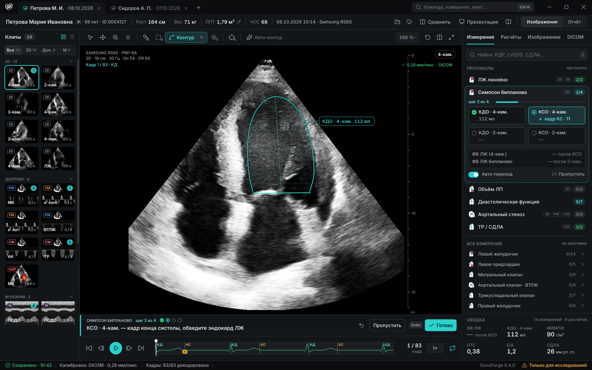
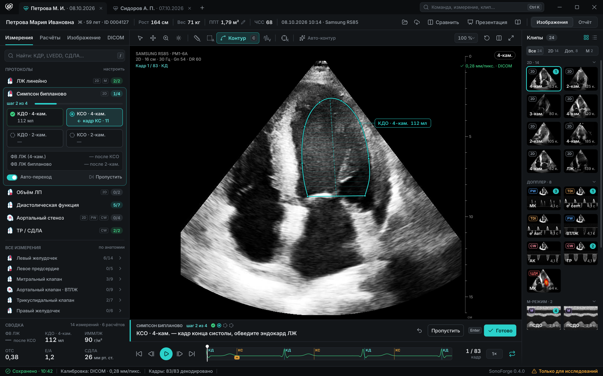
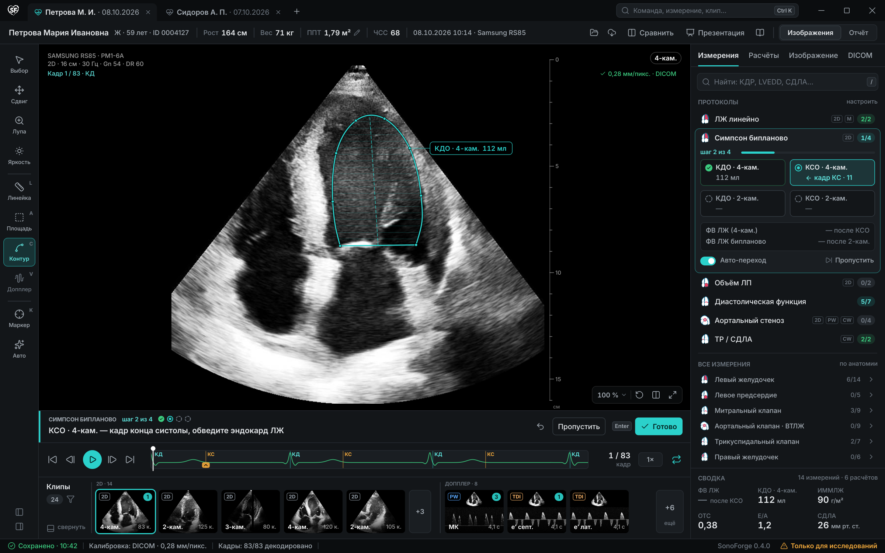
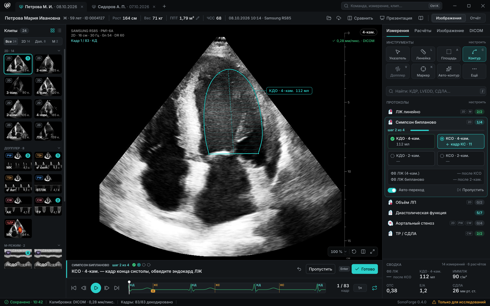
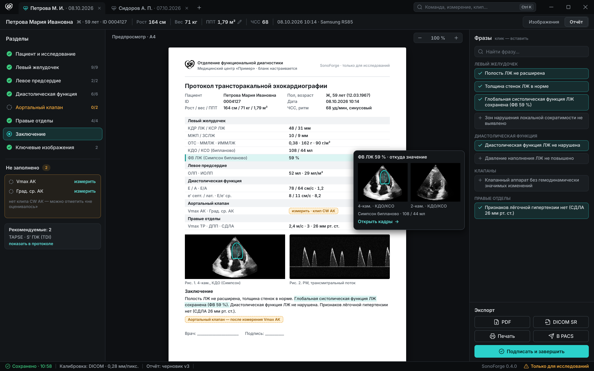
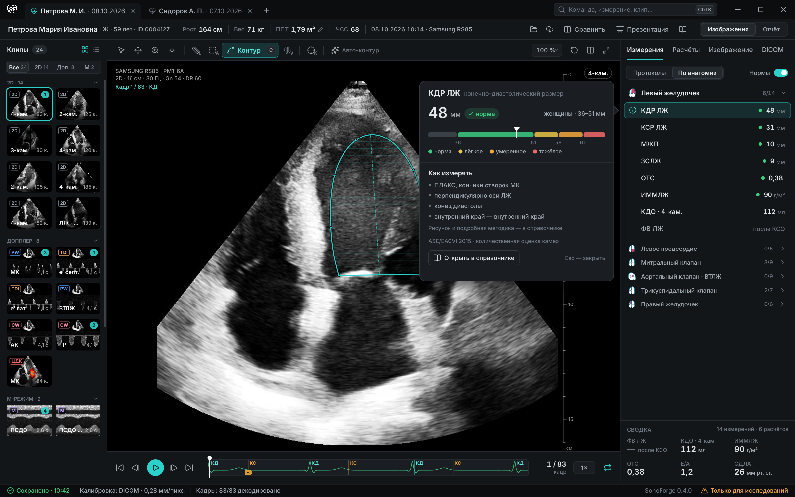
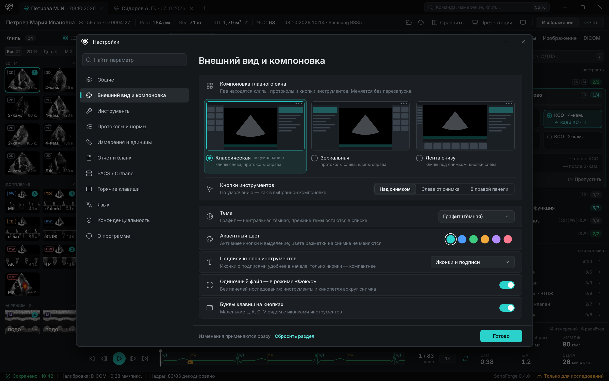
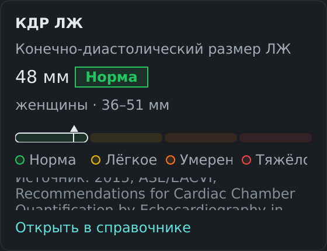
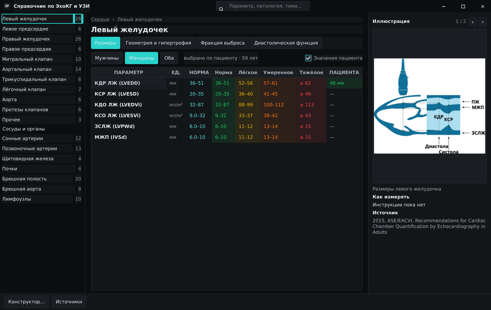
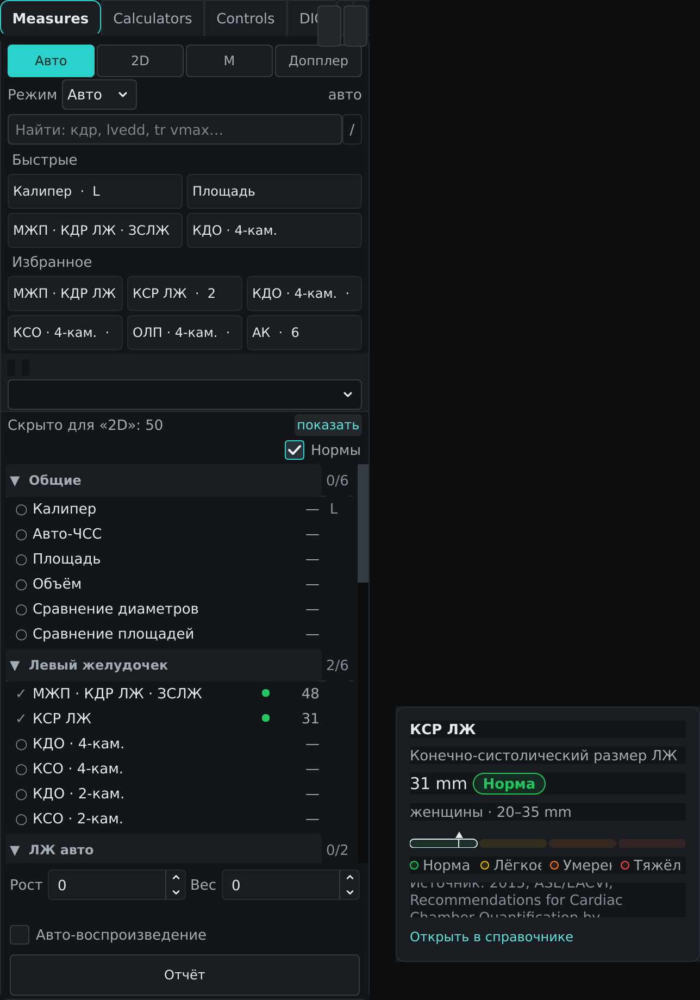

# Переработка дизайна интерфейса — спецификация и план (UI)

**Дата:** 2026-10-16

**Статус:** Draft. Направление выбрано пользователем по двум раундам макетов: раунд 1 — варианты главного окна, раунд 2 — расположение панелей и кнопок. Детали ниже — на согласование. Код этим документом не меняется.

**Тип:** UX- и визуальная спецификация + архитектура оформления (токены, компоновки, оболочка окна) + поэтапный план PR и приёмки + макеты.

**Проверенная база:** `main` на `4dd3e52` (ветка `arena/ea808c3a-sonoforge`). После неё в `main` влиты #207 (релиз 0.3.3 и трекер TP) и #208 (анализ спек); `presentation/` они не меняют.

**Связанные документы:** [TP: панель измерений 2.0 и протоколы](2026-10-15-tool-panel-2-spec-ru.md) (панель, каталог, протоколы, палитра Ctrl+K; эта спека меняет вид шага протокола), [QH: качество и безопасность](2026-10-13-quality-safety-hardening-spec-plan-ru.md) (S-02, S-11, QH-1b provenance, QH-3 `ViewerWidget`), [Customize Layout](2026-06-30-customize-layout-spec.md) (`LayoutConfig`), [Micro-UX](2026-07-04-micro-ux-design.md) (Inter, hover, рамка фокуса, reduce motion), [вкладки и стартовая страница](2026-10-07-tabs-start-page-spec-ru.md), [редизайн справочника](2026-08-16-reference-redesign-design.md), [приёмка WP4 на Windows](2026-10-08-wp4-windows-acceptance-checklist-ru.md).

**Макеты:** утверждённый вид — [`docs/images/ui-redesign/`](../../images/ui-redesign/). Варианты, из которых он выбран: [`main-window-variants/`](../../images/main-window-variants/) (раунд 1) и [`layout-variants/`](../../images/layout-variants/) (раунд 2). Макеты рисуют QPainter-скрипты [`tools/design_mockups/`](../../../tools/design_mockups/) (это не живые виджеты). Кадры — обезличенные фикстуры `tests/fixtures/for_pero`, значения условные.

> Документ описывает интерфейс и проверяемые контракты. Это не клиническая валидация. Градации норм — справочная информация, а не диагноз: врач читает значения и градации справочника.

---

## 0. Коротко

1. **Основа — A1 «Рабочая станция».** Нейтральная графитовая палитра. Заголовок окна в стиле Windows 11: вкладки исследований в заголовке, поле команд Ctrl+K, системные перемещение, изменение размера и Snap. Mac-вид не развиваем.
2. **Компоновка выбирается в Настройках → «Внешний вид и компоновка»** (как на O1). Три пресета: «Классическая» (A1, по умолчанию: клипы слева, протоколы справа), «Зеркальная» (M1), «Лента снизу» (M2). Отдельная настройка — где кнопки инструментов: над снимком, слева от снимка или в правой панели. «Классическая» + «в правой панели» — это текущее расположение. M1 и M2 уже есть в `LayoutConfig` флажками; они становятся пресетами.
3. **Шаг протокола — полоса под снимком** во всех компоновках. На изображении остаются только контур, точки, подпись значения и номер кадра. Это меняет §4.4 спеки TP: там был баннер на снимке.
4. **Отчёт — отдельный режим (R3).** Переключатель «Изображения | Отчёт» в строке пациента. Разделы с заполненностью, лист A4 — тот же документ, что уходит в PDF, «откуда значение» по наведению, фразы, экспорт.
5. **Справочник — окно S1 и карточка нормы S2.** Карточка открывается у строки измерения: значение, градация, норма для пола, шкала, как измерять, источник. Рисунков в карточке нет, они только в окне S1.
6. **Фокус для одиночного файла** — по мотивам C1: без панелей исследования, инструменты и кинопетля вокруг снимка. Вариант — на подтверждение (UQ-02).
7. **Под капотом — токены оформления.** ≈ 365 hex-литералов вне `dark_theme.py` и 202 вызова `setStyleSheet` переходят на семантические токены. QSS собирается из токенов. Тема «Графит» добавляется, прежние темы остаются. Попутно исправляется инверсия системной темы на Windows.
8. **Порядок:** UI-0 токены и тема → UI-1 оболочка окна → UI-2 компоновки и настройки → UI-3 полоса шага (вместе с TP-3), UI-4 отчёт, UI-5 справочник → UI-6 фокус → UI-7 стартовая страница → UI-8 чистка и документация. UI-0 не меняет компоновку и может идти параллельно с TP-0.



*Макет 1. «Классическая» — компоновка по умолчанию. Клипы слева, ряд инструментов над снимком, протоколы справа. Под снимком полоса шага и кинопетля.*

---

## 1. Решения и открытые вопросы

### 1.1. Решения

| ID | Решение | Источник | Статус |
|---|---|---|---|
| **UD-01** | Основа главного окна — A1 «Рабочая станция»; A2 — браузер исследований. Mac-вид (B1/B2) не развиваем | Пользователь, раунд 1 | ПРИНЯТО |
| **UD-02** | Палитра — нейтральный графит; заголовок окна — в стиле Windows 11 | Пользователь, раунд 1 | ПРИНЯТО |
| **UD-03** | Компоновки: A1 остаётся, добавляются M1 и M2, сохраняется текущее расположение (миниатюры слева, инструменты справа). Выбор — в настройках, как на O1 | Пользователь, раунд 2 | ПРИНЯТО; трактовка — UQ-01 |
| **UD-04** | Кнопки шага протокола — полоса под снимком | Пользователь, раунд 2 | ПРИНЯТО |
| **UD-05** | Отчёт — R3, отдельный режим | Пользователь, раунд 2 | ПРИНЯТО |
| **UD-06** | Справочник — S1 (окно) и S2 (карточка в контексте). В карточке S2 нет прикреплённых изображений: текст на них слишком мелкий для всплывающего окна | Пользователь, раунд 2 | ПРИНЯТО |
| **UD-07** | Одиночный файл — режим «Фокус» по мотивам C1: довольно чистое окно | Пользователь, раунд 1 | ПРИНЯТО направление; вариант — UQ-02 |
| **UD-08** | У переключателя режима два состояния: «Изображения \| Отчёт». Промежуточного «Вместе» (R2) нет | Следует из UD-05 | ПРЕДЛОЖЕНО |
| **UD-09** | Цвета задают только семантические токены (§5). Новый код без hex-литералов вне модуля палитр. CI-проверка с «храповиком»: число литералов может только уменьшаться | Предложение | ПРЕДЛОЖЕНО |
| **UD-10** | «Графит» — тема по умолчанию для новых установок. У существующих пользователей тема не меняется. Прежние темы остаются в списке (UQ-04) | Предложение | ПРЕДЛОЖЕНО |
| **UD-11** | Компоновка = пресет + расположение кнопок (`LayoutConfig` v2, §8.1). Пять независимых флажков v1 уходят вместе с сочетаниями, которые никто не проектировал. Новый ключ настроек, старый не трогается (как раскладка v3 в TP) | Предложение | ПРЕДЛОЖЕНО |
| **UD-12** | Строка пациента — одна строка 42 px во всех компоновках. Рост, вес и ППТ правятся на месте, там же ЧСС. Футер панели TP показывает только «Отчёт · N измерений» | Предложение (M2) | ПРЕДЛОЖЕНО |
| **UD-13** | Перемещение, изменение размера и Snap — системные: `QWindow.startSystemMove()` / `startSystemResize()`, на Windows — `WM_NCHITTEST` для Snap Layouts. Без новых зависимостей | Предложение | ПРЕДЛОЖЕНО |
| **UD-14** | Цвет норм в списке измерений (точки S2) — только при включённом переключателе «Нормы», по умолчанию он выключен. В карточке градация видна всегда, с легендой и источником. Это согласуется с D-07 спеки TP: по умолчанию без цвета, градации — по наведению | Предложение | ПРЕДЛОЖЕНО (UQ-03) |
| **UD-15** | Подписи измерений на экранах этой спеки берутся из каталога TP (D-02: только язык интерфейса). Новые строки интерфейса — только через локали RU/EN | Правило TP | ДЕЙСТВУЕТ |
| **UD-16** | Цвета разметки на снимке (контуры, калиперы, подписи, маркеры КД/КС) — отдельная группа токенов `overlay.*`. Тема и акцентный цвет её не меняют | Предложение | ПРЕДЛОЖЕНО |

### 1.2. Открытые вопросы

Для каждого вопроса указан вариант по умолчанию. План пользуется им, если ответа не будет.

| # | Вопрос | Вариант по умолчанию |
|---|---|---|
| **UQ-01** | Как понимать «оставить A1, взять M1, M2 + текущее расположение (слева миниатюры, справа инструменты)»? | Три пресета: «Классическая» = A1, «Зеркальная» = M1, «Лента снизу» = M2. Плюс независимая настройка «Кнопки инструментов: над снимком / слева от снимка / в правой панели». Текущее расположение = «Классическая» + «в правой панели» (макет 4). Если имелось в виду «M2, но миниатюры слева, а инструменты справа», это тот же макет 4: однострочная шапка M2, клипы слева, кнопки в панели |
| **UQ-02** | Фокус для одиночного файла: F1 (тонкая полоса сверху, рейка C1, «Измерения в этом файле» справа) или F2 (одна нижняя док-панель)? Включать его автоматически при открытии одиночного файла? | F1. Включается автоматически (настройка «Одиночный файл — в режиме «Фокус»», вкл.). Клавиша F возвращает обычный вид |
| **UQ-03** | Точки норм в списке измерений по умолчанию | Выключены. Положение переключателя «Нормы» запоминается |
| **UQ-04** | Переводить ли существующих пользователей на «Графит»? | Нет: «Графит» только у новых установок. Остальным — одно ненавязчивое предложение попробовать |
| **UQ-05** | Светлая тема в системе токенов | Существующая светлая переносится на токены без перерисовки. Лист A4 в отчёте всегда «бумажный» (белый) в любой теме |
| **UQ-06** | Экспорт отчёта в первой версии | PDF и печать. DICOM SR и «В PACS» — отдельной спекой; до неё кнопки скрыты |
| **UQ-07** | Что значит «Подписать и завершить»? | «Завершить» фиксирует версию: она только для чтения, правка создаёт новый черновик. Это не электронная подпись: подпись врача — поле бланка. Хранение версий — отдельное решение вместе с QH, потому что это новое хранилище клинических данных |
| **UQ-08** | Фразы заключения: откуда тексты и кто их утверждает? | Стартовый набор до 30 фраз RU/EN по разделам — на утверждение пользователю. Свои фразы хранятся локально, есть импорт и экспорт. Фраза вставляется только по клику врача |
| **UQ-09** | Activity bar (узкая панель в стиле VS Code) после появления «кнопок слева от снимка» | Удалить через релиз. `activity_bar = true` мигрирует в «слева от снимка» |
| **UQ-10** | macOS | Без Mac-вида (UD-01): системная рамка, вкладки и поле команд — строкой под ней. Отдельный PR после UI-1 |
| **UQ-11** | Нужна ли настройка плотности (обычная / компактная)? | Нет: уже есть `ui_scale_percent` и `ui_font_size`. Вернуться после UI-2 по отзывам |
| **UQ-12** | Текст «Как измерять» для карточки S2: в YAML справочника такого поля нет, у части параметров есть только `note` | Новое поле `how_to` (RU/EN) в схеме и конструкторе. Заполняется постепенно, начиная с параметров шести протоколов TP. Без текста блок не показывается |

---

## 2. Исходное состояние (код на `4dd3e52`)

### 2.1. Что есть и что из этого следует

| Область | Что есть | Следствие |
|---|---|---|
| Окно | `MainWindow` безрамочное (`FramelessWindowHint`, `main_window.py:155`). Перемещение — вручную в `SystemBar.mousePressEvent/mouseMoveEvent` (`system_bar.py:462–471`); из развёрнутого окна оно не работает. Развёртывание — своя геометрия рабочей области (`apply_maximized_to_work_area`, `main_window.py:116`) с пересчётом при смене экрана и DPI | Нет изменения размера за края, нет Aero Snap и Snap Layouts Windows 11, нельзя вытащить развёрнутое окно → UI-1 |
| Верхняя панель | `SystemBar`: до 16 кнопок в одной строке — Открыть, PACS, Отправить, Настройки, Калипер, Калибровка B, Калибровка допплера, Нормативы, ЧСС, Сброс, Компоновка, Multiview, Докладчик, свернуть / развернуть / закрыть. Вкладки — отдельная полоса `TabStrip` | Кнопки разносятся по смыслу: окно — в заголовок, исследование — в строку пациента, измерения — к снимку (§4.1) |
| Строки и стили | «Send to server…» не переведена (`system_bar.py:153`), хотя ключ `system_bar.send_to_server` есть в обеих локалях. У кнопки «Нормативы» inline-стиль (`system_bar.py:186`) | Исправить в UI-1 или сразу, отдельным мелким PR |
| Компоновка | `LayoutConfig` (`main_window.py:100`) — пять флажков: `swap_places` («Инструменты слева, миниатюры справа»), `gallery_horizontal` («Миниатюры снизу, 1 ряд»), `activity_bar` («Узкая панель инструментов»), `status_bar_visible`, `multiview` (не сохраняется). Меню-чекбоксы у кнопки компоновки (`_show_layout_menu`, `main_window.py:827`), JSON в `layout_state_json`, сборка — `_rebuild_layout()` (`main_window.py:1042`) с ветвлением `_decide_left/_decide_right` по четырём флагам | M1 и M2 по сути уже есть (`swap_places`, `gallery_horizontal`). Нужны пресеты вместо флажков и страница настроек → UI-2 |
| Панель | `ToolPanel` фиксированной ширины 280 (`_TOOL_PANEL_WIDTH`, `main_window.py:96`); в сплиттере она только в компоновке по умолчанию. Вертикальный сплиттер М-режима (`viewer + MModeWidget`) тоже собирается только в этой ветке | Содержимое панели — TP-2; здесь — её место и ширина. М-режим должен работать во всех пресетах |
| Темы | `dark_theme.py`: четыре палитры по 28 ключей (`_DARK` — navy, `_LIGHT`, `_VS_CODE_DARK`, `_VS_CODE_LIGHT`) и режим «system»; один QSS примерно на 790 строк (`build_clinical_stylesheet`, стр. 253). Модульные константы `BG_DARK…` описывают только navy; `SLIDER_FILL = #3b82f6` — вне палитр | База для токенов есть, но ключи смешивают роль и вид (`reset_bg1`, `hover_btn1`) → UI-0 |
| Ошибка темы | `_resolve_theme("system")` на Windows возвращает `_LIGHT` при `AppsUseLightTheme == 0`, то есть при тёмной теме системы (`dark_theme.py:233`). Соседняя `_is_system_dark()` считает правильно | Исправить в UI-0, с тестом на мок `winreg` |
| Хардкод | ≈ 365 hex-литералов вне `dark_theme.py`: `viewer_widget` 54, `orthanc_study_delegate` 26, `ui/control_panel` 22, `structured_reference_widget` 21, `doppler_overlay` 18 … И 202 вызова `setStyleSheet` в 45 файлах: `structured_reference_widget` 24, `ase_reference_dialog` 16, `viewer_widget` 12 … (grep по `presentation/`, `ui/`, `constructor/`) | Перенос по областям, по одному PR на область (UI-0) |
| Шрифты и иконки | Inter (Regular / Medium / SemiBold / Bold, Display) и JetBrains Mono уже лежат в `resources/fonts`; 42 SVG в `resources/icons` | Шрифт не меняем. Иконки дополняем из Lucide (ISC), лицензия совместима с GPL-3.0 |
| Отчёт | `ReportDialog` (QDialog): шапка пациента, дерево `ReportDocument`, заключение в `QPlainTextEdit`, PDF через reportlab (`infrastructure/measurement_report_pdf.py`). Окно и PDF строятся из одного `ReportDocument` | Хорошая основа для R3: что на экране, то и в PDF. Нет фраз, версий, «откуда значение», печати |
| Справочник | `AseReferenceDialog` + `StructuredReferenceWidget` + веб-вкладка; данные `references_structured_{ru,en}.yaml` (18 тем, 53 рисунка), конструктор | S1 — развитие диалога; S2 — новый компонент |
| Настройки | `UserPreferencesDialog` — `QTabWidget`: «Интерфейс» (с блоком «Отображение»), «Измерения», «Инструменты», «Прочее», «Экспериментальные», «Сервер». Тема — комбобокс из пяти пунктов | Раздел «Внешний вид и компоновка» (O1) встаёт на место «Интерфейса» |
| Полный экран | F11-киоск (верхняя панель выезжает при наведении к краю) и `PresenterMode` — окно докладчика для второго экрана | «Фокус» — третий режим: окно обычное, убраны только панели исследования |
| Тесты | `test_main_window_layout.py`, `test_system_bar.py`, `test_presentation_dark_theme.py`, `test_tool_panel_layout.py`, `test_presentation_report_dialog.py`, `test_presentation_user_preferences_dialog.py`, `test_structured_reference_widget.py` … Снимки виджетов (`grab()`) есть точечно: `test_presenter_view.py`, `test_ui_scale.py`. CI — offscreen + xvfb, pytest-xdist | Системы скриншот-тестов нет. Она вводится в UI-0 (§10) |

### 2.2. Что сохраняем

Шрифт Inter и отделка из Micro-UX (hover, нажатие, рамка фокуса), `reduce_motion`, масштаб `ui_scale_percent` и `ui_font_size`, вкладки исследований и стартовая страница (Э9, Э5), Multiview, режим докладчика, F11. Меняется их оформление и место на экране, а не поведение.

---

## 3. Цели, метрики, границы

**Цели.**
1. Снимок — главный. Во время протокола изображение ничем не перекрыто.
2. Каждая кнопка на своём месте по смыслу: окно, исследование, снимок, измерение.
3. Выбор компоновки без потери привычного: текущее расположение — один из вариантов.
4. Один источник оформления: тема меняется без правки виджетов.
5. Отчёт — режим работы, а не диалог.

**Метрики** (проверяются в приёмке, §11).

| # | Метрика | Цель |
|---|---|---|
| G-1 | Площадь изображения в «Классической» вне протокола при 1920×1080 и 100 % | Не меньше базовой линии текущей компоновки по умолчанию (±3 %). Базовая линия снимается скриншот-тестом в UI-0 |
| G-2 | Переключение пресета | ≤ 300 мс (p95), без перезапуска, клип, кадр и измерения на месте |
| G-3 | Hex-литералы вне модуля палитр | Новых — 0 (CI); общее число только убывает |
| G-4 | Контраст текста (WCAG 2.1 AA) | «Графит»: основной и вторичный текст и подсказки ≥ 4,5:1 на всех поверхностях; скрипт в CI. Прежние темы — отчёт без блокировки: их цвета без согласования не меняются |
| G-5 | Перекрытие изображения при активном шаге | Ничего, кроме контура, точек, подписи значения и номера кадра (геометрический автотест) |
| G-6 | Отчёт | Текст на экране совпадает с текстом PDF (golden-тесты RU/EN, S-11) |
| G-7 | Окно на Windows 10/11 | Snap Layouts, перетаскивание к краям, изменение размера за 4 стороны и углы, Win+стрелки — ручная приёмка по чек-листу WP4 |

**Вне объёма.**
- Содержимое панели измерений, протоколы, палитра команд — спека TP. Здесь только их место на экране и вид шага.
- DICOM SR, отправка отчёта в PACS, электронная подпись, хранение версий отчёта — отдельные спеки.
- Mac-вид (B) и светлая графитовая тема — не сейчас.
- Клиническая логика, нормы, формулы — без изменений. Исключение — исправление данных ММЛЖ (§4.7) отдельным PR данных.

---

## 4. Информационная архитектура и поведение

### 4.1. Вертикальная структура окна

Общая для всех компоновок:

| Полоса | Высота, px | Содержимое |
|---|---|---|
| Заголовок окна | 38 | Логотип (меню приложения: настройки, компоновка, справка, о программе, выход) · вкладки исследований (сюда переезжает `TabStrip`) · «+» · поле «Команда, измерение, клип…» Ctrl+K (палитра TP-6; до неё — поиск по панели) · свернуть / развернуть / закрыть по 46 px |
| Строка пациента | 42 | ФИО · пол, возраст, ID · рост · вес · ППТ ✎ · ЧСС · дата, время, аппарат │ Открыть · PACS ▾ (загрузить / отправить) · Сравнить · Презентация · Справочник │ **Изображения \| Отчёт** |
| Рабочая область | остальное | Пресет компоновки, §4.2 |
| Строка состояния | 26 | Сохранено · калибровка · декодирование кадров · «Только для исследований» · версия. Скрывается настройкой, как сейчас (`status_bar_visible`) |

Колонка снимка во всех пресетах, сверху вниз: ряд инструментов 42 px (если кнопки «над снимком») → изображение → **полоса шага 58 px** (только при активном протоколе) → кинопетля 66 px → лента клипов одной строкой (в «Ленте снизу», горизонтальная прокрутка и заголовки групп режимов; минимум 128 px при среднем масштабе, включая полосу прокрутки). В «Зеркальной» правый слот клипов тоже работает одной горизонтальной строкой, но шириной в одну ячейку, чтобы освободить место центральной колонке просмотра; все клипы доступны прокруткой. Размеры даны для 100 %; ячейки галереи масштабируются вместе с `thumbnail_scale`.

Куда уходят кнопки `SystemBar`:

| Сейчас | Станет |
|---|---|
| Открыть, PACS, «Отправить на сервер» | Строка пациента: «Открыть», «PACS ▾» (загрузить / отправить) |
| Настройки | Меню логотипа; Ctrl+, (проверить по реестру клавиш) |
| Калипер | Кнопки инструментов (ряд / рейка / панель) |
| Калибровка B, калибровка допплера | Чип калибровки на снимке «0,28 мм/пикс. · DICOM» → меню калибровки (§4.5) |
| Нормативы | Строка пациента: «Справочник» (окно S1) |
| ЧСС | Строка пациента: значение ЧСС; по клику — измерить или ввести |
| Сброс | Меню «Ещё» у кнопок инструментов, с подтверждением (`confirm_reset`, как сейчас) |
| Компоновка | Меню логотипа → «Компоновка»: пресеты радиокнопками и «Настроить…» |
| Multiview | «Сравнить» |
| Докладчик | «Презентация» |
| Свернуть / развернуть / закрыть | Заголовок окна |

### 4.2. Компоновки

| Пресет | Слева | Справа | Под снимком | Кнопки по умолчанию | Макет | В коде сейчас |
|---|---|---|---|---|---|---|
| **Классическая** (по умолчанию) | Клипы: сетка 216 px, группы по режиму, фильтр «Все / 2D / Доп. / M» | Панель измерений и протоколов (TP-2: 320 px, сплиттер 280–420) | Полоса шага, кинопетля | Над снимком | 1 | Компоновка по умолчанию |
| **Зеркальная** | Панель измерений и протоколов | Клипы: однострочная лента шириной в одну ячейку, горизонтальная прокрутка | Полоса шага, кинопетля | Над снимком | 2 | `swap_places` |
| **Лента снизу** | Рейка инструментов с подписями, 70 px | Панель измерений и протоколов | Полоса шага, кинопетля, лента клипов ≥128 px (один ряд, заголовки групп, горизонтальная прокрутка, сворачивается) | Слева от снимка | 3 | `gallery_horizontal` (один ряд, без рейки) |

**Кнопки инструментов** — независимая настройка: «Над снимком» (ряд A1), «Слева от снимка» (рейка M2), «В правой панели» (блок «Инструменты» вверху панели — как сейчас). По умолчанию берётся вариант пресета, но выбор пользователя запоминается отдельно. Все три вида строятся из одного списка инструментов каталога TP (id, подпись, клавиша, доступность в контексте) и идут через один вход `action_requested` (D-09 TP). Поэтому набор и порядок кнопок одинаковы.

| Вид | Где | Состав | Подписи |
|---|---|---|---|
| Ряд над снимком | Полоса 42 px над изображением | Указатель, сдвиг, лупа, яркость │ линейка L, площадь A, контур C, допплер V │ маркер K │ Авто-контур. Справа: масштаб, поворот, «Сравнить», «Фокус» | Иконки; у активного — подпись и клавиша |
| Рейка слева | Колонка 70 px | Те же инструменты столбиком; внизу — показать / скрыть боковые панели | Иконка, подпись под ней, буква клавиши |
| В правой панели | Блок «Инструменты» над поиском панели | Сетка 4 × 2; инструменты вида (сдвиг, лупа, яркость) — у снимка, в правом нижнем углу | Иконка и подпись |

Недоступный в текущем контексте инструмент (допплер на 2D-клипе) приглушён, причина — в подсказке (как состояние `locked` в TP).



*Макет 2. «Зеркальная» (M1): протоколы слева, клипы справа. Ряд инструментов, полоса шага и кинопетля — как в «Классической».*



*Макет 3. «Лента снизу» (M2): рейка инструментов с подписями слева, лента клипов под кинопетлёй, протоколы справа. Масштаб и поворот — в углу снимка.*



*Макет 4. «Классическая» + «В правой панели»: текущее расположение в новом оформлении. Над снимком ничего нет, кнопки — блоком вверху панели.*

### 4.3. Заголовок окна в стиле Windows 11

- **Перемещение.** Перетаскивание за пустое место заголовка и строки пациента вызывает `windowHandle().startSystemMove()`. Прилипание к краям, Win+стрелки, вытаскивание развёрнутого окна, переход между мониторами делает ОС.
- **Рамка.** На Windows окно сохраняет системные стили рамки (`WS_THICKFRAME`, `WS_CAPTION`), а видимая рамка убирается обработкой `WM_NCCALCSIZE`. Тогда Snap, анимации свёртывания и тень DWM работают как у обычного окна.
- **Размер.** Края 6 px: `WM_NCHITTEST` возвращает `HTLEFT … HTBOTTOMRIGHT`; на других ОС — `startSystemResize(edges)`.
- **Snap Layouts.** Над кнопкой «развернуть» `WM_NCHITTEST` возвращает `HTMAXBUTTON`, и Windows 11 показывает меню раскладок. Наведение и нажатие этой кнопки рисуем сами по `WM_NCMOUSEMOVE`, `WM_NCLBUTTONDOWN`, `WM_NCMOUSELEAVE`.
- **DWM.** Скруглённые углы (`DWMWA_WINDOW_CORNER_PREFERENCE`), тёмная рамка (`DWMWA_USE_IMMERSIVE_DARK_MODE`), системная тень. Mica не используем: графит — сплошной цвет.
- **Двойной клик** по заголовку разворачивает и восстанавливает окно, как сейчас. Своя геометрия рабочей области (`apply_maximized_to_work_area`) остаётся запасным путём там, где системное развёртывание ведёт себя плохо (часть оконных менеджеров Linux).
- **Код.** `presentation/window_chrome/`: `hit_test.py` — чистая функция «точка → зона», тестируется на всех ОС; `win32_chrome.py` — `nativeEvent` и вызовы DWM через `ctypes`, только Windows.
- **Запасной выход.** Настройка «Системная рамка окна»: стандартная рамка ОС, вкладки и поле команд — строкой под ней. На случай проблем с драйверами или удалённым рабочим столом.

### 4.4. Полоса шага протокола

Полоса стоит между изображением и кинопетлёй (макеты 1–4). Слева направо: акцентная кромка · «СИМПСОН БИПЛАНОВО» · «шаг 2 из 4» · точки шагов · что измерить и на каком кадре («КСО · 4-кам. — кадр конца систолы, обведите эндокард ЛЖ»). Справа: «Отменить точку» (↶), «Пропустить» (S), «Готово» (Enter).

| Ситуация | Поведение |
|---|---|
| Протокол не запущен | Полосы нет, изображение занимает её место. Анимация 150 мс; при `reduce_motion` — без анимации |
| Шаг взведён | Полоса показывает шаг; строка шага в карточке протокола подсвечена (TP §6.2) |
| Шаг зафиксирован | Вместо инструкции на ≥ 2 с — «✓ КДО · 4-кам. = 112 мл → далее: КСО · 4-кам.» и «Esc — остановить автопереход» (TP Q-07). Поверх снимка ничего не всплывает |
| Нужен кадр | Ссылка «← кадр КС · 11» переводит кинопетлю на кадр |
| Шаг заблокирован | Причина («нужен CW-клип») и «Найти клип» (TP §6.2) |
| Multiview | Полоса под активной панелью |
| Фокус | Полоса внизу, над кинопетлёй |
| Узкое окно (< 900 px колонки) | Инструкция сокращается с многоточием, полный текст в подсказке; кнопки — только иконки |

Полоса не забирает фокус клавиатуры у вьюера; её кнопки доступны по Tab. Клавиши — как в TP §4.5 (Enter, S, двухступенчатый Esc).

### 4.5. Строка пациента и чипы снимка

- **Строка пациента.** Рост и вес правятся на месте, ППТ пересчитывается (сейчас эти поля в `MeasureTab` панели). Без ППТ индексы в панели заблокированы с причиной «нужна ППТ», ссылка ведёт к полю в строке пациента. ЧСС: значение из DICOM или измерения; по клику — измерить (существующий `heart_rate`) или ввести.
- **Чипы снимка.** Сверху слева — аппарат, режим, глубина, частота, усиление, номер кадра и фаза (КД / КС). Сверху справа — проекция («4-кам.») и калибровка с источником («0,28 мм/пикс. · DICOM»). По клику на чип калибровки — меню «Калибровать по шкале глубины / по шкале допплера / вручную» (существующие режимы калибровки).

### 4.6. Отчёт — режим R3



*Макет 5. Режим «Отчёт» (R3) с переключателем из двух состояний. Слева — разделы и незаполненное, в центре — лист A4, справа — фразы и экспорт. По наведению на значение — «откуда значение».*

**Вход и выход.** Переключатель «Изображения | Отчёт» в строке пациента (UD-08); клавиша — по реестру (кандидат Ctrl+R: сейчас он занят только в контексте `orthanc-dialog`, проверить `shortcut_conflicts()`). Состояние вкладки (клип, кадр, взведённый шаг) сохраняется при переключении. Режим принадлежит вкладке (S-02).

| Зона | Содержимое |
|---|---|
| Слева, 284 px | «Разделы» со статусом (✓ готово / ◐ частично / ○ не заполнено) и счётчиком. «Не заполнено»: ссылка «измерить» переключает в «Изображения» и взводит нужный шаг протокола; «не оценивалось» — явная отметка. «Рекомендуемые» — из протоколов TP |
| В центре | Лист A4, всегда белый, масштаб. Это тот же документ, что уходит в PDF. Маркеры «измерить · клип CW АК» видны только на экране и не печатаются: в PDF вместо них «—» или «не оценивалось». Наведение на значение открывает «откуда значение»: клипы-источники с кадрами, метод, исходные величины, «Открыть кадры» |
| Справа, 336 px | «Фразы»: поиск, группы по разделам, ✓ у вставленных; клик вставляет фразу в заключение в позицию курсора. «Экспорт»: PDF, печать (DICOM SR и «В PACS» — UQ-06); «Завершить» — по UQ-07 |

**Данные.** Предпросмотр строится из `ReportDocument`, как PDF. Путь выбирается спайком UI-4.0 (1–2 дня):
- (а) показывать байты PDF из `measurement_report_pdf.py` через `QPdfDocument` + `QPdfView` (модули `QtPdf` и `QtPdfWidgets` входят в PySide6; проверить в спайке на версии из `uv.lock`). Это точный WYSIWYG. Для наведения при сборке PDF сохраняются координаты ячеек значений;
- (б) общий раскладчик страницы для QPainter и reportlab — больше кода и риск расхождения.

По умолчанию — (а), если пересборка укладывается в 500 мс после изменения значения (с дребезгом). «Откуда значение» берёт происхождение из QH-1b. Где происхождение не записано, так и написано (статус `unverified`, «происхождение не записано»), без догадок (QH §5.3, пп. 3 и 6).

**Язык отчёта** — язык интерфейса, как сейчас. Подписи — из каталога TP (D-02).

### 4.7. Справочник — окно S1 и карточка S2



*Макет 6. Карточка нормы КДР ЛЖ у строки измерения: значение, градация, норма для женщин, шкала градаций, как измерять, источник. Рисунков нет (UD-06), они в окне справочника. Протокол не запущен, поэтому полосы шага нет.*

**Карточка S2.** Привязана к строке измерения: список «По анатомии» и строки протоколов в панели, позже — значения в отчёте. Открывается наведением с задержкой 400 мс или клавишей на выбранной строке (по реестру). Esc закрывает.

| Блок | Содержимое |
|---|---|
| Заголовок | Подпись по каталогу TP и полное название |
| Значение | Число с единицами и чип градации по нормам справочника для пола пациента |
| Норма | Диапазон для пола («женщины · 36–51 мм»); при отсутствии нормы — «Нормы нет в справочнике», без цвета |
| Шкала | Сегменты норма / лёгкое / умеренное / тяжёлое с порогами и маркер значения; легенда |
| Как измерять | Текст из поля `how_to` (UQ-12), 3–5 пунктов. Без рисунков |
| Источник | Рекомендация и год, например «ASE/EACVI 2015 · количественная оценка камер» |
| Действие | «Открыть в справочнике» — окно S1 на этом параметре |

**Окно S1** ([макет раунда 2](../../images/layout-variants/S1-reference-window.png)) — немодальное окно с тем же заголовком в стиле Windows 11. Слева темы (18 тем, поиск). В центре таблица темы: параметр, норма для пола пациента, градации, значения пациента. Справа рисунок, «Как измерять», источник. Открывается из строки пациента, из карточки S2 и из Ctrl+K («Справочник: КДР»). Основа — `AseReferenceDialog` + `StructuredReferenceWidget`.

**Точки норм в списке** — только при включённом «Нормы» (UD-14, UQ-03). Цвет точки = градация справочника; другой шкалы нет («на границе нормы» не вводим).

**Данные.** Перед выпуском S2 исправляются нормы ММЛЖ (`lvm`) в обоих YAML: мужская норма 88–224 г — по линейному методу (М-режим), женская 66–150 г — по 2D. Для М-режима у женщин должно быть 67–162 г, так в рисунке `01-LV.png` того же справочника. Сейчас женщина с ММЛЖ 162 г по М-режиму получает «выше нормы». Строка метода хранится явно.

### 4.8. Фокус для одиночного файла

Основа — C1 (раунд 1) и его уточнение F1 ([макет раунда 2](../../images/layout-variants/F1-focus-single-file.png)); F2 — альтернатива (UQ-02).

- Тонкая полоса заголовка: имя файла, проекция, пациент, дата, метка «Фокус» и «Обычный вид F».
- Плавающая рейка инструментов слева (C1), карточка «Измерения в этом файле» справа: значения, «Копировать», «В исследование» и пояснение «Файл без исследования: значения не попадут в отчёт, пока не добавите их».
- Кинопетля — плавающая плашка внизу.
- По правилу UD-04 подсказка инструмента и полоса шага стоят внизу, над кинопетлёй, а не поверх снимка (в F1 раунда 2 подсказка была сверху).
- Плавающие элементы прижаты к краям; когда курсор при рисовании подходит к ним, они становятся полупрозрачными.
- Вход — автоматически при открытии одиночного файла (настройка) или клавишей F; выход — F. Состояние у вкладки (S-02).

### 4.9. Настройки «Внешний вид и компоновка»



*Макет 7. Настройки в стиле Windows 11, раздел «Внешний вид и компоновка»: три пресета с живыми схемами, расположение кнопок инструментов, тема, акцентный цвет, подписи кнопок, фокус, буквы клавиш.*

**Навигация** — список слева: Общие · Внешний вид и компоновка · Инструменты (TP-5) · Протоколы и нормы · Измерения и единицы · Отчёт и бланк · PACS / Orthanc · Горячие клавиши · Язык · Конфиденциальность · О программе · Экспериментальные. Перенос нынешних вкладок: «Интерфейс» → «Общие» и «Внешний вид»; «Измерения» → «Измерения и единицы»; «Прочее» разносится по смыслу (размер шрифта PDF → «Отчёт и бланк», обезличивание кадров → «Конфиденциальность»); «Сервер» → «PACS / Orthanc». Поиск по параметрам — сверху.

**Раздел «Внешний вид и компоновка».**

| Параметр | Значения | Ключ |
|---|---|---|
| Компоновка главного окна | Классическая (по умолчанию) / Зеркальная / Лента снизу — плитки со схемами | `layout_state_v2_json.preset` |
| Кнопки инструментов | Над снимком / Слева от снимка / В правой панели; по умолчанию — как в пресете | `…tool_buttons` |
| Тема | Графит (тёмная) / прежняя тёмная (navy) / Светлая / VS Code Dark / VS Code Light / Как в системе | `theme_mode` (+ `graphite`) |
| Акцентный цвет | 6 образцов; меняет активные кнопки и выделение, но не разметку на снимке (UD-16) | `accent_color` (новый) |
| Подписи кнопок инструментов | Иконки и подписи / Только иконки | `…tool_labels` |
| Одиночный файл — в режиме «Фокус» | вкл. / выкл. | `…single_file_focus` |
| Буквы клавиш на кнопках | вкл. / выкл. | `show_key_letters` (новый) |
| Масштаб, размер шрифта, меньше движения | Как сейчас | `ui_scale_percent`, `ui_font_size`, `reduce_motion` |
| Системная рамка окна | вкл. / выкл. (запасной выход, §4.3) | `native_window_frame` (новый) |

Раздел применяется сразу, с живым предпросмотром; «Сбросить раздел» возвращает умолчания. Остальные разделы до переноса диалога на новую навигацию работают как сейчас (OK / Отмена).

### 4.10. Стартовая страница и браузер исследований

`StartPage` получает вид A2 ([макет раунда 1](../../images/main-window-variants/A2-workstation-study-browser.png)): список исследований (пациент, дата, источник, число измерений, статус черновика), фильтры, открытие из папки и PACS, перетаскивание папки. Основа — `RecentStudySummary` и `recent_store`; поведение вкладок — по спеке Э9/Э5. Детали — в UI-7.

---

## 5. Токены оформления

### 5.1. Три слоя

1. **Палитра** — сырые цвета темы.
2. **Семантические токены** — роль цвета (поверхность, текст, состояние).
3. **Потребители** (QSS, делегаты, QPainter) берут только токены. Hex-литералы допустимы только в модуле палитр.

### 5.2. Семантические токены

| Токен | Роль | Графит | Navy (нынешний ключ) |
|---|---|---|---|
| `surface.0` | Фон окна, поле вокруг снимка | #0b0d0f | `bg_dark` #102135 |
| `surface.1` | Панели, полосы, заголовок | #131619 | `bg_panel` #12273d |
| `surface.2` | Поля ввода, карточки | #1a1e22 | `bg_control` #1a3050 |
| `surface.3` | Наведение, выбранный сегмент | #23282d | `bg_button` #244161 |
| `line.1` | Разделители | #262b31 | `border` #2a4a6b |
| `line.2` | Рамки контролов | #343b42 | `border` |
| `text.1` | Основной текст | #e6e9ec | `text` #f1f5f9 |
| `text.2` | Вторичный текст | #a3abb3 | `text_dim` #9bacbb |
| `text.3` | Подсказки, единицы | #858f99 | `text_dim` |
| `text.disabled` | Недоступные элементы | #6e7781 | — |
| `accent` | Активный инструмент, основная кнопка | #2bd1cb | `accent` #40e2de |
| `accent.text` | Акцентный текст на тёмном | #5fe3dd | `accent_bright` #5ff0ea |
| `accent.on` | Текст на акцентной заливке | #032421 | — |
| `state.ok` / `warn` / `err` / `info` | Состояния | #3ccb7f / #f2a93b / #f06a6a / #5aa9ff | `success` / `warning` / `error` / — |
| `state.attention.bg` / `.text` | Фон / текст маркера следующего шага | #fff59d / #1a2430 | Фиксировано во всех темах |
| `provenance.*` | Цвет источника значения в калькуляторах: ручной / нет данных / по умолчанию / предупреждение | #3b82f6 / #9ca3af / #22a35a / #f59e0b | Фиксировано во всех темах |
| `focus.ring` | Рамка фокуса клавиатуры | = `accent` | — |
| `overlay.*` | Разметка на снимке: контуры (ручной, авто, Симпсон), калиперы, подписи, текущая точка, маркеры КД / КС | Значения переносятся без изменений | Сейчас литералы в `viewer_widget`, `doppler_overlay` |
| `paper.*` | Лист A4 отчёта (поверхность, текст, вторичный текст, линии) и состояния листа измерений (выделение, выполнено) | `paper.surface` #ffffff; `paper.highlight` #fff59d; `paper.done` #e8f5e9 | Значения листа отчёта прежние; состояния зафиксированы во всех темах |

Контраст «Графита» (посчитан по формуле WCAG 2.1 для `surface.0…3`): `text.1` ≥ 12,2:1, `text.2` ≥ 6,3:1, `text.3` ≥ 4,5:1, `accent.text` ≥ 9,5:1, `accent.on` на `accent` — 8,7:1. Текст маркера следующего шага на `state.attention.bg` имеет контраст 14,04:1 и проверяется для всех тем (минимум WCAG AA — 4,5:1). На макетах подсказки нарисованы цветом #6e7781 — он даёт только 3,3–4,3:1, поэтому в токенах остаётся лишь для недоступных элементов (для них WCAG требования не задаёт).

**Размеры.** Сетка 4 px (отступы 4 / 8 / 12 / 16 / 24), радиусы 4 / 6 / 8 / 10, высота контролов 28 / 32, иконки 16 / 18. Шрифт Inter: 11,5 / 12,5 / 13,5 / 15 / 24; числа значений — с моноширинными цифрами (`tnum`). Всё умножается на `ui_scale_percent`.

### 5.3. Совместимость и проверки

- `get_theme_palette()` возвращает прежние 28 ключей, вычисленные из токенов, пока все вызовы не перенесены; удаляется в UI-8.
- `build_clinical_stylesheet()` собирает QSS из токенов; результат кэшируется по (тема, размер шрифта, масштаб).
- Прежние темы (navy, светлая, VS Code) выражаются через токены по таблице соответствия. Gate UI-0: скриншоты navy до и после совпадают в пределах допуска.
- `scripts/check_ui_colors.py` считает hex-литералы в `presentation/`, `ui/`, `constructor/` вне белого списка (модуль палитр, модуль `overlay.*`) и сравнивает с базовой линией `scripts/ui_colors_baseline.json`. Рост — ошибка CI, снижение — обновить базовую линию.
- Контраст-скрипт проверяет пары токенов: для «Графита» — как ошибку CI, для прежних тем — как отчёт (G-4).

---

## 6. Состояния и мелочи

| Ситуация | Поведение |
|---|---|
| Пустая вкладка | Стартовая страница (A2) вместо рабочей области |
| Загрузка кадров | Прогресс в строке состояния и на миниатюре; кинопетля недоступна до первого кадра |
| Нет калибровки | Чип калибровки красный «нет калибровки»; инструменты длины заблокированы с причиной (как `locked` в TP) |
| Длинное ФИО | Сокращается с многоточием; полный текст в подсказке; значения роста, веса и ППТ не сокращаются |
| Узкое окно (1366 px и меньше) | Подписи действий в строке пациента скрываются, остаются иконки; переключатель режима не сокращается |
| Ошибка | Текст причины и действие, без кодов (как в QH-4a: статические сообщения) |

---

## 7. Клавиатура

| Клавиша | Действие | Контекст реестра | Статус |
|---|---|---|---|
| F | Фокус: войти / выйти | `main-viewer` | Предложение; проверить `shortcut_conflicts()` |
| Ctrl+, | Настройки | `main-window` | Предложение |
| Ctrl+R (кандидат) | Изображения ↔ Отчёт | `main-window` | Сейчас Ctrl+R есть только в `orthanc-dialog` (обновить список); проверить пересечение контекстов |
| Ctrl+K (⌘K) | Поле команд | `main-window` | TP §4.5; зарегистрировано в UI-1 PR-2 (сделано) |
| Enter / S / Esc | Готово / пропустить / отмена шага | Протокол | TP §4.5 |

Новые привязки регистрируются в `keyboard_shortcuts.py`; пользовательский слой и проверка конфликтов — TP-5 (D-10).

---

## 8. Данные и контракты

### 8.1. `LayoutConfig` v2

```python
@dataclass(frozen=True)
class LayoutConfigV2:
    preset: Literal["classic", "mirrored", "filmstrip"] = "classic"
    tool_buttons: Literal["auto", "row", "rail", "panel"] = "auto"  # auto — как в пресете
    tool_labels: Literal["icons_labels", "icons"] = "icons_labels"
    status_bar_visible: bool = True
    single_file_focus: bool = True
    # multiview — режим сеанса, как сейчас: в настройки не пишется
```

Хранится в новом ключе `layout_state_v2_json`. Ключ v1 `layout_state_json` читается для миграции и не перезаписывается: при откате старая версия видит свои настройки.

**Миграция v1 → v2** — детерминированная функция, тест покрывает все 16 сочетаний четырёх сохраняемых флажков.

| v1 | v2 |
|---|---|
| Все флажки выключены | `classic`, `auto` |
| `swap_places` | `mirrored` |
| `gallery_horizontal` (с `swap_places` или без) | `filmstrip`: лента важнее стороны панели |
| `activity_bar` | `tool_buttons = "rail"` поверх пресета |
| `status_bar_visible` | Переносится как есть |

**Сборка.** `_rebuild_layout()` становится табличной: пресет × вид кнопок → слоты `left / center / right / bottom` и состав колонки снимка. Ветвление `_decide_left/_decide_right` уходит. М-режим и Multiview живут внутри колонки снимка во всех пресетах. Виджеты не пересоздаются, а переставляются (как сейчас `_release_content_layout`); утечки ловят существующие тесты компоновки.

### 8.2. Новые ключи настроек

`layout_state_v2_json`, `theme_mode = "graphite"` (новое значение), `accent_color`, `show_key_letters`, `native_window_frame`, `reference_norm_dots`, `theme_offer_shown` (UD-10). Все — в `infrastructure/user_preferences.py` со значениями по умолчанию; старые ключи не меняются.

### 8.3. Оболочка окна

```python
Zone = Enum("Zone", "CLIENT CAPTION MIN MAX CLOSE LEFT RIGHT TOP BOTTOM TOP_LEFT TOP_RIGHT BOTTOM_LEFT BOTTOM_RIGHT")

def hit_test(pos: QPoint, window: QSize, *, border: int, caption: QRect, buttons: dict[Zone, QRect],
             interactive: list[QRect], maximized: bool) -> Zone: ...
```

Чистая функция без Qt-окна: интерактивные элементы заголовка (вкладки, поле команд, кнопки) всегда `CLIENT`, в развёрнутом окне края не работают. `win32_chrome.py` переводит `Zone` в коды `HT*`.

### 8.4. Отчёт

Контракт предпросмотра: `render_report(document: ReportDocument) -> RenderedReport(pdf: bytes, anchors: dict[ValueId, list[PageRect]])`. Один вызов строит и PDF для экспорта, и якоря для наведения. Маркеры «измерить» — отдельный слой экрана, не часть PDF.

### 8.5. Справочник

- Поле `how_to: {ru: [...], en: [...]}` у параметра в `references_structured_{ru,en}.yaml`, в JSON-схеме и в конструкторе. Необязательное.
- Карточка получает `ReferenceCardModel(param_id, label, full_name, value, unit, sex, grade, norm_range, cuts, how_to, source)` из `reference_data_store` + `ase_reference_norms`; градация вычисляется в домене, виджет её только показывает.

---

## 9. Модули

| Модуль | Слой | Что |
|---|---|---|
| `presentation/theme/tokens.py`, `palettes.py`, `qss.py` | presentation | Токены, палитры, сборка QSS (выносятся из `dark_theme.py`; он остаётся фасадом) |
| `presentation/window_chrome/` (`hit_test.py`, `win32_chrome.py`, `title_bar.py`) | presentation | Заголовок окна, вкладки, поле команд, системные перемещение и размер |
| `presentation/patient_line.py` | presentation | Строка пациента и переключатель режима |
| `presentation/layout/presets.py` | presentation | `LayoutConfigV2`, миграция, таблица слотов |
| `presentation/viewer_column.py` | presentation | Колонка снимка: ряд инструментов, изображение, полоса шага, кинопетля, лента |
| `presentation/tool_buttons/` (`row.py`, `rail.py`, `panel_block.py`) | presentation | Три вида кнопок из каталога TP |
| `presentation/protocol_step_bar.py` | presentation | Полоса шага (подключается в TP-3) |
| `presentation/report_mode/` | presentation | Режим отчёта: разделы, предпросмотр, фразы, экспорт |
| `presentation/reference_card.py` | presentation | Карточка S2 |
| `presentation/focus_mode.py` | presentation | Фокус |
| `presentation/settings/appearance_page.py` | presentation | Раздел «Внешний вид и компоновка» |
| `infrastructure/user_preferences.py` | infrastructure | Новые ключи §8.2 |
| `infrastructure/measurement_report_pdf.py` | infrastructure | Якоря значений для предпросмотра |
| `infrastructure/locales/{ru,en}.json` | infrastructure | Новые строки |
| `scripts/check_ui_colors.py`, `scripts/check_contrast.py` | tooling | Храповик литералов и контраст |

---

## 10. План работ

| Пакет | Содержание | PR | Зависит от | Размер |
|---|---|---|---|---|
| **UI-0** | Токены, палитры, QSS из токенов, совместимость `get_theme_palette()`; «Графит» в списке тем; исправление темы «system» на Windows; храповик литералов и контраст-скрипт; база скриншот-тестов; перенос литералов по областям | PR-1: токены + совместимость + исправление + храповик (сделано); PR-2: «Графит» + скриншот-тесты (сделано); PR-3: верхняя панель и строка состояния (сделано); PR-4: панель и меню (сделано); PR-5: справочник (сделано); PR-6: Orthanc и делегаты (сделано); PR-7: вьюер → `overlay.*` без изменения цветов (сделано); PR-7b: хвост оверлеев — спектр допплера, трекинг, M-режим, strain, лента маркеров (сделано) | — | L |
| **UI-1** | Оболочка окна: заголовок с вкладками и полем команд, системные перемещение и размер, Snap Layouts, DWM; строка пациента; разнос кнопок `SystemBar`; строка состояния; «Send to server…» → локаль; системная рамка как запасной выход | PR-1: hit-test + Win32 + запасная рамка (сделано); PR-2: заголовок и вкладки (сделано); PR-3: строка пациента и разнос кнопок (сделано, в одном PR с UI-2 PR-1) | UI-0 | L |
| **UI-2** | Компоновки: `LayoutConfig` v2 и миграция; табличный `_rebuild_layout()`; раздел настроек; меню компоновки в меню логотипа; ряд над снимком и рейка слева; лента клипов в один ряд с группами | PR-1: v2 + миграция + табличная сборка (сделано, в одном PR с UI-1 PR-3; единственное видимое изменение — «Зеркальная + Лента» → лента снизу, панель справа, см. «Ход работ по UI-2»); PR-2: раздел настроек и пресеты (сделано, см. «Ход работ по UI-2»); PR-3: ряд и рейка (сделано, #230; решения по рейке/auto/составу ряда — см. «Ход работ по UI-2»); PR-4: однострочная лента с группами и перенос `thumbnail_gallery` на токены (сделано, см. «Ход работ по UI-2») | UI-1; PR-3 — TP-0 | L |
| **UI-3** | Полоса шага под снимком вместо баннера | Виджет полосы — отдельный PR внутри TP-3 | UI-2 PR-1, TP-3 | M |
| **UI-4** | Отчёт R3: переключатель, разделы и «не заполнено», лист A4 = PDF, «откуда значение», фразы, экспорт PDF и печать, «Завершить» по UQ-07 | Спайк UI-4.0 (сделано: путь (а) принят, см. «Ход работ по UI-4.0») → PR-1: режим + переключатель + предпросмотр (сделано, см. «Ход работ по UI-4 PR-1»); PR-2: разделы и «не заполнено»; PR-3: фразы; PR-4: «откуда значение»; PR-5: печать и завершение | UI-1; TP-1 (подписи); QH-1b (provenance) | L |
| **UI-5** | Справочник: карточка S2 без рисунков, окно S1, точки норм по переключателю, поле `how_to` | PR-0 (данные): ММЛЖ; PR-1: S2; PR-2: S1; PR-3: `how_to` в схеме и конструкторе | UI-0; PR-0 — без зависимостей | M |
| **UI-6** | Фокус для одиночного файла (F1 или F2 по UQ-02) | 1–2 PR | UI-2 | M |
| **UI-7** | Стартовая страница → браузер исследований A2 | 1–2 PR | UI-1 | M |
| **UI-8** | Удаление activity bar, меню-чекбоксов v1 и совместимости палитр; HELP RU/EN, новые скриншоты в `docs/screenshots`, CHANGELOG; проход доступности | 1–2 PR | все | S |

**Порядок:** UI-0 → UI-1 → UI-2 → (UI-3 вместе с TP-3 ∥ UI-4 ∥ UI-5) → UI-6 → UI-7 → UI-8. PR-0 из UI-5 (данные ММЛЖ) можно делать сразу.

**Связь с TP.** TP-0 (каталог) нужен ряду и рейке (UI-2 PR-3). TP-2 (панель) встаёт в слоты пресетов; ширина панели — по TP-2. TP-3 рисует шаг полосой UI-3. TP-6 (палитра) занимает поле команд заголовка; до неё поле открывает поиск панели. Футер панели TP — по UD-12.

**Связь с QH.** Хуки во вьюере (ряд инструментов, полоса шага) подключаются через `ToolInteractionController` (QH-3), до него — тонкий адаптер без нового состояния в `ViewerWidget`. PR UI не смешиваются с переносами QH (правило QH: не менять видимый UX в PR переноса). «Откуда значение» берёт происхождение из QH-1b; отчёт соблюдает S-11.

**Проверки каждого пакета (PR gate).**
- **UI-0** — скриншоты navy до и после совпадают в пределах допуска (база скриншотов — `tests/baselines/ui`, PR-2); храповик зелёный; контраст «Графита» зелёный (тема «Графит» — в `ENFORCED_CONTRAST_THEMES`, PR-2), по прежним темам — отчёт; тест темы «system» на мок `winreg` (PR-1).
- **UI-1** — тесты `hit_test` (все зоны, развёрнутое окно, 100 / 150 / 200 %); ручной чек-лист Windows 10 и 11 (Snap Layouts, края, Win+стрелки, два монитора с разным DPI, удалённый рабочий стол); macOS и Linux — перемещение и размер.
- **UI-2** — миграция 16 сочетаний; переключение пресетов без утечек и ≤ 300 мс; скриншоты 3 пресета × 3 вида кнопок × RU/EN × 100 / 150 % на 1366×768 и 1920×1080.
- **UI-3** — геометрический тест «ничто не перекрывает изображение»; Enter / S / Esc; скрытие вне протокола; `reduce_motion`.
- **UI-4** — golden-тесты текста экрана и PDF на RU и EN; маркеры «измерить» не печатаются; «измерить» взводит шаг в режиме «Изображения».
- **UI-5** — в карточке нет изображений (тест дерева виджетов); градации по полу; «Открыть в справочнике» открывает S1 на параметре; тест данных ММЛЖ.
- **UI-6** — вход и выход по F и автоматически; состояние у вкладки; полоса шага и подсказки не перекрывают снимок.

---

## 11. Матрица приёмки

| ID | Сценарий | Ожидание | Проверка |
|---|---|---|---|
| UA-01 | Windows 11: навести на «развернуть» | Меню Snap Layouts; выбор раскладки ставит окно | ручная |
| UA-02 | Перетащить заголовок к верхнему краю, к боковому; Win+стрелки; вытащить развёрнутое окно | Развернуть, половина экрана, восстановление под курсором | ручная (Windows 10/11) |
| UA-03 | Потянуть за каждую сторону и угол | Размер меняется; минимальный размер соблюдён | ручная + `hit_test` |
| UA-04 | Настройки: Классическая → Зеркальная → Лента снизу | Без перезапуска, ≤ 300 мс; клип, кадр, измерения, взведённый шаг на месте | авто + ручная |
| UA-05 | 3 пресета × 3 вида кнопок, 1366×768 и 1920×1080, 100 / 150 %, RU / EN | Ничего не обрезано и не перекрыто | скриншот-тесты |
| UA-06 | Старые настройки: `swap_places` + `activity_bar` | «Зеркальная», кнопки слева; ключ v1 не изменён; откат читает свои настройки | авто |
| UA-07 | Шаг Симпсона: взвести, обвести, Enter | Полоса под снимком; уведомление в полосе ≥ 2 с; поверх снимка ничего не всплывает | авто + ручная |
| UA-08 | Протокол остановлен | Полосы нет, изображение выросло на её высоту | авто |
| UA-09 | «Изображения» → «Отчёт» → «Изображения» | Клип, кадр и шаг сохранены; режим у своей вкладки | авто |
| UA-10 | Экспорт PDF из режима «Отчёт» | Текст PDF совпадает с листом на экране; маркеров «измерить» в PDF нет | авто (golden) |
| UA-11 | Наведение на «ФВ ЛЖ 59 %» в отчёте | Карточка «откуда значение»: клипы, кадры, КДО/КСО; «Открыть кадры» ведёт к клипу | авто + ручная |
| UA-12 | «Не заполнено» → «измерить» у Vmax АК | Режим «Изображения», взведён шаг стеноза АК | авто |
| UA-13 | Карточка нормы КДР ЛЖ 48 мм у женщины | «норма», 36–51 мм, шкала, источник; изображений нет; «Открыть в справочнике» — S1 на КДР | авто |
| UA-14 | ММЛЖ 162 г по М-режиму у женщины | Норма (после PR-0 UI-5) | авто |
| UA-15 | Переключатель «Нормы» выключен | В списке нет цветных точек; карточка по наведению работает | авто |
| UA-16 | Тема «Как в системе» на Windows в тёмном режиме | Тёмная тема | авто (мок) + ручная |
| UA-17 | Новый код | Храповик литералов и контраст-скрипт зелёные | CI |
| UA-18 | Открыть одиночный DICOM-файл | Фокус (если включено); F — обычный вид и обратно | авто + ручная |
| UA-19 | Всё новое — только с клавиатуры | Tab доходит до каждого элемента, рамка фокуса видна; клавиши без конфликтов | авто + ручная |
| UA-20 | Удалённый рабочий стол или проблемный драйвер | «Системная рамка окна» возвращает стандартную рамку ОС | ручная |

---

## 12. Риски

| Риск | Мера |
|---|---|
| Win32-обработка заголовка сложна (наведение на кнопку под `HTMAXBUTTON`, DPI, RDP) | Отдельный модуль, чистая функция `hit_test` с тестами, чек-лист WP4, запасная «Системная рамка окна» |
| Регрессии при переносе цветов (нечитаемые виджеты) | Скриншот-тесты по темам, перенос по областям, navy остаётся, храповик |
| Конфликт с рефакторингом вьюера (QH-3) и большим `main_window.py` (4241 строка) | Маленькие PR, адаптеры, без смешения с переносами QH |
| Привычка к нынешнему виду | «Классическая» + «в правой панели» = текущее расположение; миграция флажков; старая тема остаётся; заметка в CHANGELOG |
| Расхождение предпросмотра отчёта и PDF | Один рендер (вариант (а)), golden-тесты, S-11 |
| Цвет норм воспринимается как диагноз | По умолчанию выключен, только градации справочника, легенда и источник, нормы по полу (D-07 TP) |
| Ошибки в данных норм | PR-0 ММЛЖ до S2; тесты на граничные значения |
| Расползание объёма (DICOM SR, подпись, версии, плотность, светлый графит) | Вне объёма; отдельные спеки; UQ-06, UQ-07, UQ-11 |
| Производительность пересборки QSS и отчёта | Кэш QSS; дребезг пересборки отчёта; бюджет ≤ 500 мс |

---

## 13. Карта кода

| Файл | Что затрагивается |
|---|---|
| `presentation/main_window.py` | `LayoutConfig` (стр. 100), `apply_maximized_to_work_area` (116), безрамочное окно (155), `_load_layout_state` (799), `_show_layout_menu` (827), `_release_content_layout` (974), `_rebuild_layout` (1042), `_decide_left/_decide_right` (1169), `_TOOL_PANEL_WIDTH` (96), статус-метки с inline-цветами |
| `presentation/system_bar.py` | Кнопки разносятся (§4.1), строка «Send to server…» (153), inline-стиль (186), перемещение окна (462–471) → `window_chrome/`; в PR-2 полоса отдала кнопки управления окном заголовку и взяла `CaptionDragMixin` |
| `presentation/window_chrome/title_bar.py`, `caption_drag.py`, `presentation/command_catalog.py` | Заголовок 38 px: вкладки, «+», поле команд `Ctrl+K` и меню логотипа, кнопки 46 px (UI-1 PR-2) |
| `presentation/tab_bar.py` | Вкладки переезжают в заголовок |
| `presentation/dark_theme.py` | Палитры → токены; `_resolve_theme` (233); `build_clinical_stylesheet` (253) |
| `presentation/thumbnail_gallery.py` | Сетка и однострочная горизонтальная лента клипов, сгруппированная по режиму; буквенные маркеры нескольких исследований |
| `presentation/tool_panel.py`, `measures_menu.py` | Место и ширина панели; рост / вес / ППТ → строка пациента (UD-12) |
| `presentation/activity_bar.py` | Удаляется после рейки (UQ-09) |
| `presentation/viewer_widget.py`, `doppler_overlay.py` | Литералы → `overlay.*`; хуки ряда инструментов и полосы шага через контроллер QH-3 |
| `presentation/report_dialog.py`, `infrastructure/measurement_report_pdf.py`, `domain/services/report_builder.py` | Режим «Отчёт», якоря значений, маркеры «измерить» |
| `presentation/ase_reference_dialog.py`, `structured_reference_widget.py`, `domain/services/reference_data_store.py`, `ase_reference_norms.py`, `constructor/` | S1, S2, поле `how_to` |
| `resources/references/references_structured_{ru,en}.yaml` | `lvm` (ММЛЖ), `how_to` |
| `presentation/user_preferences_dialog.py`, `tool_panel_settings.py` | Новая навигация, раздел «Внешний вид и компоновка» |
| `presentation/start_page.py` | Вид A2 |
| `presentation/presenter_view.py` | Только оформление (токены) |
| `keyboard_shortcuts.py` | F, Ctrl+, переключатель режима и `Ctrl+K` — поле команд (§7; `Ctrl+K` зарегистрирован в UI-1 PR-2) |
| `infrastructure/user_preferences.py`, `infrastructure/locales/{ru,en}.json` | Ключи §8.2, строки |

---

## 14. Макеты

Утверждённый вид — `docs/images/ui-redesign/` (скрипт `tools/design_mockups/lay_final.py`, запуск `lay_run.py lay_final`):

| № | Файл | Что показывает |
|---|---|---|
| 1 | `01-main-classic.png` | «Классическая» (A1): ряд инструментов над снимком, полоса шага, протоколы справа |
| 2 | `02-main-mirrored.png` | «Зеркальная» (M1) |
| 3 | `03-main-filmstrip.png` | «Лента снизу» (M2): рейка с подписями, лента клипов |
| 4 | `04-main-tools-in-panel.png` | «Классическая» + кнопки в правой панели — текущее расположение |
| 5 | `05-report-mode.png` | Режим «Отчёт» (R3) с переключателем из двух состояний |
| 6 | `06-reference-card.png` | Карточка нормы S2 без рисунка |
| 7 | `07-settings-layout.png` | Настройки «Внешний вид и компоновка» |

Без изменений берутся из раунда 2: [S1 — окно справочника](../../images/layout-variants/S1-reference-window.png), [F1 — фокус](../../images/layout-variants/F1-focus-single-file.png) и [F2](../../images/layout-variants/F2-focus-bottom-dock.png) (UQ-02). Обзорные листы раундов: [раунд 1](../../images/main-window-variants/00-overview.png), [раунд 2](../../images/layout-variants/00-overview.png).

---

## Приложение A. Как выбирался вид

**Раунд 1** (`main-window-variants/`): четыре концепции главного окна — A «Рабочая станция», B в стиле macOS, C «Фокус на снимке», D «От протокола к отчёту» — и обвязка окна по ОС (E1). Ответ пользователя: A1 и A2 нравятся; C1 — как фокус на одном файле с довольно чистым окном; отчёт — что-то между D1 и D2; Mac-вид не очень интересен; палитра — нейтральный графит; рамка — Windows 11.

**Раунд 2** (`layout-variants/`) — расположение панелей и кнопок поверх A1: M1 «Зеркальная», M2 «Лента снизу», M3 «Командная строка», K1 «Где ставить кнопки», F1 / F2 «Фокус», R1–R3 «Отчёт», S1 / S2 «Справочник», O1 «Настройки». Ответ пользователя:
1. Главное окно: оставить A1, взять M1, M2 + текущее расположение (слева миниатюры, справа инструменты) и дать выбор в настройках, как на O1.
2. Кнопки шага протокола — полоса под снимком.
3. Отчёт — R3.
4. Справочник — S1 и S2 подходят, но в оверлее S2 не должно быть прикреплённых изображений: текст на них может быть очень мелким.

**Что изменилось в утверждённых макетах относительно раунда 2:**
- Одна строка пациента с переключателем «Изображения | Отчёт» во всех компоновках (в M1 была шапка A1 высотой 50 px, в R3 — переключатель из трёх положений).
- Полоса шага под снимком во всех компоновках, баннера нет нигде.
- Добавлен макет 4 — текущее расположение (кнопки в правой панели).
- В карточке S2 нет рисунка; «Как измерять» — текстом на всю ширину; МЖП 10 мм в списке показан как норма (в раунде 2 была жёлтая точка «на границе», такой градации в справочнике нет).
- В настройках три пресета вместо четырёх (без «Одной панели» M3) и новая строка «Кнопки инструментов»; акцентный цвет не меняет разметку на снимке.

## Приложение B. Изменения в спеке TP

Вместе с этой спекой в [TP](2026-10-15-tool-panel-2-spec-ru.md) заменён баннер шага на полосу под снимком: §0 п. 4, §4.4, §6.2 (событие «Взвод шага»), §9 (согласование с QH-3), §10 (TP-3), §14 (макет 3 помечен как ранний вариант). Сводка — в приложении C спеки TP. Футер панели TP при UD-12 меняется при реализации TP-2; основной текст TP пока не правится, предложение записано в его приложении C.

## Приложение A. UI-0 PR-1…PR-3 — токены, «Графит», база скриншотов, оболочка окна (2026-10-16)

### PR-1 — токены и совместимость (сделано)

- Пакет `presentation/theme/`: `tokens.py` (56 объявленных семантических токенов: 48 со значениями и 8 ожидающих `overlay.*`; таблица соответствия прежним 28 ключам), `palettes.py` (палитры navy / светлая / VS Code dark / VS Code light — единственное место с hex-литералами), `qss.py` (таблица стилей собирается из токенов), `contrast.py` (правила WCAG), `system_theme.py` (схема ОС). Прежние имена `presentation/theme_tokens.py` и `presentation/dark_theme.py` остаются фасадами и уходят в UI-8. `get_theme_palette()` и QSS прежних тем закреплены golden-файлами `tests/fixtures/ui/stylesheet_*.golden.txt` (совпадают с до-UI-0 версией побайтно).
- Тема «system» на Windows исправлена: `AppsUseLightTheme == 0` — это тёмная тема (было наоборот); тест на мок `winreg`.
- Храповик `scripts/check_ui_colors.py` + `scripts/ui_colors_baseline.json`: рост — ошибка CI. Hex-литералы допустимы только в модуле палитр.
- Скрипт контраста `scripts/check_contrast.py` (правила — в `presentation/theme/contrast.py`): прежние темы — отчёт, «Графит» — ошибка.

### PR-2 — «Графит» и база скриншотов (сделано)

- **Тема «Графит»** (`graphite`): 40 токенов на момент PR-2 (до добавления восьми токенов PR-4) — `surface.0…3` (#0b0d0f / #131619 / #1a1e22 / #23282d), `line.1`/`line.2` (#262b31 / #343b42), `text.1…3` (#e6e9ec / #a3abb3 / #858f99), `text.disabled` #6e7781, `accent` #2bd1cb, `accent.text` #5fe3dd, `accent.on` #032421, `state.ok/warn/err/info` (#3ccb7f / #f2a93b / #f06a6a / #5aa9ff), `focus.ring` = `accent`. Палитра лежит в `presentation/theme/palettes.py` рядом с остальными темами. Шаги hover/pressed поверхностей и разрушительная шкала, которых нет в §5.2, зафиксированы этим PR вместе со скриншотами темы (граница разрушительной кнопки — не темнее 4,9:1 на любой поверхности, текст на заливке — не темнее 5,9:1).
- **Контраст — блокирующий.** «Графит» добавлен в `ENFORCED_CONTRAST_THEMES` (`presentation/theme/contrast.py`): пара ниже порога — ошибка CI, скрипт `scripts/check_contrast.py`. Фактические отношения: `text.1` 12,20–15,97:1 (порог 4,5), `text.2` 6,39–8,37:1 (4,5), `text.3` 4,52–5,92:1 (4,5), `accent.text` 10,79–12,53:1 (4,5), `accent.on` на `accent` 8,67:1 (4,5), `state.danger.text` на заливке 8,19:1 (4,5). Прежние темы — по-прежнему отчёт.
- **Тема в интерфейсе:** список тем на стартовой странице, поле «Тема» в настройках, допустимые значения в `UserPreferences` (`graphite`), строки локалей `preferences.theme_graphite` («Графит» / «Graphite»). Логотип тёмной темы — как у остальных тёмных тем.
- **База скриншотов** (`tests/baselines/ui/<тема>.png`, помощник `tests/fixtures/screenshot_base.py`): виджет-зонд (метка, поле ввода, кнопка) рендерится настоящим QSS темы и сравнивается с зафиксированным PNG **в пределах допуска** (разница канала ≤ 48, не более 10 % пикселей). Сравнение «пиксель в пиксель» невозможно: версия PySide6 (`>=6.6,<6.12`) и растеризация шрифта различаются между машинами. Поэтому ворота — не «пиксели те же», а «тема та же»: 1) «сильные» цвета рендеринга — только цвета токенов темы; 2) каждый пиксель — смесь двух цветов темы (не зависит от шрифта); 3) PNG-база — грубая проверка «большого изменения нет». База navy снята до появления «Графита» и после — совпадает: navy не изменился.
- **Что не менялось:** компоновка, поведение, прежние темы. Храповик литералов не вырос (378 — как было).

### PR-3 — верхняя панель и строка состояния (сделано)

- **Вход миграции:** `dark_theme.get_theme_tokens()` — семантические роли активной темы (копия словаря; «system» разрешается общим `resolve_theme_id`). Виджет просит роль (`text.1`, `state.warn`), а не легаси-ключ: смена темы перестаёт быть ветвлением в коде.
- **Иконки.** `_load_icon` полосы, `_close_icon` вкладок и `_load_icon` рейки брали легаси-ключ `text` с hex-запасным `#f1f5f9` — теперь роль `text.1`. Функции не кэшируют результат, поэтому `SystemBar.reload_icons()` и `TabStrip.update_control_height()` перекрашивают глифы при смене темы, как раньше.
- **«Нормативы».** Inline-стиль с шестью литералами снят (решение владельца, вариант «убрать подсветку сейчас»): кнопка становится обычной кнопкой полосы, как на макете A1, где «Справочник» — обычная кнопка строки пациента. UI-1 переносит туда действие.
- **Строка состояния.** `MainWindow.apply_status_bar_tokens()` — «Только для исследований» → `state.warn`, версия → `text.3`; вызов при создании полосы и в `_apply_user_preferences` рядом с `reload_icons()`. До создания полосы вызов ничего не делает (окно применяет настройки в `__init__` раньше).
- **Побочный дефект рейки.** `activity_bar._load_icon` заполнял pixmap через `QPixmap.fill(0)`: формат RGB32, непрозрачный чёрный — под глифами рисовались чёрные квадраты поверх прозрачного фона кнопки (в «Графите» и в navy одинаково). Исправлено на прозрачную заливку; закрыто тестом альфа-канала. Это не изменение вида, а исправление: рейка рисовала то, чего не было на макетах. Сравнение до/после (фрагмент 96 × 116, ×2) — [`08-activity-rail-icons.png`](../../images/ui-redesign/08-activity-rail-icons.png).
- **Проверки.** Храповик: 378 → 367 (ноль новых). Контраст: 0 блокирующих пар. Скриншот-база и golden-таблицы прежних тем не менялись. Новые тесты: `tests/unit/test_shell_tokens.py` (13 GUI), `TestGetThemeTokens` (6) и `TestStatusBarTokens` (2). Инвентарь 7538 → 7559 (`not_gui` 4188, GUI 3371, файлов GUI 170).
- **Вне объёма PR-3:** переносы PR-4…PR-6 (панель и меню, справочник, Orthanc и делегаты) и PR-7 (вьюер → `overlay.*`).

### PR-4 — панель и меню (сделано)

Это не механический перенос десяти литералов. В виджетах были семантические цвета, одинаковые во всех темах: маркер следующего шага, происхождение / предупреждение значения в калькуляторе и бумажные состояния листа измерений. Добавлены токены `state.attention.bg/text`, `provenance.manual/missing/default/warning` и `paper.highlight/done`, закреплённые во всех пяти палитрах. На момент PR-4 в словаре было 56 объявленных токенов: 48 со значениями и 8 ожидающих `overlay.*`.

- Маркер шага в `measures_menu.py` и `measurement_tools_panel.py` задаёт фон и текст из `state.attention.*`. Контраст `#1a2430` на `#fff59d` — **14,04:1** при минимуме WCAG AA **4,5:1**; пара проверяется для всех тем.
- `calculators_panel.py` использует `provenance.*` для ручного / отсутствующего / обычного источника и предупреждений (включая рамку значения вне диапазона).
- `measurement_worksheet.py` берёт цвета пустой / выделенной / выполненной строки из `paper.surface`, `paper.highlight`, `paper.done`.
- Все 10 литералов удалены из потребителей. После PR-3 baseline уменьшен с 367 до **357** (вклад PR-4 — −10). Вид и поведение сохранены.
- Инвентарь CI-тестов: 7 559 → **7 565** (+4 GUI, +2 логических; 170 GUI-файлов — без изменений).

### PR-5 — справочник (сделано)

- **Вход миграции:** тот же `dark_theme.get_theme_tokens()`. `structured_reference_widget`, `ase_reference_dialog` и `web_reference_widget` просят роли, а не легаси-ключи; значения ролей те же (легаси-палитра вычисляется из токенов), поэтому вид не меняется.
- **Структурный виджет.** Таблицы, карточки, панели и полосы (`surface.1/2`, `line.1`, `text.1/2`, `accent.tab`, `surface.hover`); перекраска SVG-схем — `text.1`/`text.2` вместо `p.get("text", "#f1f5f9")`. Попутно убран мёртвый запасной ключ `bg_panel_alt`: его нет ни в одной палитре, `.get()` всегда возвращал `bg_control` = `surface.2`.
- **Диалог ASE.** Хром вкладок, меню, кнопки закрытия и markdown-текст — роли (`accent.tab`, `surface.*`, `progress.text`, `line.1`, `text.1/2`); наведение кнопки закрытия — `state.danger.solid`/`state.danger.on` (тот же `#e81123` во всех темах). Белый `#ffffff` текста на `accent.tab` оставлен: в navy `accent.on` тёмный, замена разъехалась бы попиксельно; решает UI-5.
- **Web-справочник.** Фон страницы, статус-подпись и CSS-переменные моста (`--bg-*`, `--text-*`, `--accent`, `--border`, `--success/warning/danger`) — роли (`surface.0…3`, `text.1/2`, `accent.tab/text`, `line.1`, `state.ok/warn/err`).
- **Вне переноса (сознательно):** клинические цвета градаций `_GRADATION_COLORS*` — это данные норм, а не тема (владелец — UI-5, карточка S2); поисковые шаблоны SVG-ассетов `#000000`/`#706f6f` — цвета самих файлов.
- **Проверки.** Храповик: 367 → 359 на базе PR-3 (вклад PR-5 — −8; поверх PR-4 итог 349, ноль новых). Контраст: 0 блокирующих пар. Скриншот-база и golden-таблицы прежних тем не менялись. Новые тесты: `tests/unit/test_reference_tokens.py` (6 GUI). Инвентарь с учётом PR-4: 7565 → 7572 (GUI 3375 → 3381, файлов GUI 171).
- **Вне объёма PR-5:** перенос PR-6 (Orthanc и делегаты), PR-7 (вьюер → `overlay.*`).

### PR-6 — Orthanc и делегаты (сделано)

- **Orthanc study / series delegate.** `OrthancRowDelegate` берёт semantic tokens вместо legacy-палитры; строки, выделение, чекбоксы, подписи и состояния используют `surface.*`, `line.*`, `text.*`, `accent` и `state.*`. Удалены hex-запасные значения, чтобы ошибка в палитре не скрывалась fallback-цветом.
- **Фиксированные цвета делегата.** Для letterbox миниатюры, галочки и текста на цветных badge заведены пять тематически независимых токенов. Их значения совпадают с цветами до миграции во всех темах, поэтому отображение делегата не меняется.
- **Orthanc loader и PACS-настройки.** Scoped QSS, заголовок диалога и индикаторы соединения/безопасности используют токены. `build_loader_dialog_stylesheet()` по-прежнему принимает прежнюю 28-ключевую палитру для совместимости вызывающих сторон; внутри она переводится в токены. Экран server settings и диалог профилей также используют `state.warn` и `text.2` вместо литералов.
- **Проверки.** Храповик уменьшен с 349 до **313** (−36, новых литералов нет); `scripts/check_contrast.py` сообщает **0 блокирующих пар**. Добавлен `tests/unit/test_orthanc_tokens.py` (4 GUI-теста). GUI-тесты не удалось запустить: Qt не загружается без системной библиотеки `libGL.so.1`. Синтаксис Python проверен компиляцией модулей; `ruff`, `git diff --check`, храповик и скрипт контраста выполнены.
- **Вне объёма PR-6:** PR-7 — вьюер и значения `overlay.*`.

### PR-7 — вьюер (сделано)

- **`viewer_widget` на `overlay.*`.** 40 литералов разметки снимка переведены на восемь токенов группы: `overlay.contour.manual` / `.auto` / `.model` (контуры ручной, авторский и Симпсона), `overlay.caliper` и `overlay.caliper.doppler`, `overlay.label` (подпись значения), `overlay.point` (текущая точка), `overlay.marker` (КД/КС). Значения зафиксированы в `theme/palettes.py` и одинаковы во всех пяти палитрах — UD-16 (тема и акцентный цвет разметку не меняют), поэтому вид не изменился ни в navy, ни в «Графите».
- **Проверки.** Храповик: 313 → **273** (−40). Скриншот-база и golden-таблицы прежних тем не менялись.
- **Вне объёма PR-7:** оверлеи вне вьюера — хвост закрыт PR-7b.

### PR-7b — хвост оверлеев (сделано)

- **Что перенесено.** Разметка на снимке и на спектре жила литералами в девяти модулях: `doppler_overlay` (18), `multiview_marker_strip` (11), `speckle_overlay` (9), `mmode_measurement` (7), `strain_curve_widget` (6), `doppler_widget` (5), `ecg_strip_widget` (3), `mmode_scan_line` (3), `mmode_widget` (1). Итого **63** литерала — все перешли на `overlay.*`; новых цветов нет, значения токену соответствует цвет, который был в коде.
- **Словарь.** Группа выросла с 8 токенов до 39: пик и его подпись и направляющая (`overlay.peak`, `.fill`, `.caption`, `.guide`), спектр (`overlay.doppler.roi` / `.baseline` / `.trace` / `.envelope` / `.interval` / `.interval.text` / `.region` / `.point`), трекинг пятна (`overlay.speckle.zone` / `.arrow` / `.legend` / `.rejected` / `.unverified` / `.ed` / `.es`), M-режим и кривые strain (`overlay.mmode.es`, `overlay.strain.longitudinal` / `.radial` / `.ed` / `.es`, `overlay.ecg.wave`), лента маркеров (`overlay.multiview.track` / `.window` / `.playhead` / `.badge.text` / `.caption`). Калипер M-режима и направляющие используют уже существующие `overlay.caliper` и `overlay.label` — тот же цвет, та же роль.
- **Цикл вместо токена.** Шесть цветов маркеров multiview — не один цвет, а последовательность, поэтому токеном они быть не могут: цикл лежит в `theme/palettes.py` (`OVERLAY_MULTIVIEW_MARKERS`), читается через `palettes.overlay_cycle("overlay.multiview.markers")`, имя объявлено в `tokens.OVERLAY_CYCLES`. Полупрозрачные заливки ленты (полоса общего окна, подложка подписи) выводятся из тех же токенов установкой альфа-канала — один источник цвета.
- **Сознательно оставлено.** Чипы и баннеры поверх снимка в `viewer_widget` (14 литералов) и `thumbnail_gallery` (14) — это хром над изображением, а не разметка: `thumbnail_gallery` переезжает вместе с лентой клипов (UI-2 PR-4), а чипы вьюера ждали решения по строке пациента и чипам снимка (§4.5). Плавающие карточки `ste_sensitivity_overlay` (8), `vessel_sensitivity_overlay` (6) и `study_loading_overlay` (1) нарисованы легаси-navy: перенос на `surface.*` / `line.*` / `text.*` изменил бы их вид в светлых темах, а перенос в PR переноса вида не меняет — им нужен отдельный маленький PR с решением владельца.
- **Проверки.** Храповик: 273 → **210** (−63, новых литералов нет), `scripts/check_contrast.py` — 0 блокирующих пар, скриншот-база и golden-таблицы прежних тем не менялись. Новый `tests/unit/test_overlay_tokens.py` (34): таблица закреплённых значений покрывает всю группу (новый токен без цвета валит тест), группа одинакова во всех пяти палитрах, перенесённые модули не содержат ни одного литерала и читают токены, цикл закреплён и различим, имя цикла не притворяется токеном. `tests/unit/test_multiview_widgets.py` берёт цикл из палитры вместо локальной копии цветов. Инвентарь 7853 → **7887** (`not_gui` 4380 → 4414, GUI 3473 и 176 GUI-файлов без изменений).

### UI-5 PR-0 — данные ММЛЖ (2026-10-16)

В обоих YAML `lvm` приведён к линейному методу (М-режим) из `01-LV.png`: женские градации 67–162 / 163–186 / 187–210 / ≥211 г. Мужские диапазоны сохранены. Поле `method` добавлено в схему и обе модели с round-trip; форма редактирования метода и карточки S1/S2 — последующие PR. Проверка UA-14 и границ отчёта: `test_lvm_reference_data.py` (11 случаев). `lvmi_hyp` и остальные строки не входят в это исправление.

---

## Ход работ по UI-5

### PR-1 — карточка S2 без рисунков (2026-10-18)



*Карточка КДР ЛЖ 48 мм у женщины в теме «Графит», ×2: подпись и полное название, значение с чипом градации, норма для пола, шкала с легендой и маркером значения, источник, «Открыть в справочнике». Рисунка нет — он остался в окне справочника (UD-06).*

- **Модель в домене.** Новый модуль `domain/services/reference_card.py`: `GradeCut` (имя, `low`, `high` — закрытые границы, `None` — открытая сторона), `ReferenceCardModel` (`param_id`, `label`, `full_name`, `value`, `value_text`, `unit`, `sex`, `sex_label`, `grade`, `norm`, `norm_text`, `cuts`, `how_to`, `source`, `method`) и `build_reference_card(param_id, *, value, unit, sex, language, label, full_name, value_text, decimals, scale)`. Градация, норма для пола и пороги считаются здесь — виджет только показывает готовую модель (§8.5). Пол понимается так же, как в отчёте (`report_builder.is_female`): неизвестный пол даёт мужские диапазоны без подписи пола, а не догадку. Значения модели — в показываемых единицах: перевод единиц справочника (TR Vmax: см/с против м/с) берётся из той же таблицы, что в отчёте (новая функция `report_builder.reference_unit_scale`), а не копируется.
- **Честные ответы.** Параметра нет в справочнике — `known=False`, карточка говорит «Нормы нет в справочнике» и не красит значение; норма есть, а значения нет — норма, шкала и источник остаются, вместо числа «не измерено»; значение ниже первой градации — чипа нет (никакого «на границе нормы», UD-14), маркер встаёт у левого края шкалы. Метод нормы из PR-0 («М-режим») показывается в строке нормы и укорачивается с полным текстом в подсказке.
- **Карточка.** `presentation/reference_card.py` — `ReferenceCard` (`QFrame` в окне типа `ToolTip` без активации: карточка не крадёт фокус у строки), `_GradeScale` (сегменты по градациям, маркер значения, всё рисуется `QPainter`), `_GradeChip` (чип градации), `show_reference_card(model, pos, *, parent, anchor)` и `HOVER_DELAY_MS = 400`. Размещение: карточка не выходит за экран и не накрывает строку, к которой привязана; Esc закрывает; «Открыть в справочнике» отдаёт хозяю сигнал `reference_requested(param_id)`. Цвета — только токены активной темы (`surface.2`, `line.1`, `text.1/2/3`, `accent.text`).
- **Рисунков нет.** В модуле нет ни `QPixmap`, ни `QImage`, ни одного пути к изображению: шкала нарисована, чип — рамка с фоном. Это проверяется не только обходом дерева виджетов (никто не держит `pixmap` и `icon`), но и по исходнику модуля.
- **Цвета градаций.** Клинические цвета `_GRADATION_COLORS*` переехали из `structured_reference_widget` в новый `presentation/reference_grades.py` (владелец — UI-5): окно справочника и карточка читают одну палитру, значения не изменены. Это данные норм, а не роли темы, поэтому токенами они не стали; тест `test_reference_tokens.py` по-прежнему закрепляет их значения. Храповик литералов: 210 → **210** (перенос, не новые цвета).
- **Локали.** +7 ключей `ref_card.*` в RU и EN (`how_to`, `no_norm`, `not_measured`, `open`, `sex_female`, `sex_male`, `source`); паритет сохранён.
- **Проверки.** Храповик: 210 (ноль новых). Контраст: 0 блокирующих пар. Скриншот-база и golden-таблицы не менялись. Новые тесты: `tests/unit/test_reference_card_model.py` (50 логических — UA-13, градации по полу, границы ММЛЖ из PR-0, единицы, пустые ответы, язык, формат значения, `GradeCut`) и `tests/unit/test_reference_card.py` (20 GUI — нет изображений в дереве и в исходнике, UA-13 по тексту карточки, маркер на шкале, сигнал «Открыть в справочнике», пустые состояния, цвета только из токенов и палитры градаций, перекраска при смене темы, размещение и переиспользование карточки). Прогон GUI-тестов — последовательно, без `-n`. Инвентарь 8039 → **8109**.
- **Снимок.** [`10-reference-card-s2.png`](../../images/ui-redesign/10-reference-card-s2.png) — реальная карточка (тема «Графит», 560 × 430 px при ×2), дополняет утверждённый макет 06.
- **Вне объёма PR-1.** Подключение к строкам измерений (наведение 400 мс и клавиша на выбранной строке) — после TP-2 gate, чтобы не спорить с панелью 2.0 в одном PR; окно S1 и его открытие на параметре (PR-2); поле `how_to` в схеме и конструкторе (PR-3); точки норм в списке по переключателю «Нормы» (UD-14/UQ-03) — вместе с хозяином списка.

### PR-3 — поле `how_to` и редактор конструктора (2026-10-18)

- **Контракт данных.** Необязательное `how_to: {ru: [...], en: [...]}` добавлено в JSON-схему, `ParameterRef`/`ParameterModel`, YAML-загрузчик и сериализаторы. Обе locale-записи сохраняются даже при незаполненном переводе; пустое поле не попадает в YAML, а для карточки остаётся доступен fallback на заполненный язык.
- **Конструктор.** В метаданных параметра кнопка открывает диалог с вкладками RU/EN и многострочными полями (один пункт на строку). Отмена не меняет модель; подтверждение помечает справочник изменённым. Подсказка рекомендует 3–5 пунктов; валидация схемы требует обе locale-ветки и хотя бы один непустой перевод.
- **Подача текста.** В этот PR не добавлены клинические инструкции к производственным параметрам. Содержимое `how_to` заполняется постепенно по шести протоколам TP после клинической проверки формулировок.
- **Проверки.** Добавлены тесты сериализации модели, схемы, загрузки/сохранения YAML и передачи текста в модель карточки; UI-редактор и диалог покрыты GUI-тестами.

### PR-2 — окно S1 (2026-10-18)



*Окно S1 в теме «Графит», ×2: слева 18 тем с поиском и счётчиком параметров, в центре таблица темы «Левый желудочек» с нормой для пола, градациями и значением пациента, справа рисунок, «Как измерять» и источник. КДР ЛЖ 48 мм у женщины 59 лет — зелёная «Норма».*

- **Модель в домене.** `domain/services/reference_topics.py`: `TopicEntry`, `ReferenceRow`, `TopicView`, `build_topic_view(topic, sex, language)`, `search_view`, `reference_values`, `format_cut`, `gradation_key` / `gradation_rank`, `chip_label`, `parameter_matches`. Норма и градации выбираются по полу пациента; значения пациента приходят из `build_study_projection` исследования, а не вводятся в окне.
- **Окно.** `presentation/reference_window.py` — `ReferenceWindow(QDialog)` в стиле заголовка S1: темы, крошки, чипы подгрупп, переключатель пола, строка привязки к пациенту, таблица с колонкой «ПАЦИЕНТА», рисунок с навигацией, «Как измерять» и источник, футер «Конструктор…» / «Источники». Окно немодальное, одно на приложение, Esc прячет, `Ctrl+F` ведёт в поиск, геометрия — в `QSettings`.
- **Проверки.** Храповик: 210 (ноль новых; пофайловый baseline выровнен на перенос палитры из PR-1). Контраст: 0 блокирующих пар. Новые тесты: `tests/unit/test_reference_topics.py` (35 логических) и `tests/unit/test_reference_window.py` (32 GUI). Инвентарь 8170 → **8237**.
- **Вне объёма PR-2.** Точки норм в списке измерений по переключателю «Нормы» (UD-14/UQ-03) — вместе с хозяином списка; подключение карточки S2 к строкам (ждёт TP-2 gate); клинические тексты «Как измерять» (поле схемы — PR-3).

### PR-4 — подключение S2 к строкам и точки норм (2026-10-19)



*Панель 2.0 в теме «Графит», ×2: у строк со значениями — точки норм слева от числа (цвет = градация справочника), вверху списка — переключатель «Нормы», справа — карточка S2 строки «КСР ЛЖ» (полное название, значение с чипом градации, норма для пола, шкала, «Открыть в справочнике»). На снимке карточка размещена рядом со строкой, чтобы не закрывать список; в интерфейсе она открывается под строкой с грейсом переноса мыши.*

- **Карточка у строки (§4.7).** Строка `ToolRow` (`tool_panel_v2/sections.py`) — хост жестов S2: наведение запускает таймер `HOVER_DELAY_MS = 400` и просит карточку, клавиша `N` на выбранной строке открывает её сразу, Esc закрывает карточку первой ступенью (событие дальше к `cancel_tool` не уходит — TP §6.2), уход мыши с строки прячет карточку после 250 мс грейса (успеть до кнопки «Открыть в справочнике»; пока курсор над карточкой, она не гаснет). Клавиша зарегистрирована в реестре (`keyboard_shortcuts.py`, `reference_card` / `N` / `shortcuts.group.main`) — подсказка попала в HELP, конфликтов нет; строка обрабатывает её сама, поэтому `N` в текстовом поле остаётся буквой. Модель карточки — из домена: `card_for_row(key, value, unit, sex, language, label, full_name)` (`presentation/reference_card.py`) берёт id справочника из той же таблицы `PROJECTION_TO_HANDBOOK`, что окно S1, а пол считает хост (`MainWindow._row_reference_sex`, кэш на исследование — заголовок DICOM не читается на каждое наведение). Карточка живёт одна на панель (`show_reference_card(parent=panel)`), «Открыть в справочнике» уходит окну сигналом `open_reference_requested(param_id)` и открывает S1 на параметре.
- **Точки норм (UD-14/UQ-03).** Переключатель «Нормы» (`panel.norms`) — чекбокс вверху списка, над секциями; по умолчанию **выключен** (цвет никогда не должен читаться как диагноз), положение запоминается ключом `reference_norm_dots` (`user_preferences.py`, spec §8.2). Точка — 7 px кружок слева от значения, цвет = градация справочника из `reference_grades.grade_colors` и больше ничего (никакого «на границе нормы», UD-14; по умолчанию без цвета — D-07 TP); градацию считает та же модель карточки (`build_reference_card(...).grade`), поэтому точка и карточка не могут разойтись. Значения вне шкалы точки не получают; выключатель выкл → точек нет, карточка по наведению работает (UA-15).
- **Единицы: пара «строка ↔ справочник».** `build_reference_card` теперь переводит нормы в единицу строки по самой паре единиц (мм ↔ см при переключателе TP-1, см/с против м/с у скоростей) с отступлением на таблицу отчёта для неизвестной пары; явный `scale` по-прежнему главнее. Таблица `PROJECTION_TO_HANDBOOK` выросла за пределы семейства ЛЖ до всех пар, где единицы совпадают (индексированные объёмы, GLS, TAPSE, e′, площади, давления, ВПД, аорта, ЛП/ПП), а стоп-тест «не отгадывать» переписан в пару инвариантов: ключи — из каталога, значения — из справочника, единицы пары совпадают. Струйные скорости (`tr.vmax`, `av.vmax`) остаются вне таблицы: проекция говорит см/с отчёта, справочник — м/с, здесь переводить нечем — строка честно отвечает «Нормы нет в справочнике».
- **Значения строк.** `ToolStatus` теперь приходит в строку вместе с числом, единицей и ключом проекции (`set_tool_statuses` → `row.set_value(..., value=, unit=, key=)`), и та же порция статусов возвращает точки и значения после пересборки панели (тема/язык — это не новое исследование).
- **Локали.** +3 ключа в RU и EN: `panel.norms`, `panel.norms_hint`, `shortcuts.action.reference_card`; паритет сохранён, HELP пересобран `scripts/update_shortcut_help.py`.
- **Проверки.** Храповик: 210 (ноль новых — цвет точки берётся из палитры градаций, а не пишется литералом). Контраст: 0 блокирующих пар. Новые тесты: 5 логических (`test_reference_card_model.py` — пара единиц решает перевод, строка в см при ASE-переключателе, неизвестная пара отступает на таблицу отчёта; `test_reference_topics.py` — инварианты таблицы перевода и семейства за пределами ЛЖ) и 12 GUI (`test_tool_panel_v2.py` ×9 — UA-15, цвет точки = градация, 400 мс, клавиша/Esc, грейс скрытия, «Открыть в справочнике» отдаёт id, переживание пересборки, прокидывание через `ToolPanel`; `test_user_preferences.py` ×3 — `reference_norm_dots` выключен по умолчанию и запоминается). Прогон GUI-тестов — последовательно, без `-n`. Инвентарь на ветке 8309 → 8326, после слияния main (UI-4 PR-1 + UI-3 PR-2 — 8360) → **8377** (`not_gui` 4758 → 4763, GUI 3602 → 3614, файлов GUI 184).
- **Снимок.** [`12-row-card-norms.png`](../../images/ui-redesign/12-row-card-norms.png) — реальная панель с карточкой и точками (тема «Графит»), дополняет утверждённые макеты 05–06.
- **Вне объёма PR-4.** Точки норм и карточка у строк протоколов (шаги без значений — TP-3) и у значений отчёта — позже, по §4.7; перевод струйных скоростей в таблице `PROJECTION_TO_HANDBOOK` — вместе с ключами проекции, которые их понесут; клинические тексты «Как измерять» — по мере проверки (PR-3).

---

## Ход работ по UI-1

### PR-1 — hit-test + Win32 + запасная рамка (сделано)

- **Пакет `presentation/window_chrome/`.**
  - `hit_test.py` — чистая функция `hit_test(pos, window, *, border, caption, buttons, interactive, maximized) -> Zone` и перечисление `Zone` из 13 зон (`CLIENT`, `CAPTION`, `MIN`, `MAX`, `CLOSE`, `LEFT`, `RIGHT`, `TOP`, `BOTTOM`, `TOP_LEFT`, `TOP_RIGHT`, `BOTTOM_LEFT`, `BOTTOM_RIGHT`). Интерактивные элементы внутри заголовка всегда отдают `Zone.CLIENT`; в развёрнутом окне края и углы отключены, верхний край вне интерактивных элементов остаётся `Zone.CAPTION`, а кнопки `MIN` / `MAX` / `CLOSE` доходят до верхнего и правого края экрана (правило Фиттса). Помощники масштабирования (`resize_border_for_scale`, `scale_point`, `scale_rect`, `scale_size`), перевод зон в `Qt.Edge` и курсоры изменения размера, восстановление геометрии развёрнутого окна под курсором (`restore_maximized_geometry_for_drag`) и делегирование в `QWindow.startSystemMove()` / `startSystemResize(edges)` с запасным путём.
  - `win32_chrome.py` — `Win32Chrome` и `Win32Api` (`ctypes`): перевод `Zone -> HT*` (`HTMAXBUTTON` на кнопке разворота для Snap Layouts Windows 11, `HTCAPTION` на пустом месте заголовка, `HTLEFT..HTBOTTOMRIGHT` на 6 px полях изменения размера), обработка `WM_NCCALCSIZE` (снятие стандартной неклиентской рамки с сохранением `WS_THICKFRAME | WS_CAPTION | WS_MAXIMIZEBOX | WS_MINIMIZEBOX` для `Win+стрелки` и Aero Snap, отступ `SM_CXSIZEFRAME + SM_CXPADDEDBORDER` в `IsZoomed`), `WM_NCHITTEST` с учётом High-DPI (`devicePixelRatioF`), `WM_NCMOUSEMOVE` / `WM_NCLBUTTONDOWN` / `WM_NCLBUTTONUP` / `WM_NCMOUSELEAVE` для подсветки и клика по Qt-кнопкам неклиентской зоны, а также атрибуты DWM (`DWMWA_USE_IMMERSIVE_DARK_MODE` с запасным кодом 19 и `DWMWA_WINDOW_CORNER_PREFERENCE = DWMWCP_ROUND`).
- **Запасная системная рамка (`UA-20`).** Ключ `native_window_frame: bool = False` в `UserPreferences` (`infrastructure/user_preferences.py`), чекбокс «Системная рамка окна» / «Use system window frame» (`preferences.native_window_frame` + `preferences.native_window_frame_hint` в `ru.json` / `en.json`) на вкладке «Интерфейс» `UserPreferencesDialog`. `MainWindow.apply_window_frame_mode()` переключает `Qt.FramelessWindowHint` и скрывает собственные кнопки управления окном `SystemBar` без потери видимости и геометрии. Прежний путь `apply_maximized_to_work_area()` сохранён как запасной для оконных менеджеров Linux.
- **Локализация `SystemBar`.** Захардкоженная подпись `"Send to server…"` при создании кнопки и `"maximize"` в `update_maximize_button(False)` переведены на `tr("system_bar.send_to_server")` и `tr("system_bar.maximize")`.
- **Проверки.** Храповик: 313 (ноль новых). Контраст: 0 блокирующих пар. Новые тесты: `tests/unit/test_window_chrome_hit_test.py` (63 логических: все 13 зон, развёрнутое окно, интерактивные виджеты заголовка, масштабы 100 / 150 / 200 %, `Qt.Edge`, `Win32Chrome` `WM_NCCALCSIZE` / `WM_NCHITTEST` / `HTMAXBUTTON` / неклиентские сообщения мыши / DWM) + 11 GUI-тестов в `test_user_preferences.py`, `test_presentation_user_preferences_dialog.py`, `test_system_bar.py` и `test_main_window_layout.py`. Инвентарь: 7576 → **7650** (`not_gui` 4191 → 4254, GUI 3385 → 3396, файлов GUI 172).
- **Вне объёма PR-1:** объединённый заголовок 38 px с вкладками и полем команд `Ctrl+K` (UI-1 PR-2), строка пациента и разнос кнопок `SystemBar` (UI-1 PR-3).

### PR-2 — заголовок и вкладки (сделано)

- **Полоса заголовка.** `presentation/window_chrome/title_bar.py` — `WindowTitleBar` (`objectName` `windowTitleBar`, высота по §4.1 — 38 px). В одной строке: логотип-меню (`appMenuButton`), `TabStrip` (переносится, а не пересобирается), «+» (`newTabButton`), поле «Команда, измерение, клип…» (`commandField`) и кнопки управления окном по 46 px (`minimizeButton` / `maximizeButton` / `closeButton` внутри `windowControls`). Высота — `max(38, title_bar_height(padding=18))`: при шрифте 18 pt полоса растёт, а вкладки, поле и кнопки меряются заново (Э4). Кнопки доходят до верхнего правого угла экрана (правило Фиттса) — зоны `Zone.MIN` / `Zone.MAX` / `Zone.CLOSE` и `HTMAXBUTTON` те же, что в PR-1, поэтому `WM_NCHITTEST`, Snap Layouts (UA-01) и `StartSystemMove` (UA-02) не менялись.
- **Стиль полосы** — scoped QSS из токенов активной темы (`surface.1`, `line.1`, hover — `surface.3`, закрытие — `state.danger.solid` / `state.danger.on`). Общий `theme/qss.py` и golden-таблицы прежних тем не тронуты, новых токенов нет: храповик 313, контраст — 0 блокирующих пар.
- **Общий миксин.** `presentation/window_chrome/caption_drag.py` (`CaptionDragMixin`) — системное перемещение, изменение размера по 6 px краям и двойной клик; его используют и заголовок, и `SystemBar`, поэтому «пустое место» обеих полос ведёт себя одинаково.
- **`SystemBar` отдал хром.** Кнопки управления окном, контейнер `windowControls`, `caption_buttons()`, `set_window_controls_visible()`, `window_controls_visible()` и `update_maximize_button()` удалены из полосы и живут в заголовке; `MainWindow._chrome_geometry_provider()` и `_chrome_button_lookup()` переведены на `_title_bar`, а запасная системная рамка (UA-20) скрывает кнопки заголовка. Разнос остальных кнопок полосы — PR-3.
- **Меню логотипа.** `MainWindow._build_app_menu()`: «Настройки…», «Компоновка» (общий `_build_layout_menu()` — те же пять пунктов, что у кнопки полосы), «Справочник», «Справка», «Руководство пользователя», «О программе» (`_show_about()`, текст `system_bar.about_text`) и «Выход».
- **Поле команд (UA-19).** `Ctrl+K` — новая привязка реестра `command_field` в контексте `main-window` (`docs/HELP_RU.md` и `docs/HELP_EN.md` пересобраны `scripts/update_shortcut_help.py`); Esc очищает поле и возвращает фокус, Enter выполняет первую команду каталога `presentation/command_catalog.py` (17 команд с `label_key` / `action` / `shortcut_id`, `commands_for_profile()`, двуязычный поиск `match_commands()`, `resolve_command()`), ответ — строки `title_bar.command_empty` / `title_bar.command_done`. До палитры TP-6 поле работает как «найти и выполнить»; клавиша `/` остаётся свободной и закреплена за поиском панели (TP §4.5).
- **Локали и иконки.** +15 ключей в каждом словаре (2248 в `ru.json` и `en.json`): `title_bar.*` ×6, `app_menu.*` ×7, `shortcuts.action.command_field`, `system_bar.about_text`. Новые `resources/icons/plus.svg` и `search.svg` красятся ролью `text.1`.
- **Проверки.** Храповик: 273 (ноль новых; 273 — значение `main` после #225). Контраст: 0 блокирующих пар. Скриншот-база и golden-таблицы прежних тем не менялись. Новые тесты: `tests/unit/test_title_bar.py` (22 GUI) и `tests/unit/test_command_catalog.py` (8 логических) плюс 8 GUI-тестов в существующих файлах (полнота `_command_handlers()` по каталогу, Ctrl+K доводит фокус до поля и отдаёт локализованный каталог в автодополнение, Enter выполняет команду и очищает поле, неизвестный запрос объясняется статусом, кнопки окна есть только в заголовке, меню логотипа — семь пунктов с общей «Компоновкой», полноэкранный режим прячет и возвращает заголовок, свободное место строки остаётся перетаскиваемым, а вкладка и «+» — клиентскими — `test_main_window_layout.py` ×7; «+» открывает вкладку — `test_main_window_tabs.py` ×1). `test_system_bar.py`, `test_shell_tokens.py`, `test_main_window_layout.py` и `test_main_window_tabs.py` приведены к новому контракту (вкладки больше не отдельная строка `_root_layout`, проба высот сверяется с заголовком). Инвентарь 7694 → **7732** (`not_gui` 4288 → 4296, GUI 3406 → 3436, файлов GUI 172 → 173; до PR-2 `main` после #225 — 7694/3406/4288/172).
- **Снимок строки.** [`09-title-bar-ui1-pr2.png`](../../images/ui-redesign/09-title-bar-ui1-pr2.png) — реальная полоса (тема «Графит», 1180 × 38 px, ×2): логотип-меню без лишней стрелки, три вкладки с ×, «+», поле «Команда, измерение, клип…» и три кнопки управления окном. Снимок дополняет утверждённый макет 01.
- **Вне объёма PR-2:** строка пациента 42 px и разнос кнопок `SystemBar` (UI-1 PR-3), полоса шага (UI-3), палитра команд с группами и последними действиями (TP-6).

### PR-3 — строка пациента и разнос кнопок (сделано, объединён с UI-2 PR-1)

- **Строка пациента 42 px.** `SystemBar` (`presentation/system_bar.py`) переписан: высота строки считается через `ui_metrics` (`line_height` + 16 px, минимум 42 px, `PATIENT_LINE_HEIGHT_PX`, `update_row_height()`). Логотип убран (он в заголовке с PR-2).
- **Разнос кнопок (§4.1).**
  - «Открыть» остаётся кнопкой; «Загрузить с сервера…» и «Отправить на сервер…» собраны в кнопку «PACS ▾» (`QToolButton` с `InstantPopup`-меню, иконки пунктов).
  - «Нормативы» → «Справочник» (открывает текущий `AseReferenceDialog`; окно S1 — UI-5).
  - «ЧСС» видна в строке как точка входа; значение поля — UI-1 PR-4.
  - «Сравнить» (Multiview), «Презентация» (только в сборке Presenter), «Сброс» (остаётся в строке до UI-2 PR-3).
  - «Настройки» и «Компоновка» убраны из строки: они в меню логотипа заголовка. «Калипер» убран из строки: инструмент — в панели инструментов.
  - Калибровки B-mode и допплера созданы, но в строку не размещены (чипа на снимке ещё нет). Вызов остаётся по сочетанию клавиш `calibration_toggle` и из контекстного меню снимка.
- **Локали.** `system_bar.references` и `presenter.button` переименованы (ru: «Справочник», «Презентация»; en: `References`, `Presentation`). Новые ключи `system_bar.pacs`, `system_bar.pacs_tooltip`, `system_bar.compare` в обоих словарях.
- **Не входит в PR-3 (ждёт решения владельца).** Состав строки пациента — ФИО, пол, возраст, ID, рост, вес, ППТ, дата, аппарат (§4.1, §4.5): в PR не выведен, выведены только кнопки. Ctrl+, для «Настроек» не зарегистрирован: в реестре клавиш нет ключа `settings`.
- **Проверки.** Храповик цветов: 273 (ноль новых). Тесты: `test_system_bar.py` (высота 42 px, отсутствие удалённых кнопок, меню PACS), `test_shell_tokens.py`, `test_main_window_tabs.py`, `test_presentation_main_window.py`, `test_main_window_extended.py`, `test_multiview_window.py` приведены к новому контракту. Прогон GUI-тестов — только последовательно, без `-n`.

## Ход работ по UI-2

### PR-1 — `LayoutConfig` v2, миграция и табличная сборка (сделано, объединён с UI-1 PR-3)

- **Документ v2.** Новый модуль `presentation/layout/presets.py`: `LayoutConfigV2` (§8.1), `migrate_v1()` (16 сочетаний флажков), `flags_for()` (обратная проекция для меню), `SlotPlan`, таблица `SLOT_TABLE` `(preset, rail, multiview) → left / center / right / bottom` и `slot_plan()`. Модуль чистый, без Qt.
- **Хранение.** Ключ `layout_state_v2_json` (`infrastructure/user_preferences.py`; `user_preferences_dialog.py` пересобирает поле явно). Ключ v1 `layout_state_json` читается для миграции и не перезаписывается. Порядок чтения: v2 → v1 через `migrate_v1` → значения по умолчанию.
- **`MainWindow`.** `LayoutConfig.from_v2()` / `to_v2()`; `_save_layout_state()` пишет только v2; `_rebuild_layout()` берёт слоты из таблицы; `_decide_left` / `_decide_right` удалены. Пункты «Поменять местами» и «Галерея горизонтально» взаимоисключающие, меню логотипа обновляет отметки (`_sync_layout_menu_checks`). Меню «Компоновка» открывается от кнопки логотипа в заголовке.
- **Единственное видимое изменение.** Сочетание «поменять местами + галерея горизонтально» раньше давало панель инструментов слева. По §8.1 «лента важнее стороны панели»: теперь галерея снизу, панель инструментов справа. Остальные 15 сочетаний совпадают с прежним видом.
- **Проверки.** `tests/unit/test_layout_presets.py` (чистые: 16 сочетаний, инварианты таблицы, документ v2) и `tests/unit/test_layout_v2_window.py` (v2 важнее v1; сохранение пишет только v2; взаимоисключение пресетов; размещение слотов по таблице). Тесты, которые писали v1, сбрасывают `layout_state_v2_json` перед записью. Не сделано в этом PR: скриншоты 3 пресетов × 3 вида кнопок × RU/EN × 100/150 % (PR gate §10) и замер переключения пресетов ≤ 300 мс.

### PR-2 — раздел настроек, пресеты и меню компоновки (сделано)

- **Окно — нативное v2.** `LayoutConfig` удалён; `MainWindow` хранит `LayoutConfigV2` (`_layout_document`) и сессионный флаг `_multiview_mode`, который никогда не сохраняется («Сравнить» — единственный переключатель multiview; при запуске и закрытии — сброс). `flags_for()` удалён; новый `resolve_document(v2_raw, v1_raw)` — общий порядок чтения окна и диалога (v2 → миграция v1 → значения по умолчанию).
- **Меню «Компоновка».** Вместо пяти чекбоксов: три радио-пресета (Классическая, Зеркальная, Лента снизу), подменю «Кнопки инструментов» (Авто/Панель/Строка/Столбец) и пункт «Настроить…» (открывает настройки на вкладке внешнего вида). Строка и столбец — промежуточные: до PR-3 кнопки рисует рейка (`ActivityBar`) над снимком / слева от него.
- **Настройки.** Вкладка «Интерфейс» переименована во «Внешний вид и компоновка»; первый блок — компоновка: плитки пресетов с мини-схемами, комбобоксы кнопок и подписей, видимость строки состояния и фокус одного файла. Диалог пишет `layout_state_v2_json`, v1 не трогает; применение живое (окно перестраивается без перезапуска).
- **Локали.** +20 ключей `layout.*` в RU/EN, паритет сохранён.
- **Проверки.** Переключение пресетов ≤ 300 мс (оффскрин-гейт с прогревом, `test_layout_v2_window.py`); идентичность виджетов, выбора галереи и контуров при перестройке; миграция v1→v2 через окно и диалог. Не сделано в этом PR: скриншоты 3 пресетов × 3 вида кнопок × RU/EN × 100/150 % (PR gate §10) — ждут настоящих строки и рейки PR-3.

### UI-2 PR-3 — ряд над снимком и рейка слева (сделано)

Новое: `presentation/tool_buttons/{__init__,buttons,base,row,rail}.py` и
`presentation/viewer_column.py`; `SLOT_TABLE` переключена на ключ
`(preset, вид кнопок, multiview)` и получила поле `top` (голова колонки снимка).

* `buttons.py` — Qt-free таблица из 10 кнопок: три измерения из каталога TP-0
  (`tool.caliper`, `tool.area`, `tool.volume`), пять режимов из реестра клавиш
  (`manual_contour` C, `model_contour` M, `vti_trace` V, `doppler_interval` T,
  `calibration_toggle` K), авто-контур (I) и «Масштаб» (0). Подписи и полные
  имена берутся из каталога и реестра, новых копий строк нет; храповик не вырос
  (210 → 210), контраст — 0 блокирующих.
* Отклонения от §4.2 сознательные и оформлены в докстринге: «указатель», «сдвиг»,
  «яркость» и «поворот» не включены — в `ViewerWidget` нет таких режимов, они
  появятся с `ToolInteractionController` (QH-3); «Сравнить» не дублирует чип
  строки заголовка; «Фокус» — UI-6; «маркер K» в коде занят калибровкой (K),
  отдельного инструмента маркера нет. Подсветка активного инструмента оставлена
  как API `set_active()` без вызова: состояние инструментов принадлежит QH-3,
  заводить его в `ViewerWidget` запрещено.
* Один вход (D-09 TP): оба вида отдают `action_requested(button_id)`; окно
  разрешает id в `MainWindow._on_tool_button_requested` — каталожный инструмент
  идёт в `_on_measure_action(action, view, phase, extra)`, режимный — в тот же
  обработчик, что и его клавиша (`_shortcut_handlers`). Проверено тестом: кнопка
  и клавиша не могут разойтись.
* Доступность (D-08): причина в подсказке, кнопка не исчезает. Правило
  контекста читается из каталога (`ToolSpec.contexts ∩ контекст клипа`), поэтому
  в допплер-клипе ряд гасит 2D-инструменты сам; M-режим ничего не гасит (§4.4 —
  состав ряда там тот же). Для клипа без файла и для Multiview — свои причины.
* Геометрия из разметки: ряд 42 px (кнопка = высота ряда − 4), рейка
  измеряется по подписям (72 px в RU и 71 в EN при минимуме 70); подпись ряда
  показывается только у активного, в `tool_labels="icons"` — нигде; при 1024 px
  ряд складывает лишнее в «Ещё» (`hidden_ids()`).
* Multiview: ряд не собирается (полоса инструментов там запрещена §10.2 спеки
  сравнения), состав слотов для Multiview не изменился.
* «В правой панели» = текущий вид (блок «Инструменты» — за TP-2); подсказка
  настройки `layout.tool_buttons_hint` переписана, «авто» для «Классической» и
  «Зеркальной» = ряд, для «Ленты снизу» = рейка (§4.2).
* Временная `activity_bar.py` удалена вместе с проводкой окна: рейка собирает
  те же инструменты из каталога, а её нижняя кнопка показывает/скрывает боковые
  панели (состояние `_rail_panels_pinned` переживает пересборку и выход из киоска).
  Пункт UI-8 «удаление activity bar» считается закрытым этим PR-ом; ключи
  `activity.*` и `layout.activity_bar*` остаются до UI-8.
* Стихия палитры, не локальный QSS: `apply_theme()` красит полосу через `QPalette`
  (роль `Window`/`ButtonText`/`Highlight` из токенов) — аудит оболочки
  `test_shell_tokens.py` запрещает чипу строки носить подставленные цвета сам;
  глифы рисуются `QSvgRenderer` на прозрачной подложке (урок UI-0 PR-3).
* Тесты: `tests/unit/test_layout_presets.py` переписан под 18 строк таблицы и
  `resolve_buttons` (115 зелёных), `test_layout_v2_window.py` — вместо
  interim-контракта пять тестов сборки ряда/рейки, один вход, причину и пин
  панели; `test_main_window_layout.py` — обход `_viewer_column` (`_holds`),
  правило «рейка вытесняет панель только там, где ей нет слота», M-режим
  оборачивается внутри колонки; тесты таб-переключателя удалённой рейки сняты
  вместе с механизмом. Прогон: `test_main_window_layout`, `test_layout_v2_window`,
  `test_layout_presets`, `test_layout_settings`, `test_shell_tokens` — зелёные
  (последовательно, без `-n`).

### PR-3 — решения после влития (2026-10-17, отвечают агенту-исполнителю)

- **Решения по PR-3 (влил как #230):**
  1. **Рейка vs каталог (Q1)** — вариант **А**: в этом составе рейка не переводится на каталог, остаётся 7 фиксированных кнопок. Позже — оптимизация по варианту **В** (кнопки рейки привязать к id каталога, вид не меняется; «Б» — все 94 инструмента в рейке — отклонена как непомещающаяся без прокрутки). Отдельный PR, со скриншотами.
  2. **auto (Q2)** — дефолт ряда для «Классической»/«Зеркальной» **включён** (§4.2): при `tool_buttons="auto"` вид кнопок берётся от пресета (`resolve_buttons()`, `DEFAULT_TOOL_BUTTONS` — `presets.py:63`), «Классическая»/«Зеркальная» дают `row`, «Лента снизу» — `rail`; явный выбор пользователя (`panel`/`rail`) пресетом не переопределяется. Временное отступление, записанное 2026-10-18 (`auto` → «В правой панели»), снято решением от 2026-10-19 (см. ниже).
  3. **Скриншоты и замер (Q3, PR gate §10)** — снятие на локальной машине (реальная графика и палитры); offscreen-снимки допускаются как черновая проверка геометрии. Финальная визуальная сверка владельца — один раз перед закрытием **UI-2 целиком** (не каждого PR). Состав набора: 3 пресета × ряд/панель/рейка × RU/EN × 100/150 % + 1366×768.
  4. **Состав ряда (Q4)** — шесть инструментов (линейка, площадь, контур, допплер, калибровка, авто-контур). Указатель, сдвиг, лупа, яркость и правая группа добавляются по мере появления обработчиков; пустых заглушек нет (кнопка без действия хуже отсутствия кнопки).
- **Проверки.** `tests/unit/test_overlay_tokens.py` (172 строки; храповик литералов 273→210), `test_layout_presets.py`, `test_layout_v2_window.py`, `test_shell_tokens.py`, `test_ui_scale.py`, `test_main_window_layout.py`. Тесты ветки-двойника (9b9fd567: `test_tool_row_model/window`) в PR не вошли — написаны под модель прямого payload, несовместимы с каталог-диспетчером. CI-фикс `abc7a8b5`: удалён хвост тестов по удалённому `activity_bar`, тесты `_on_activity_action` переписаны на `_on_tool_button_requested`, формат `test_layout_presets.py`. После фикса CI зелёный.

## Ход работ по UI-2 (продолжение после PR-3)

- Шаги после PR-3: набор скриншотов (п.3, owner-машина), решение о дефолте ряда (п.2) и привязка рейки к каталогу (п.1). Скриншоты и дефолт ряда закрыты 2026-10-19; привязка рейки к каталогу (вариант **В**) остаётся отдельным PR.
- **[2026-10-18] Скриншоты UI-2 отложены.** Владелец не смог снять набор: в текущей сборке нет отдельных кнопок «Настройки» и «Компоновка» — по редизайну (UI-1 PR-3) они переехали в меню логотипа (`main_window.py:1132` «Настройки», `1136` «Компоновка»). Скриншоты и решение о дефолте ряда перенесены на более поздний этап; дефолт ряда на тот момент оставался «В правой панели» — **снято 2026-10-19, см. запись ниже**.
- **[2026-10-19] Скриншоты UI-2 сняты (UA-05), дефолт ряда закрыт.** Набор `3 пресета × 4 позиции кнопок × 1366×768/1920×1080 × 100/150 % × RU/EN` — 93 PNG (коммит `5321027d`) в `docs/screenshots/UI2.0/` ветки `docs/ui2-screenshots`. Решено **не вливать ≈27 МБ бинарников в `main`, а слинковать**: [ветка и набор](https://github.com/areatu/SonoForge/tree/docs/ui2-screenshots/docs/screenshots/UI2.0); локально — `git fetch origin docs/ui2-screenshots && git checkout docs/ui2-screenshots -- docs/screenshots/UI2.0`. Финальная визуальная сверка владельца — по-прежнему один раз перед закрытием **UI-2 целиком**. Дефолт ряда (п.2 решений PR-3) подтверждён: `row` для «Классической»/«Зеркальной» (`presets.py:63`).

### UI-2 PR-4 — однострочная лента, группы и токены

- **Одна строка.** В `gallery_horizontal` выключен wrap: все клипы идут слева направо и прокручиваются одной горизонтальной полосой; вертикальная прокрутка отключена. Колесо прокручивает ленту, а планировщик превью получает горизонтальный буфер видимых элементов. Минимальная высота нижней ленты на среднем масштабе — 128 px с учётом заголовка группы и горизонтальной полосы прокрутки; на крупных ячейках высота следует за размером ячейки. В «Классической» левая галерея остаётся двухколоночной на широком окне, но ниже 1600 физических px становится однострочной лентой шириной в одну ячейку; порог одинаков для 1366 px при 100 % и 150 % DPI. В «Зеркальной» правый слот всегда остаётся компактной горизонтальной лентой шириной в одну ячейку, чтобы не занимать место центральной колонки просмотра.
- **Группы режимов.** В ленте клипы собраны в секции `2D`, `Допплер` и `М-режим` с количеством клипов; секции идут в стабильном порядке, внутри каждой сохраняется порядок исследований (сначала новые) и сортировка клипов. Классификация берёт `SequenceOfUltrasoundRegions`/`ImageType`, затем `SeriesDescription`; нераспознанный режим по умолчанию — `2D`. Буквенные маркеры (A…Z, AA…) и цветной контур остаются дополнительным различителем нескольких исследований; отдельная легенда для них не добавляется.
- **Оформление.** `thumbnail_gallery.py` больше не содержит hex-литералов: фон и текст ячейки, рамка заглушки, выделение и подсказка Multiview читают активные `surface.*`, `text.*`, `accent.*`, `line.*`; cine/still/DICOM-маркеры — фиксированные `gallery.*` токены. При смене темы галерея обновляет токены без пересоздания.
- **Проверки.** Новые GUI-тесты фиксируют группировку по режиму и подписи с количеством, одну строку при узком viewport, горизонтальный скролл, масштабирование и переключение обратно в сетку; mapper-тесты покрывают классификацию по DICOM-регионам и запасной вариант по описанию серии. Проверки темы подтверждают перекраску подсказки; токены групп и контраст закреплены в `test_theme_tokens.py`. Храповик цветов: 210 → 196; `thumbnail_gallery.py`: 14 → 0.

### UI-2 PR-4 — корректировки по матрице скриншотов 1366×768

- **«Классическая» и «Зеркальная».** В «Классической» левая сетка остаётся двухколоночной на широком окне, но ниже 1600 физических px переключается в однострочную ленту шириной в одну ячейку; порог проверяется по физической ширине, поэтому 1366 px работает одинаково при 100 % и 150 % DPI. В «Зеркальной» правый слот всегда компактный: клипы 9–10 доступны горизонтальной прокруткой, а центральная колонка просмотра получает дополнительное пространство. Нижняя лента сохраняет растяжение на всю ширину.
- **Рейка инструментов.** Ширина остаётся 70 логических px; длинная подпись может сокращаться справа многоточием только если полное название остаётся и в подсказке, и в доступном имени кнопки. Например, при размере шрифта 9 px «Калибровка» может отображаться как «Калибро…». Это правило действует и при проверке UA-16 в тёмной теме Windows; сама строка UA-16 по-прежнему проверяет тему и не меняет свой сценарий. Сокращение не раздвигает рабочую область на высоком DPI.
- **Viewer.** `ViewerColumn`, стек и графическая область получают `Expanding` по обеим осям; сохранено ограничение пропорций медицинского изображения — расширяется панель, не растягиваются пиксели.
- **Проверка.** Регрессии покрывают компактную галерею на 1366 px при 100/150 % DPI, адаптивную панель, ширину рейки и растяжение viewer. CI run 39289151088 выполнил все четыре GUI-шарда с `QT_QPA_PLATFORM=offscreen`; каждый запускал `-m "gui and not interactive"`, а объединённая проверка инвентаря прошла (8392 теста = 3623 GUI + 4769 логических, `gui_files=184`). Значит, GUI-тесты не только собраны, но и выбраны и выполнены шардом; локальный GUI/визуальный запуск по-прежнему блокирует отсутствующий `libGL.so.1`.

## Ход работ по UI-4.0 (спайк предпросмотра отчёта, 2026-10-19)

Спайк закрыт: **путь (а) принят** — лист A4 показывает байты PDF из
`render_report` через `QPdfDocument` + `QPdfView`, «откуда значение» — по
координатам ячеек значений, записанным при сборке PDF. Путь (б) (общий
раскладчик QPainter + reportlab) не нужен. Полные замеры и выводы —
[`docs/spikes/2026-10-19-ui-4-0-report-preview-spike-ru.md`](../../spikes/2026-10-19-ui-4-0-report-preview-spike-ru.md).

- **QtPdf доступен** на PySide6 6.11.1 из `uv.lock`; бинарники — в
  `pyside6-addons` (мета-пакет `pyside6` его тянет). Для `sonoforge-standalone.spec`
  — hiddenimports `PySide6.QtPdf`/`PySide6.QtPdfWidgets` и проверка Windows-сборки.
- **Бюджет 500 мс** (условие выбора (а)) выдержан с трёхкратным запасом: типичный
  отчёт 80 значений / 3 страницы — 55 мс p95, крупный 250 значений / 8 страниц —
  151 мс p95 (`render_report` + `QPdfDocument.load`; растр страницы ~5 мс идёт на
  потоке `QPdfView`). Дебаунс 300 мс, пересборка синхронная.
- **Геометрия `QPdfView`** воспроизведена (`tools/report_preview_spike/view_map.py`,
  по исходникам `qpdfview.cpp` Qt 6.11) и проверена пикселями: 51/51 хиттестов в
  ячейку, худшее расхождение 1.86 px. Нюансы: `currentZoom`/`currentLocation` у
  `QPdfPageNavigator` трансформацию не отражают; `FitInView` считает высоту с
  вычетом `pageSpacing`, а не маржинов; `zoomFactor` 1.0 = `logicalDPI/72` px/pt;
  DPI экрана Qt запоминает при создании вьюера. Link-аннотации в PDF не нужны —
  экспорт остаётся чистым.
- **Контракт §8.4 закреплён кодом:** `measurement_report_pdf.render_report(document)
  -> RenderedReport(pdf: bytes, anchors: dict[ValueId, list[PageRect]])`;
  `PageRect` — пункты, верх-лево; `ValueId = (group, value)` (позиционный —
  `ReportValue` пока без стабильного id; PR-4 привяжет к provenance QH-1b);
  `export_report_document_pdf` = `render_report` + атомарная запись. Тесты
  `tests/unit/test_report_render.py` (10 логических, включая перекрёстную
  проверку координат с fitz).
- **Вне спайка:** ховер-карточка и маркеры «измерить» (PR-2/PR-4), golden-тесты
  RU/EN (gate UI-4), замеры на Windows (hi-DPI, мультимониторность, первый paint
  — до ~2 с в контейнере на больших листах).

## Ход работ по UI-4 PR-1 (режим + переключатель + предпросмотр, 2026-10-19)

PR-1 сделан: отчёт стал режимом работы вкладки, а не только диалогом.

- **Переключатель.** В строке пациента (`SystemBar`), у правого края —
  сегментная пара «Изображения | Отчёт» (UD-08, ровно два состояния).
  Переключатель не сокращается при узком окне (§6): у контейнера
  `Fixed`-политика, уступают подпись исследования и действия. Оформление —
  только глобальный QSS (`QPushButton:checked`): виджетных таблиц стилей у
  оболочки не бывает (гейт UI-0 PR-3), а глобальный QSS прежних тем
  закреплён golden-файлами побайтно — поэтому сегментная косметика (общая
  кромка, заливка `accent.selected`) в PR-1 не вводится.
- **Режим у вкладки (S-02).** `TabSession.report_mode: bool`; поверхность —
  третья страница главного стека окна. `TabCoordinator.update_main_stack`
  спрашивает окно (`_report_mode_page()`), и тот же вызов синхронизирует
  переключатель строки пациента — зеркало не может отстать от вкладки.
  Загрузка исследования всегда показывает сначала свою поверхность загрузки,
  а свежая загрузка (`retarget_empty` / `replace_active`) возвращает вкладку
  в «Изображения»: только что открытое исследование не встречает листом.
  Переключение не трогает вьюер — клип, кадр и взведённый шаг протокола
  переживают круг (UA-09, авточасть: `TestReportMode`).
- **Клавиша.** Кандидат §4.6 подтверждён: `Ctrl+R` (`toggle_report_mode`,
  контекст `main-window`); его единственная другая привязка — обновление
  списка в диалоге Orthanc, независимый контекст, `shortcut_conflicts()`
  пуст. Секции HELP RU/EN перегенерированы (заодно подтянулась строка `S`
  из TP-3, которой в HELP не было).
- **Предпросмотр.** `presentation/report_mode/`: `preview.py` — лист A4 =
  байты `render_report` в `QPdfView` (MultiPage + FitToWidth, как
  рекомендовал спайк), панель масштаба (по ширине / страница целиком /
  50–200 %; «100 %» = `zoomFactor` 1.0 по §4.1 спайка), «Страница N из M»,
  дебаунс 300 мс с синхронной пересборкой от провайдера документа.
  Документ строится тем же путём, что у диалога (снапшот исследования +
  шапка DICOM + пол + единицы), поэтому лист и диалог не расходятся (S-11).
  Изменение измерений/клипа при открытом отчёте планирует пересборку;
  размер шрифта PDF, язык и единицы длины из настроек применяются живьём.
  Ошибка рендера — строка статуса в панели предпросмотра, не падение.
  Сборка без `pyside6-addons` (нет `QtPdf`) показывает честную заглушку
  «недоступно», рендер для экспорта при этом работает.
- **Геометрия.** `view_map.py` переехал из спайка в
  `presentation/report_mode/`; математика — чистая `layout_pages(ViewLayout)`
  без Qt (18 логических тестов с ручными ожиданиями, включая асимметрию
  FitInView и `qRound`), адаптер `document_geometry(view)` читает живой
  `QPdfView`. `ReportPreview.value_at()` уже отвечает «какая ячейка под
  точкой» — фундамент ховера PR-4; самой карточки в PR-1 нет.
- **Сборка.** `sonoforge-standalone.spec`: hiddenimports
  `PySide6.QtPdf`/`PySide6.QtPdfWidgets` (рекомендация спайка).
- **Что не тронуто.** `ReportDialog` и его входы («Отчёт» панели) работают
  как прежде: правка шапки и заключения и экспорт PDF живут там до PR-3/PR-5.
  Разделы и «не заполнено» — PR-2, фразы — PR-3, «откуда значение» — PR-4,
  печать и «Завершить» — PR-5, golden RU/EN — gate UI-4.
- **Проверки.** +48 тестов (23 логических, 25 GUI; инвентарь 8309 → 8357,
  GUI-файлов 183 → 184). Храповик литералов 210 → 210, контраст — 0
  блокирующих пар, golden-таблицы тем и скриншот-база не менялись.
