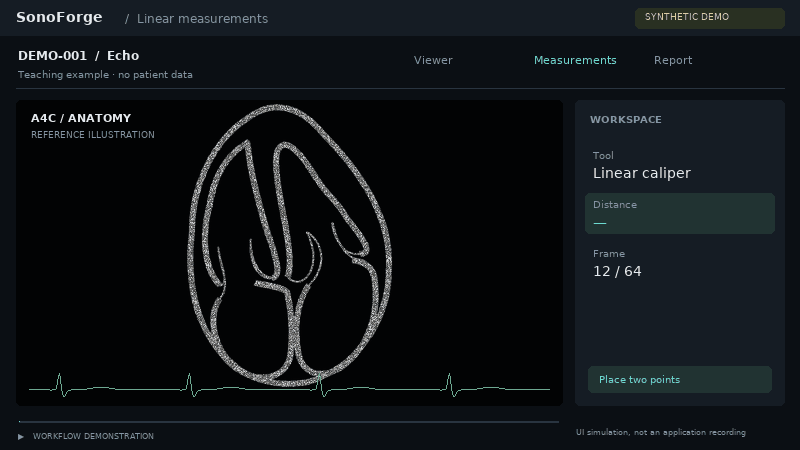
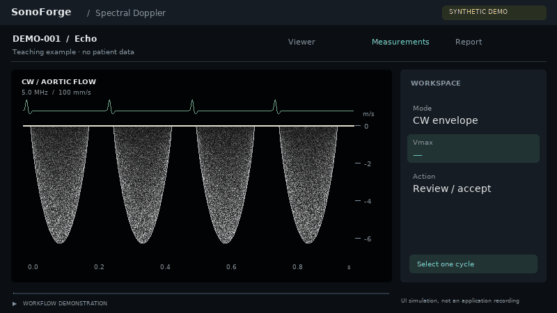
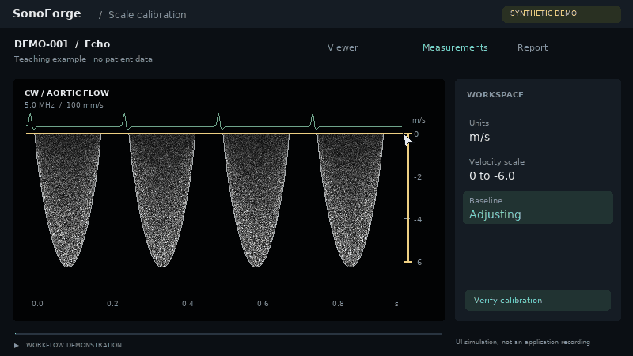
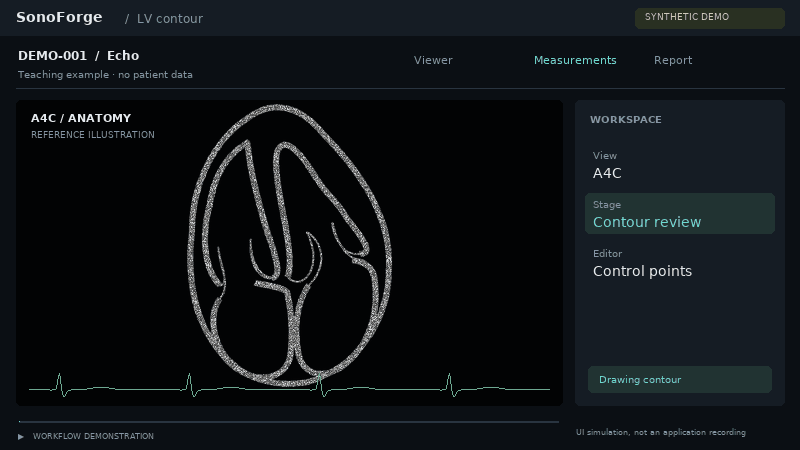
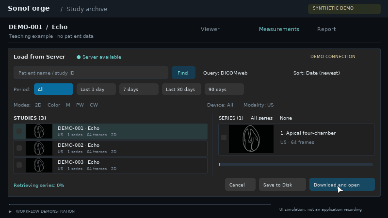
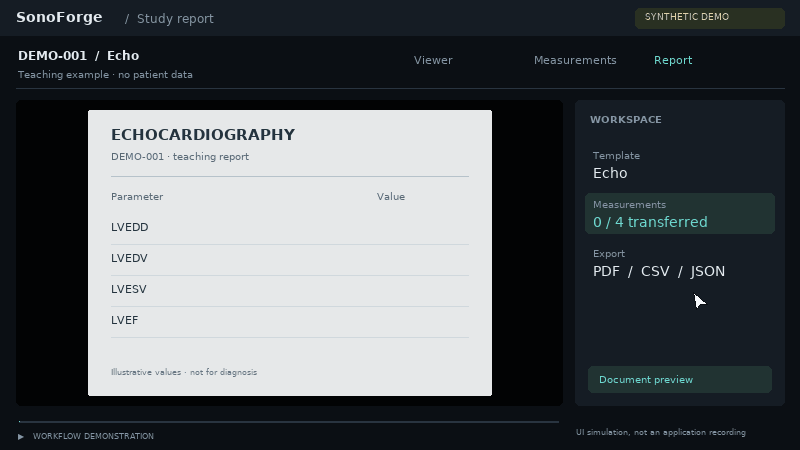

# SonoForge — вариант C: клинический рабочий интерфейс

Шесть анимаций, 800 × 450. Это синтетические демонстрации, **не запись приложения**.
Все изображения, сигналы и значения условные. Набор пока не подключён к сайту.

## 1. Калипер: постановка двух точек → результат

## 2. Допплер: обводка одного цикла → VTI

## 3. Калибровка: шкала скорости → установка базовой линии

## 4. Сегментация: построение контура → проверка опорных точек

## 5. PACS: выбор исследования → получение серий

## 6. Протокол: последовательный перенос значений в документ

## Revision 2

- English labels throughout all six animations.
- CW Doppler: negative spectrum, high baseline, right-hand velocity ruler.
- Anatomical A4C schematic shared by the viewer and PACS thumbnails.
- Frozen segmentation frame; open contour from septal MV annulus via apex to lateral annulus.
- Server loader layout based on SonoForge's study/series browser.

## Revision 4 — simplified anatomical redraw

The reference raster is no longer embedded. All A4C scenes use a smooth,
label-free line drawing with contours, septa and AV valve leaflets only.
Chambers have no fill; `a4c-schematic.png` is the transparent master.
The segmentation trace matches the new LV path on a frozen frame.

## Revision 5 — myocardial speckle and caliper alignment

Wall bands now have a fixed grayscale speckle texture; cavity alpha remains zero.
The caliper endpoints intersect both LV boundaries at exactly the same height.
